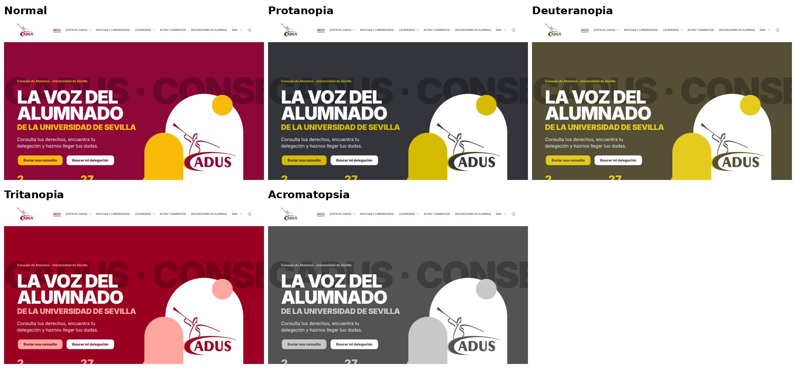
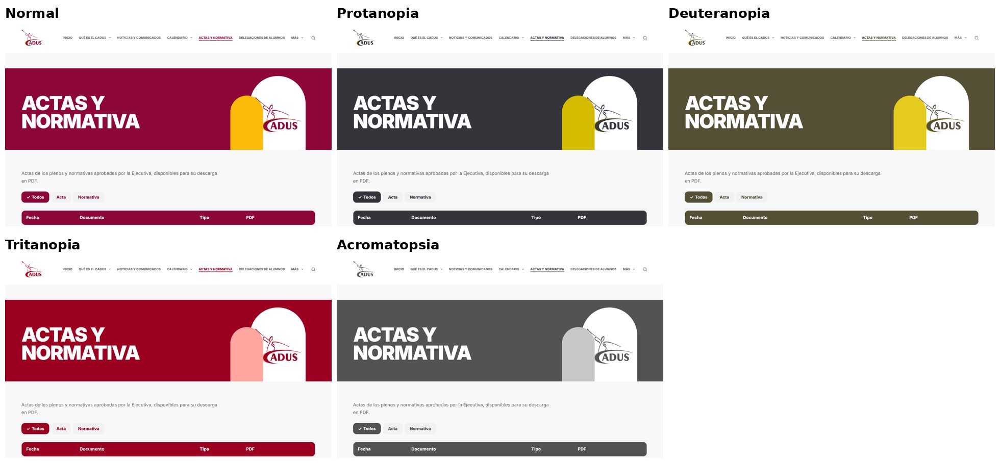
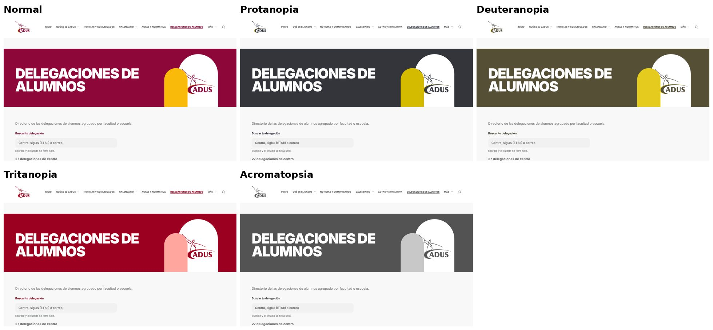

# Auditoría de accesibilidad, daltonismo y pautas DUA (HU-15c)

**Responsable:** Miguel Ángel Camacho Martín · **Sprint 3** · **Fecha:** 12/11/2026
**Requisito del cliente** (entrevista del 26/10, pregunta 18): «que sea una página accesible para personas con alguna necesidad (ciegas o daltónicas) y que siga las pautas del DUA». Objetivo: **WCAG 2.1 nivel AA**.
**Relación con el resto de HU-15:** HU-15a (Pablo) cubre el contraste, el foco, el teclado y el enlace «saltar al contenido»; HU-15b (Marcos) cubre las etiquetas, los textos alternativos, los encabezados, ARIA y el lector de pantalla. Esta parte es la **auditoría automática** de todo el portal, el **daltonismo** y las **pautas DUA**, con la corrección de lo que ha salido.

## 1. Cómo se ha hecho

- **Entorno:** WordPress 7.1 con Blocksy y `cadus-portal`, con los contenidos de ejemplo del plugin y las 27 delegaciones con escudo. Navegador Chromium. La auditoría se hizo sobre `main` en el commit `9c3e2b8` y se repitió el 12/11 por la tarde sobre `48ca925`, que ya trae HU-24 (pie nuevo, acceso y gestión desde el portal), HU-14c, HU-15b y HU-20b. Las cifras son las de esa segunda pasada.
- **axe-core 4.10** con las reglas de WCAG 2.0 y 2.1, niveles A y AA, en **19 páginas públicas** y en dos tamaños: escritorio (1280 px) y móvil (390 px). Son 38 pasadas en total.
  - Páginas: portada, «Qué es el CADUS», «Gobierno y estatutos», noticias y una noticia, actas y un acta, delegaciones y dos fichas (una con escudo y miembros), «Atención al estudiante», buzón, seguimiento de ticket, preguntas frecuentes, aviso de privacidad, votaciones, contacto, calendario y «Acceso».
- **Lighthouse 12** (accesibilidad, rendimiento, buenas prácticas y SEO) en las cinco páginas más visitadas, en móvil y en escritorio.
- **Daltonismo:** simulación con filtros de color sobre la web real. Se usan las matrices de Machado, Oliveira y Fernandes (2009) para protanopia, deuteranopia y tritanopia, con severidad máxima, y escala de grises para acromatopsia. Después se revisa a ojo si algo se entiende solo por el color.
- **DUA:** revisión de los tres principios del Diseño Universal para el Aprendizaje (CAST, versión 3.0) sobre lo que ofrece el portal.

Los scripts están en [`scripts/pruebas/accesibilidad/`](../../scripts/pruebas/accesibilidad/) y se pueden repetir sobre el servidor del equipo o sobre el de la US.

## 2. Resultados

### axe-core (WCAG 2.1 A y AA)

| | Antes | Después |
|---|---|---|
| Pasadas sin fallos | 0 de 34 | **38 de 38** |
| Fallos | 1 regla en todas las páginas (`color-contrast`, grave) | **Ninguno** |

### Lighthouse (puntuación sobre 100; móvil / escritorio)

| Página | Accesibilidad | Rendimiento | Buenas prácticas | SEO |
|---|---|---|---|---|
| Portada | 100 / 100 | 93 / 100 | 100 / 100 | 92 → **100** / 92 → **100** |
| Noticias | 98 → **100** / 98 → **100** | 97 / 100 | 100 / 100 | 92 → **100** / 92 → **100** |
| Delegaciones | 100 / 100 | 92 / 99 | 100 / 100 | 92 → **100** / 92 → **100** |
| Actas y normativa | 100 / 100 | 95 / 100 | 100 / 100 | 92 → **100** / 92 → **100** |
| Buzón de consultas | 100 / 100 | 95 / 100 | 100 / 100 | 61 → 69 (*) |
| Gobierno y estatutos | 100 / 100 | 95 / 99 | 100 / 100 | 100 / 100 |

(*) El buzón lleva `noindex` a propósito, para que los buscadores no indexen las páginas de tickets (RN-03), y Lighthouse lo penaliza. No se cambia.

## 3. Fallos encontrados y corregidos

| # | Fallo | Criterio WCAG | Dónde | Corrección |
|---|---|---|---|---|
| 1 | La marca de agua «CADUS» del pie (granate sobre granate, 1,32:1) contaba como texto sin contraste | 1.4.3 Contraste | Pie de todas las páginas | Es decorativa, así que pasa a ser solo CSS (`::before`). No es contenido y los lectores de pantalla no la leen (`portada_extra.php`, `cadus.css`) |
| 2 | Las tarjetas del listado de noticias usaban `h3` justo debajo del `h1`, sin `h2` entre medias | 1.3.1 Información y relaciones | Noticias y comunicados | En el listado, cada comunicado lleva `h2`. En la portada sigue en `h3` porque va dentro de una sección con `h2` (`setup.php`, `cadus.css`, `cadus-interior.css`) |
| 3 | **Daltonismo:** en el menú, la página actual solo se distinguía por el color (granate frente a gris); en acromatopsia casi no se notaba | 1.4.1 Uso del color | Menú de la cabecera | La página actual (y la sección que la contiene) va **subrayada** (`cadus.css`) |
| 4 | **Daltonismo:** el filtro activo (actas, votaciones…) se marcaba con el fondo | 1.4.1 Uso del color | Filtros con `aria-current` o `aria-pressed` | Se añade una **marca ✓** delante del filtro activo. El lector de pantalla no la lee, porque ya anuncia `aria-current` (`cadus.css`) |
| 5 | El desplegable del menú decía «More» en una web en español | 3.1.2 Idioma de las partes | Cabecera (Blocksy sin traducción) | Ya corregido en `main` con la traducción de Blocksy de `estilo.php` («More» → «Más»); se comprueba que desaparece |
| 6 | Las páginas no tenían meta descripción | (SEO; ayuda a saber de qué trata la página antes de abrirla) | Todas | Resumen de la página o, si no hay, descripción del sitio. Se desactiva solo si se instala Yoast, Rank Math o SEOPress (`estilo.php`) |

## 4. Daltonismo

Cada imagen muestra la misma pantalla en visión normal y con los cuatro tipos de daltonismo, ya con las correcciones.

Lo que se ha comprobado:
- **La paleta funciona por luminosidad, no por tono.**
  - Granate `#8d0739` con texto blanco: 9,45:1.
  - Dorado `#faba09` con texto granate oscuro `#6b052b`: 7,19:1.
  - Gris `#f1f1f1` con granate: 8,37:1.

  Como la diferencia es de claridad, se mantiene en los cuatro tipos de daltonismo. Los botones dorados y blancos se siguen distinguiendo del fondo incluso en escala de grises.
- **No hay información que dependa solo del color.**
  - Los estados de los tickets y de las votaciones se escriben con palabras: «Próxima», «Abierta», «Cerrada», «Pendiente», «En proceso»…
  - Los enlaces dentro del texto van subrayados (regla `link-in-text-block` de axe, sin fallos).
  - Tras las correcciones 3 y 4, el menú y los filtros tampoco dependen del color.
- **Rojo y verde:** el portal no usa la combinación rojo/verde para indicar estados, que es la que más confunde con protanopia y deuteranopia.

## 5. Pautas DUA (Diseño Universal para el Aprendizaje)

El DUA pide ofrecer **varias formas de representación, de acción y expresión, y de implicación**.

| Principio | Qué hace ya el portal | Pendiente o recomendado |
|---|---|---|
| **Representación** (percibir y comprender la información de más de una forma) | Texto con iconos y fotos con texto alternativo. Fichas de delegación con campos fijos (correo, horario, enlaces). Actas y normativa con fecha, tipo y PDF descargable. Glosario y «Finger Rules» enlazados en el pie. Lenguaje directo («Envía tu consulta», «Busca tu delegación»). | Publicar un **resumen en HTML** de cada acta o normativa además del PDF: un PDF escaneado no lo lee un lector de pantalla. Añadir una versión de **lectura fácil** de «Qué es el CADUS» y del buzón. |
| **Acción y expresión** (varias formas de participar y de pedir ayuda) | Contacto por buzón web, correo (`dcadus@us.es`), teléfono, Instagram y la delegación de cada centro. Seguimiento del ticket con un código, sin cuenta. Buscador y filtros por tipo, categoría y año. Toda la web funciona con teclado (HU-15a) y en móvil y tablet (HU-14). | Que el formulario del buzón admita adjuntar archivos (capturas, documentos) para quien explica mejor con una imagen. |
| **Implicación** (motivar y dar sentido) | «Así funciona» en tres pasos en la portada. Plazo de respuesta claro (máximo 4 días hábiles desde que la Ejecutiva revisa el ticket). Aviso de privacidad en lenguaje sencillo. Calendario de asambleas y cursos, y votaciones con su asamblea. Movimiento reducido para quien lo pide en el sistema (`prefers-reduced-motion`). | Publicar las noticias y los eventos reales (E2-08, E2-19): la web anima a participar cuando muestra lo que hace el CADUS. |

## 6. Límites de esta auditoría

- Las herramientas automáticas detectan entre un 30 % y un 50 % de los problemas. La prueba con lector de pantalla (NVDA y TalkBack) es parte de HU-15b, y la de teclado, de HU-15a.
- El **formulario del buzón** (Fluent Forms) no estaba instalado en el entorno de prueba. La página del buzón se auditó sin él, así que hay que repetir `axe.mjs` en el servidor del equipo con el formulario activo.
- Con el contenido real (actas en PDF, fotos de las noticias) hay que repetir la auditoría. Los textos alternativos de las fotos nuevas los escribe quien las sube.
