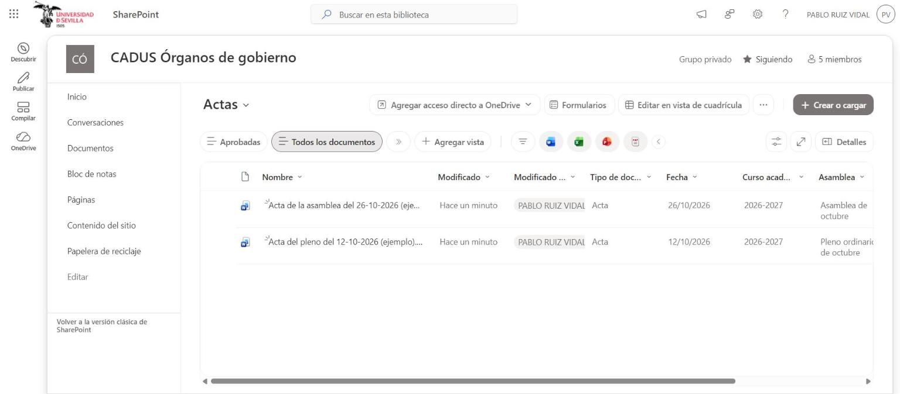
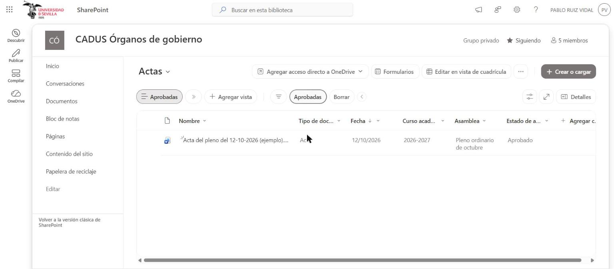

# Casos de uso — Acta de pleno o asamblea

DMS del CADUS · Lab 4 · Universidad de Sevilla (GSI) · versión 1.1 · Autor: Miguel Ángel Camacho Martín · Prueba cruzada: Marcos-Paban Delgado Rodríguez

## 1. Documento

Un acta es el documento que recoge lo que se trató y lo que se acordó en un pleno o una asamblea del CADUS. La Ejecutiva la redacta a partir de una plantilla. Queda en borrador hasta que la Ejecutiva la aprueba, y solo entonces la ven los delegados, que entran con la cuenta de su delegación. Es la versión oficial de los acuerdos, la misma regla que siguen las actas del portal (RN-01).

| Dato | Valor |
|---|---|
| Sitio de SharePoint | CADUS Órganos de gobierno |
| Biblioteca | Actas (con aprobación de contenido) |
| Casos de uso | CU-D01 Redactar, aprobar y archivar un acta (Ejecutiva) y CU-D02 Consultar las actas aprobadas (Delegado) |
| Reglas de negocio | RN-D01 Actas aprobadas y RN-D06 Tipo de documento |
| Requisitos | RF-D01, RF-D02, RF-D03, RF-D04, RF-D05, RF-D06, RF-D09, RF-D10 e IR-D02 |
| Documentos de ejemplo | Acta del pleno del 12-10-2026 (ejemplo).docx (aprobada) y Acta de la asamblea del 26-10-2026 (ejemplo).docx (borrador) |

## 2. Metadatos

| Metadato | Tipo de columna | Obligatorio |
|---|---|---|
| Tipo de documento | Elección (Acta) | Sí (RN-D06) |
| Fecha | Fecha (la del pleno o la asamblea) | Sí |
| Curso académico | Elección | No |
| Asamblea | Texto de una línea (por ejemplo, «Pleno ordinario de octubre») | No |
| Estado de aprobación | Nativo de SharePoint (Borrador, Pendiente, Aprobado, Rechazado) | Automático |
| Resumen | Generado automáticamente (RF-D10, deseable) | No |

El estado de aprobación no se escribe a mano: lo pone SharePoint cuando la Ejecutiva aprueba o rechaza el acta. La vista plana **Aprobadas** muestra solo las actas con estado Aprobado (UI-D02).

## 3. Permisos

| Rol | Qué ve en Actas |
|---|---|
| Ejecutiva (Propietarios, cuenta del CADUS) | Control total: crea, edita, aprueba y elimina actas, y ve también los borradores. |
| Equipo del proyecto (Integrantes) | Editar, solo mientras se trabaja con datos de ejemplo. |
| Delegado (Visitantes, con la cuenta de su delegación) | Lectura, solo de las actas aprobadas. No ve los borradores, ni en la biblioteca ni por enlace directo. |
| Estudiante | Nada: solo es visitante del sitio Documentación pública. |

La biblioteca usa la **aprobación de contenido** con la opción «Solo los usuarios que pueden aprobar elementos (y el autor del elemento)» para ver los borradores. Así se cumple RN-D01 sin romper la herencia de permisos del sitio: los delegados son visitantes de Órganos de gobierno, pero SharePoint les oculta lo que no está aprobado.

## 4. Casos de uso

### CU-D01 Redactar, aprobar y archivar un acta

| Campo | Contenido |
|---|---|
| Actor | Ejecutiva del CADUS |
| Cuándo | Después de cada pleno o asamblea del CADUS. |
| Escenario | El 26 de octubre se celebra la asamblea de octubre. Esa semana, la Ejecutiva crea el acta a partir de la plantilla y la deja en borrador mientras la revisa. Cuando todos los miembros de la Ejecutiva están de acuerdo con el texto, la aprueba, y desde ese momento los delegados la pueden consultar antes de la asamblea siguiente. |
| Precondición | La Ejecutiva dispone de la plantilla de acta y del acta redactada. |
| Postcondición | El acta está aprobada y es visible para los delegados. |

**Pasos**

1. La Ejecutiva del CADUS crea el acta a partir de la plantilla en la biblioteca Actas.
2. El sistema guarda el acta como borrador visible solo para su autor y la Ejecutiva.
3. El sistema solicita el tipo de documento, la fecha, el curso académico y la asamblea.
4. La Ejecutiva del CADUS rellena los metadatos y envía el acta a aprobación.
5. La Ejecutiva del CADUS aprueba el acta.
6. El sistema publica el acta aprobada para los delegados.

**Requisitos relacionados:** RF-D01, RF-D02, RF-D03, RF-D09, RN-D01, RN-D06, IR-D02 y ACT-D01.

### CU-D02 Consultar las actas aprobadas

| Campo | Contenido |
|---|---|
| Actor | Delegado |
| Cuándo | Antes de cada asamblea, para repasar lo acordado. |
| Escenario | El día antes de la asamblea de noviembre, la delegación de la ETSII quiere comprobar qué se acordó en el pleno ordinario de octubre. Entra con la cuenta de su delegación (no con el correo de alumno de quien sea delegado este curso), abre la vista «Aprobadas» y busca el acta del 12/10/2026. |
| Precondición | El delegado ha iniciado sesión con la cuenta de su delegación. |
| Postcondición | El delegado ha abierto el acta que buscaba. |

**Pasos**

1. El delegado abre la vista plana de actas aprobadas.
2. El sistema muestra solo las actas aprobadas, sin los borradores.
3. El delegado filtra por fecha, curso o palabra clave.
4. El sistema muestra las actas que cumplen los filtros.
5. El delegado abre el acta.

**Requisitos relacionados:** RF-D03, RF-D04, RF-D05, RF-D06, RF-D10, RN-D01, IR-D02, UI-D02 y ACT-D02.

La cuenta es de la delegación y no de la persona: cuando cambia el equipo de una delegación, la cuenta pasa al equipo nuevo con una contraseña nueva y sigue teniendo el mismo acceso a las actas (la misma decisión que en el portal, HU-22).

## 5. Implementación en SharePoint

La biblioteca Actas guarda las dos actas de ejemplo con las columnas Tipo de documento, Fecha, Curso académico y Asamblea. En la vista «Todos los documentos», que solo usan la Ejecutiva y los integrantes, aparecen las dos: el acta del pleno del 12/10/2026, aprobada, y el acta de la asamblea del 26/10/2026, todavía en borrador. Corresponde a los pasos 1 a 4 de CU-D01 (RF-D01, RF-D02, RF-D09, IR-D02).

La vista «Aprobadas» filtra por estado de aprobación y solo muestra el acta del pleno del 12/10/2026, con estado Aprobado. El borrador del 26/10 no aparece. Es lo que ve el delegado en los pasos 1 y 2 de CU-D02, y el resultado del paso 6 de CU-D01 (RF-D03, RF-D05, UI-D02, RN-D01).

## 6. Pruebas

| Fecha | Quién | Qué | Resultado |
|---|---|---|---|
| 14/11/2026 | Marcos | CU-D01 de principio a fin con un acta nueva de ejemplo (cuenta propietaria): crear desde la plantilla, rellenar metadatos, enviar a aprobación y aprobar | Correcto. «Acta de prueba de Marcos (ejemplo).docx» se crea a partir de la plantilla de la biblioteca Plantillas, toma Tipo de documento «Acta» y Curso «2026-2027», se completan Fecha (14/11/2026) y Asamblea, y se aprueba con «Aprobar o rechazar». Aparece en la vista «Aprobadas» junto al acta del 12/10, y el borrador del 26/10 sigue sin aparecer. |
| 14/11/2026 | Marcos | CU-D02 con un visitante: ve el acta aprobada en «Aprobadas» y no ve el borrador del 26/10, ni en la biblioteca ni con su enlace directo | PENDIENTE: hace falta una cuenta del grupo Visitantes; con la cuenta propietaria se ven también los borradores. |

Si no hay una cuenta de delegación real, la prueba de CU-D02 se hace con un integrante del equipo movido temporalmente al grupo Visitantes. Se anota así, porque no demuestra que funcione la cuenta de una delegación concreta.
