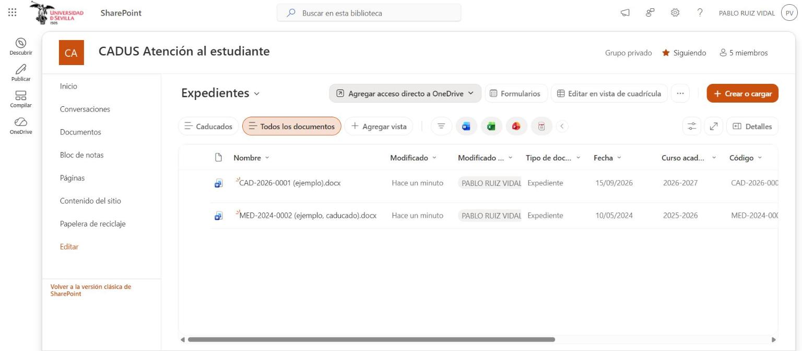
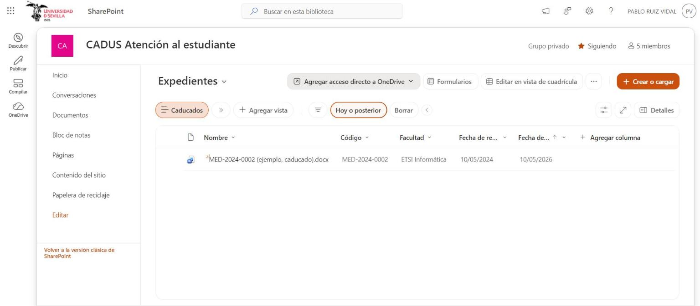
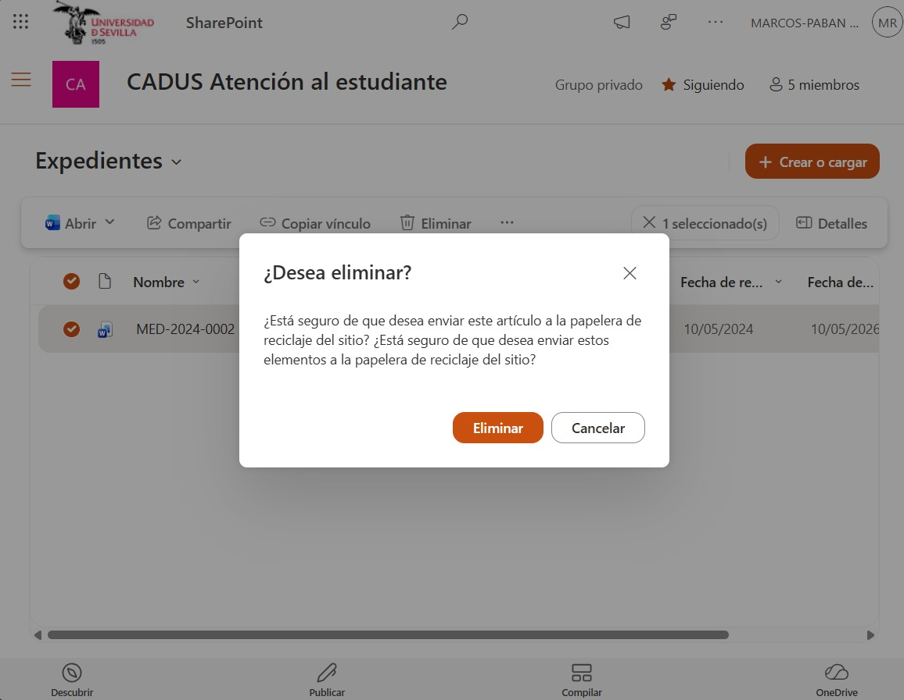
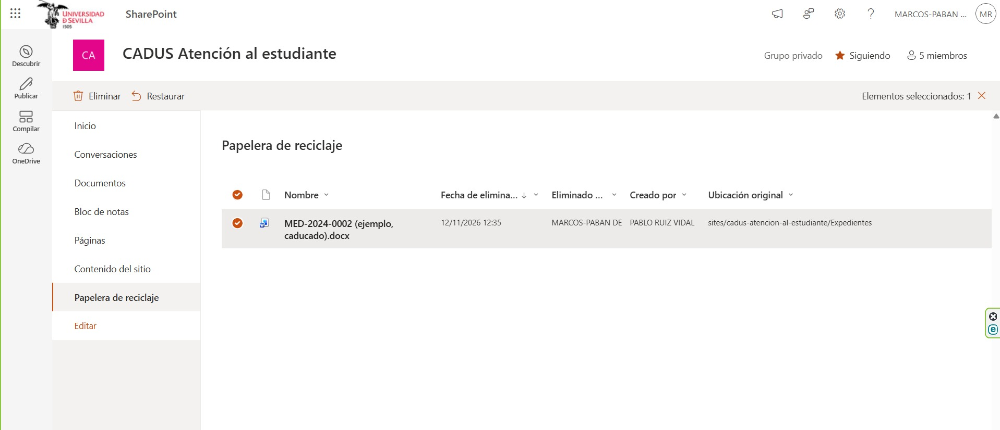
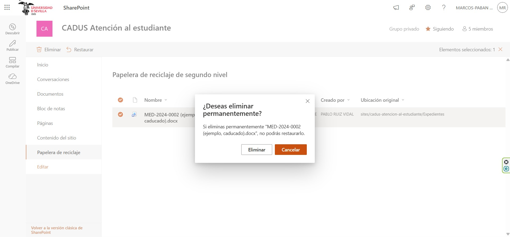

# Casos de uso — Expediente de reclamación o mediación

DMS del CADUS · Lab 4 · Universidad de Sevilla (GSI) · versión 1.1 · Autor: Marcos-Paban Delgado Rodríguez · Prueba cruzada: Álvaro Martínez Ocaña

## 1. Documento

Un expediente es el documento que queda de una reclamación o una mediación ya resuelta por la Ejecutiva del CADUS. Viene del buzón del portal (tickets `CAD-…`) o del formulario de mediación (`MED-…`). Se conserva 2 años desde que se resuelve, como prueba de lo que se hizo, y después se retira. Contiene datos personales de estudiantes, así que solo lo ve la Ejecutiva.

| Dato | Valor |
|---|---|
| Sitio de SharePoint | CADUS Atención al estudiante |
| Biblioteca | Expedientes |
| Casos de uso | CU-D04 Archivar un expediente resuelto (Ejecutiva) y CU-D05 Retirar los expedientes caducados (Ejecutiva) |
| Reglas de negocio | RN-D02 Expedientes privados y RN-D03 Conservación de 2 años |
| Requisitos | RF-D01, RF-D02, RF-D07, RF-D08, IR-D04 y RNF-D04 |
| Documentos de ejemplo | CAD-2026-0001 (ejemplo).docx y MED-2024-0002 (ejemplo, caducado).docx |

## 2. Metadatos

| Metadato | Tipo de columna | Obligatorio |
|---|---|---|
| Tipo de documento | Elección (Expediente) | Sí |
| Fecha | Fecha | Sí |
| Curso académico | Elección | No |
| Código | Texto (`CAD-…` o `MED-…`) | No |
| Facultad | Elección | No |
| Estado | Elección (Resuelto) | Sí |
| Fecha de resolución | Fecha (de ella depende la caducidad) | Sí |
| Fecha de caducidad | Calculada: fecha de resolución más 2 años (RF-D07) | Automático |

La vista plana **Caducados** muestra los expedientes cuya fecha de caducidad es anterior a hoy (RF-D08).

## 3. Permisos

| Rol | Qué ve en Expedientes |
|---|---|
| Ejecutiva (Propietarios, cuenta del CADUS) | Control total: sube, edita y elimina expedientes. |
| Equipo del proyecto (Integrantes) | Editar, solo mientras se trabaja con datos de ejemplo. |
| Delegado (Visitantes, con la cuenta de su delegación) | Nada: la biblioteca tiene permisos exclusivos y no incluye el grupo Visitantes. |
| Estudiante | Nada: solo es visitante del sitio Documentación pública. |

La biblioteca rompe la herencia de permisos del sitio para cumplir RN-D02, igual que la privacidad de los tickets en el portal (RN-03).

## 4. Casos de uso

### CU-D04 Archivar un expediente resuelto

| Campo | Contenido |
|---|---|
| Actor | Ejecutiva del CADUS |
| Cuándo | Cada vez que se resuelve una reclamación o una mediación. |
| Escenario | El 3 de diciembre la Ejecutiva cierra en el portal la reclamación CAD-2026-0001 de un estudiante de la Facultad de Derecho. Ese mismo día guarda el expediente en el DMS. |
| Precondición | La Ejecutiva ha resuelto el ticket o la mediación. |
| Postcondición | El expediente está archivado con su fecha de caducidad. |

**Pasos**

1. La Ejecutiva del CADUS sube el expediente a la biblioteca Expedientes.
2. El sistema solicita el código, la facultad y la fecha de resolución.
3. La Ejecutiva del CADUS rellena los metadatos.
4. El sistema calcula la fecha de caducidad (resolución más 2 años).
5. El sistema guarda el expediente visible solo para la Ejecutiva.

**Requisitos relacionados:** RF-D01, RF-D02, RF-D07, RN-D02, IR-D04 y ACT-D01.

### CU-D05 Retirar los expedientes caducados

| Campo | Contenido |
|---|---|
| Actor | Ejecutiva del CADUS |
| Cuándo | Una vez al mes. |
| Escenario | En la revisión mensual del 1 de diciembre, la Ejecutiva abre la vista Caducados y encuentra la mediación MED-2024-0002, resuelta el 10/05/2024 y caducada desde el 10/05/2026. La elimina, con todas sus versiones, y vacía las dos papeleras del sitio. |
| Precondición | Existen expedientes con fecha de caducidad anterior a hoy. |
| Postcondición | Los expedientes caducados se han eliminado, con sus versiones y de la papelera. |

**Pasos**

1. La Ejecutiva del CADUS abre la vista de expedientes caducados.
2. El sistema muestra los expedientes cuya caducidad es anterior a hoy.
3. La Ejecutiva del CADUS elimina cada expediente y vacía la papelera de reciclaje.
4. El sistema deja de conservar esos expedientes y sus versiones.

**Requisitos relacionados:** RF-D07, RF-D08, RN-D03, RNF-D04 y ACT-D01.

En SharePoint, un documento eliminado pasa primero a la papelera del sitio y, al vaciarla, a la papelera de la colección de sitios (segunda fase), donde sigue 93 días en total. Para cumplir RN-D03 hay que vaciar también la segunda fase: Configuración del sitio → Papelera de reciclaje → «Papelera de reciclaje de segunda fase». Al eliminar el documento se eliminan también todas sus versiones.

## 5. Implementación en SharePoint

La biblioteca guarda los expedientes resueltos con las columnas Tipo de documento, Fecha, Curso académico, Código, Facultad, Estado y Fecha de resolución, más la fecha de caducidad calculada. Tiene permisos exclusivos, sin el grupo Visitantes (RN-D02). Corresponde a CU-D04 (RF-D01, RF-D02, RF-D07, IR-D04).

La vista «Caducados» filtra los expedientes cuya fecha de caducidad es anterior a hoy. Aparece MED-2024-0002, resuelto el 10/05/2024 y caducado desde el 10/05/2026. Es el paso 1 y 2 de CU-D05 (RF-D07, RF-D08).

PENDIENTE (captura de Marcos): la Ejecutiva elimina MED-2024-0002 desde la vista «Caducados». Paso 3 de CU-D05 (RN-D03).

PENDIENTE (captura de Marcos): el expediente aparece en la papelera del sitio y se elimina de ella. Paso 3 de CU-D05 (RN-D03).

PENDIENTE (captura de Marcos): la papelera de segunda fase ya no contiene el expediente y la vista «Caducados» queda vacía. Paso 4 de CU-D05 y postcondición (RN-D03, RNF-D04).

## 6. Pruebas

| Fecha | Quién | Qué | Resultado |
|---|---|---|---|
| 13/11/2026 | Marcos | CU-D05 de principio a fin con MED-2024-0002 (cuenta propietaria) | PENDIENTE |
| 14/11/2026 | Álvaro | CU-D04 y CU-D05 con el expediente caducado nuevo que prepara Marcos | PENDIENTE |
| 14/11/2026 | Álvaro | Rol estudiante: no ve la biblioteca Expedientes ni por enlace directo | PENDIENTE |
