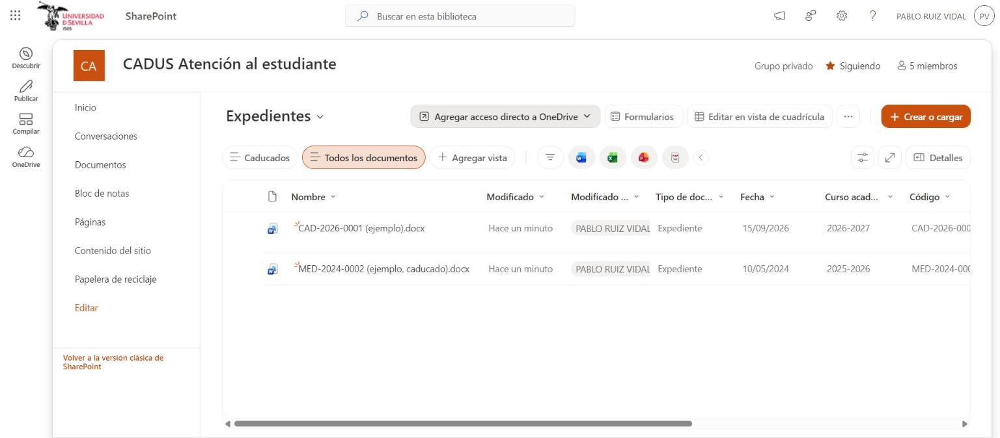
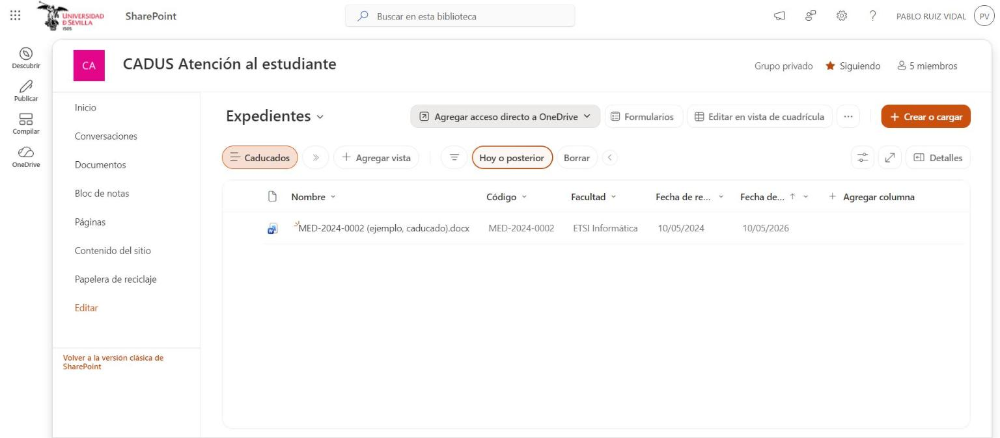
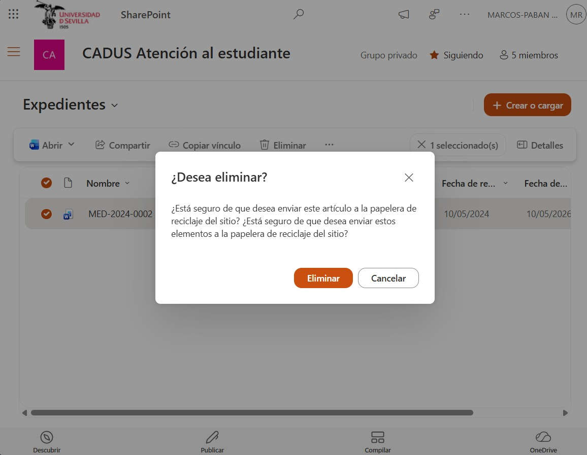
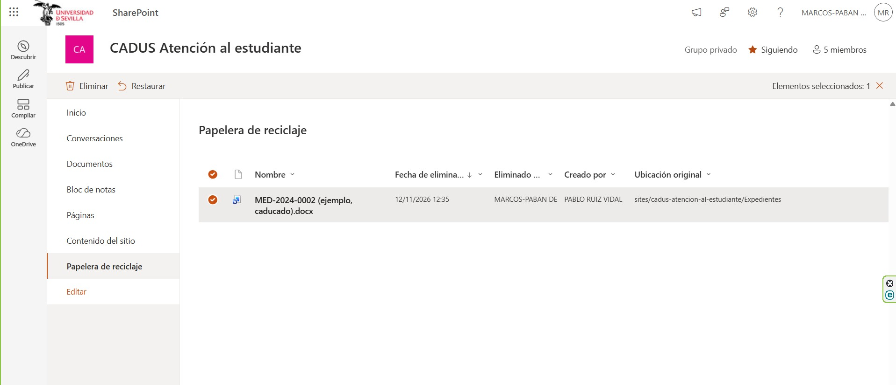
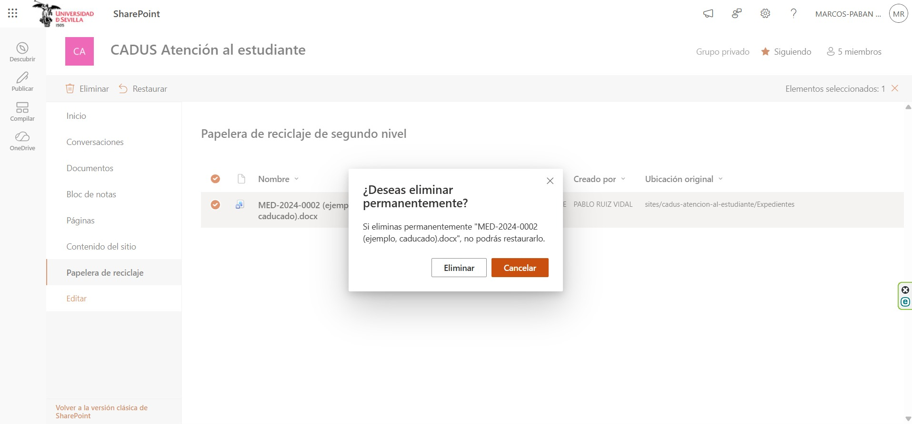

# Casos de uso — Expediente de reclamación o mediación

DMS del CADUS · Lab 4 · Universidad de Sevilla (GSI) · versión 1.1 · Autor: Marcos-Paban Delgado Rodríguez · Prueba cruzada: Álvaro Martínez Ocaña

## 1. Documento

Un expediente es el documento que queda de una reclamación o una mediación ya resuelta por la Ejecutiva del CADUS. Viene del buzón del portal (tickets `CAD-…`) o del formulario de mediación (`MED-…`). Se conserva 2 años desde que se resuelve, como prueba de lo que se hizo, y después se retira. Contiene datos personales de estudiantes, así que solo lo ve la Ejecutiva.

| Dato | Valor |
|---|---|
| Sitio de SharePoint | CADUS Atención al estudiante |
| Biblioteca | Expedientes |
| Casos de uso | CU-D04 Archivar un expediente resuelto (Ejecutiva) y CU-D05 Retirar los expedientes caducados (Ejecutiva) |
| Reglas de negocio | RN-D02 Expedientes privados y RN-D03 Conservación de 2 años |
| Requisitos | RF-D01, RF-D02, RF-D07, RF-D08, IR-D04 y RNF-D04 |
| Documentos de ejemplo | CAD-2026-0001 (ejemplo).docx y MED-2024-0002 (ejemplo, caducado).docx |

## 2. Metadatos

| Metadato | Tipo de columna | Obligatorio |
|---|---|---|
| Tipo de documento | Elección (Expediente) | Sí |
| Fecha | Fecha | No |
| Curso académico | Elección | No |
| Código | Texto (`CAD-…` o `MED-…`) | No |
| Facultad | Elección | No |
| Estado | Elección (Resuelto) | Sí |
| Fecha de resolución | Fecha (de ella depende la caducidad) | Sí |
| Fecha de caducidad | Calculada: fecha de resolución más 2 años (RF-D07) | Automático |

La vista plana **Caducados** muestra los expedientes cuya fecha de caducidad es anterior a hoy (RF-D08).

## 3. Permisos

| Rol | Qué ve en Expedientes |
|---|---|
| Ejecutiva (Propietarios, cuenta del CADUS) | Control total: sube, edita y elimina expedientes. |
| Equipo del proyecto (Integrantes) | Editar, solo mientras se trabaja con datos de ejemplo. |
| Delegado (Visitantes, con la cuenta de su delegación) | Nada: la biblioteca tiene permisos exclusivos y no incluye el grupo Visitantes. |
| Estudiante | Nada: solo es visitante del sitio Documentación pública. |

La biblioteca rompe la herencia de permisos del sitio (comprobado por la API el 13/11/2026) para cumplir RN-D02, igual que la privacidad de los tickets en el portal (RN-03). Es una excepción al modelo del Lab 4, que concede los permisos sobre el sitio: como el sitio Atención al estudiante no tiene visitantes, el efecto es el mismo y los permisos propios son un refuerzo.

## 4. Casos de uso

### CU-D04 Archivar un expediente resuelto

| Campo | Contenido |
|---|---|
| Actor | Ejecutiva del CADUS |
| Cuándo | Cada vez que se resuelve una reclamación o una mediación. |
| Escenario | El 3 de diciembre la Ejecutiva cierra en el portal la reclamación CAD-2026-0001 de un estudiante de la Facultad de Derecho. Ese mismo día guarda el expediente en el DMS. |
| Precondición | La Ejecutiva ha resuelto el ticket o la mediación. |
| Postcondición | El expediente está archivado con su fecha de caducidad. |

**Pasos**

1. La Ejecutiva del CADUS sube el expediente a la biblioteca Expedientes.
2. El sistema solicita el código, la facultad y la fecha de resolución.
3. La Ejecutiva del CADUS rellena los metadatos.
4. El sistema calcula la fecha de caducidad (resolución más 2 años).
5. El sistema guarda el expediente visible solo para la Ejecutiva.

**Requisitos relacionados:** RF-D01, RF-D02, RF-D07, RN-D02, IR-D04 y ACT-D01.

### CU-D05 Retirar los expedientes caducados

| Campo | Contenido |
|---|---|
| Actor | Ejecutiva del CADUS |
| Cuándo | Una vez al mes. |
| Escenario | En la revisión mensual del 1 de diciembre, la Ejecutiva abre la vista Caducados y encuentra la mediación MED-2024-0002, resuelta el 10/05/2024 y caducada desde el 10/05/2026. La elimina, con todas sus versiones, y vacía las dos papeleras del sitio. |
| Precondición | Existen expedientes con fecha de caducidad anterior a hoy. |
| Postcondición | Los expedientes caducados se han eliminado, con sus versiones y de la papelera. |

**Pasos**

1. La Ejecutiva del CADUS abre la vista de expedientes caducados.
2. El sistema muestra los expedientes cuya caducidad es anterior a hoy.
3. La Ejecutiva del CADUS elimina cada expediente y vacía la papelera de reciclaje.
4. El sistema deja de conservar esos expedientes y sus versiones.

**Requisitos relacionados:** RF-D07, RF-D08, RN-D03, RNF-D04 y ACT-D01.

En SharePoint, un documento eliminado pasa primero a la papelera del sitio y, al vaciarla, a la papelera de la colección de sitios (segunda fase), donde sigue 93 días en total. Para cumplir RN-D03 hay que vaciar también la segunda fase: Configuración del sitio → Papelera de reciclaje → «Papelera de reciclaje de segunda fase». Al eliminar el documento se eliminan también todas sus versiones.

## 5. Implementación en SharePoint

La biblioteca guarda los expedientes resueltos con las columnas Tipo de documento, Fecha, Curso académico, Código, Facultad, Estado y Fecha de resolución, más la fecha de caducidad calculada. Tiene permisos exclusivos, sin el grupo Visitantes (RN-D02). Corresponde a CU-D04 (RF-D01, RF-D02, RF-D07, IR-D04).

La vista «Caducados» filtra los expedientes cuya fecha de caducidad es anterior a hoy. Aparece MED-2024-0002, resuelto el 10/05/2024 y caducado desde el 10/05/2026. Es el paso 1 y 2 de CU-D05 (RF-D07, RF-D08).

La Ejecutiva selecciona MED-2024-0002 en la vista «Caducados» y pulsa «Eliminar». SharePoint pide confirmación y avisa de que el archivo irá a la papelera de reciclaje del sitio. Paso 3 de CU-D05 (RN-D03).

El expediente aparece en la papelera de reciclaje del sitio, eliminado el 12/11/2026 por la cuenta propietaria, con su ubicación original en la biblioteca Expedientes. La Ejecutiva lo selecciona y lo elimina también de aquí. Paso 3 de CU-D05 (RN-D03).

En la «Papelera de reciclaje de segundo nivel» la Ejecutiva elimina el expediente de forma permanente; SharePoint avisa de que ya no se podrá restaurar. La captura muestra ese diálogo de confirmación, no el estado final. El resultado final (vista «Caducados» vacía) se anotó en la prueba del 12/11 y no tiene captura. Paso 4 de CU-D05 y postcondición (RN-D03, RNF-D04).

## 6. Pruebas

| Fecha | Quién | Qué | Resultado |
|---|---|---|---|
| 12/11/2026 | Marcos | CU-D05 de principio a fin con MED-2024-0002 (cuenta propietaria) | Correcto: el expediente se borra de la biblioteca y de las dos papeleras, y «Caducados» queda vacía. Se deja MED-2024-0003 (resuelto el 15/09/2024, caducado desde el 15/09/2026) para la prueba de Álvaro. |
| 27/11/2026 | Álvaro (cuenta de la US de Álvaro, integrante del sitio; ejecutada por Claude en su nombre y a petición suya, en Chrome) | CU-D04: crear en Expedientes el documento de ejemplo «CAD-2026-0002 (ejemplo, prueba cruzada).docx» (sin datos personales) y rellenar Código CAD-2026-0002, Tipo de documento Expediente, Estado Resuelto y Fecha de resolución 20/11/2026. CU-D05: en la vista «Caducados», eliminar MED-2024-0003 y quitarlo de la papelera del sitio y de la de segundo nivel | CU-D04 correcto: la Fecha de caducidad se calcula sola como 20/11/2028 (resolución más 2 años, RF-D07) y el expediente no aparece en «Caducados». Observación: mientras la Fecha de resolución está vacía, SharePoint marca el archivo con «Falta información obligatoria» y la caducidad calculada sale 30/12/1901; al rellenarla se corrige. CU-D05 correcto: «Caducados» mostraba solo MED-2024-0003 (resuelto el 15/09/2024, caducado el 15/09/2026); se eliminó (SharePoint pide confirmación y lo manda a la papelera del sitio), se eliminó de la papelera del sitio y después, de forma permanente, de la de segundo nivel («no podrás restaurarlo»); al final la papelera de segundo nivel queda vacía y «Caducados» también. Observación: en la papelera del sitio quedaba otra copia de «MED-2024-0003 (ejemplo, caducado).docx» eliminada por Marcos el 12/11/2026 a las 13:02; con el permiso de Álvaro se eliminó también de la papelera del sitio y de la de segundo nivel, y las dos quedan vacías (RN-D03). |
| 27/11/2026 | Álvaro | Rol estudiante: no ve la biblioteca Expedientes ni por enlace directo | Pendiente: no hay ninguna cuenta con rol de estudiante (solo visitante de Documentación pública) para hacer la prueba; con la cuenta de Álvaro, que es integrante del sitio, no se puede comprobar. |
