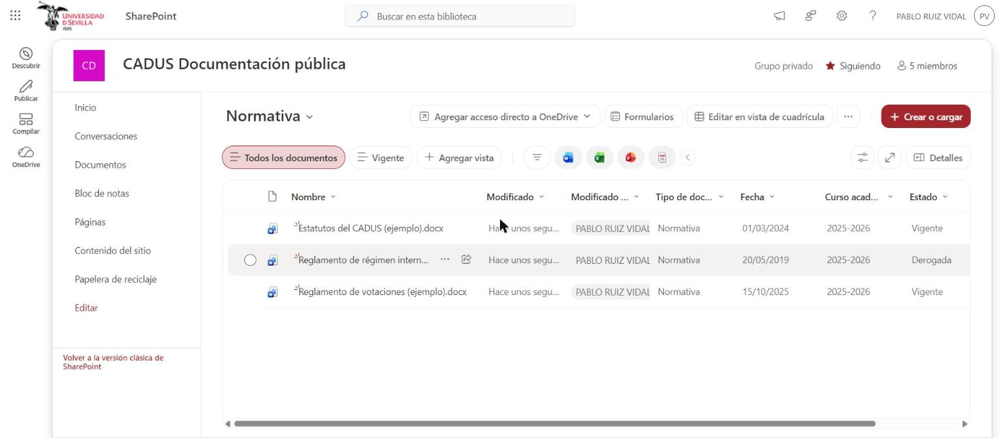
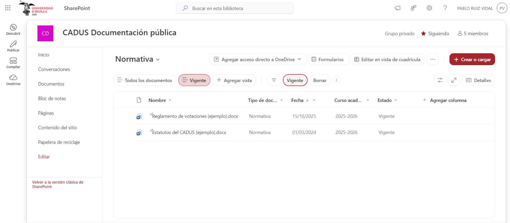
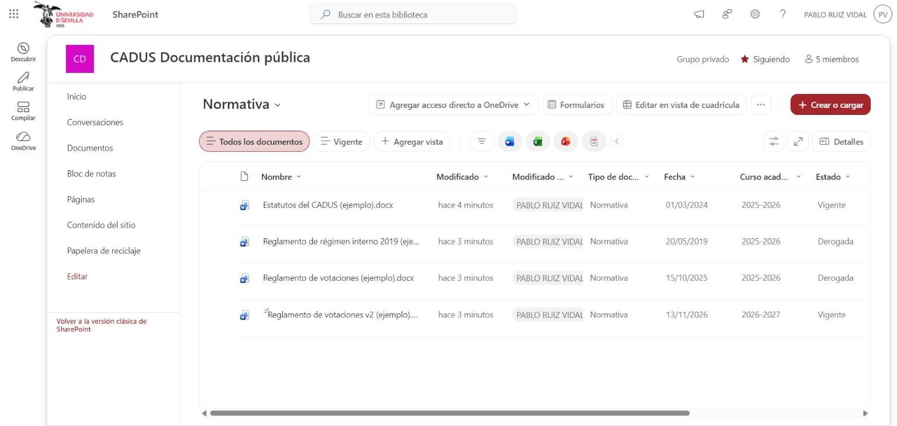
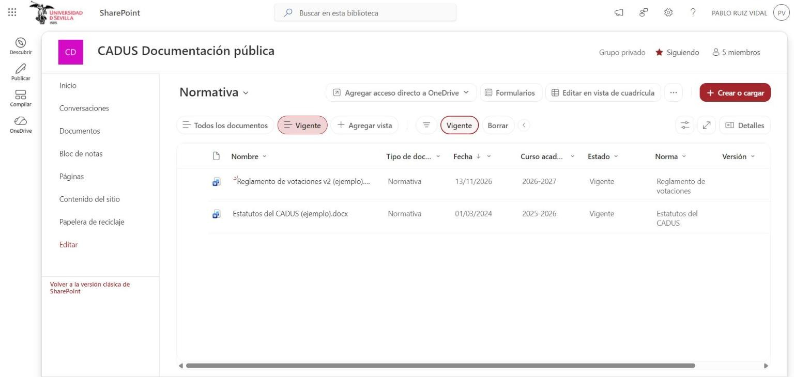

# Casos de uso — Normativa y estatutos

DMS del CADUS · Lab 4 · Universidad de Sevilla (GSI) · versión 1.1 · Autor: Pablo Ruiz Vidal (redactado el 13/11/2026 en lugar de Joaquín Luna Canela, a quien correspondía) · Prueba cruzada: pendiente (Joaquín)

## 1. Documento

Una norma es un reglamento, un estatuto o cualquier texto que fija los derechos o el funcionamiento del CADUS. La Ejecutiva la publica y la mantiene; estudiantes y delegados solo la leen. De cada norma solo hay una versión vigente: al publicar una versión nueva, la anterior pasa a derogada y se conserva como referencia (RN-D07).

| Dato | Valor |
|---|---|
| Sitio de SharePoint | CADUS Documentación pública |
| Biblioteca | Normativa |
| Casos de uso | CU-D03 Consultar la normativa vigente (Delegado o Estudiante) y CU-D07 Publicar una nueva versión de una norma y derogar la anterior (Ejecutiva) |
| Reglas de negocio | RN-D06 Tipo de documento y RN-D07 Una versión vigente por norma |
| Requisitos | RF-D01, RF-D02, RF-D04, RF-D05, RF-D06, IR-D03 |
| Documentos de ejemplo | Estatutos del CADUS (ejemplo).docx (vigente), Reglamento de votaciones (ejemplo).docx (v1, derogada), Reglamento de votaciones v2 (ejemplo).docx (v2, vigente) y Reglamento de régimen interno 2019 (ejemplo, derogado).docx |

## 2. Metadatos

| Metadato | Tipo de columna | Obligatorio |
|---|---|---|
| Tipo de documento | Elección (Normativa) | Sí (RN-D06) |
| Fecha | Fecha (la de aprobación de esa versión) | No |
| Curso académico | Elección | No |
| Norma | Texto de una línea: identifica la misma norma entre sus versiones (por ejemplo, «Reglamento de votaciones») | Sí (desde el 13/11/2026) |
| Versión | Número, sin decimales (1, 2, 3…) | Sí (desde el 13/11/2026) |
| Estado | Elección (Vigente, Derogada) | Sí |

«Norma» y «Versión» se añaden para CU-D07: sin ellas no se sabe qué documentos son versiones de la misma norma ni cuál es la más reciente. La vista plana **Vigente** muestra solo los documentos con estado Vigente (UI-D02, RF-D05).

## 3. Permisos

| Rol | Qué ve en Normativa |
|---|---|
| Ejecutiva (Propietarios, cuenta del CADUS) | Control total: sube, edita, cambia el estado y elimina. |
| Equipo del proyecto (Integrantes) | Editar, solo mientras se trabaja con datos de ejemplo. |
| Delegado (Visitantes, con la cuenta de su delegación) | Lectura. |
| Estudiante (Visitantes, con su correo @alum.us.es) | Lectura. |

Los permisos se conceden sobre el sitio Documentación pública con los grupos predefinidos (Propietarios, Integrantes y Visitantes); la biblioteca hereda los del sitio (RF-D06).

## 4. Casos de uso

### CU-D03 Consultar la normativa vigente

| Campo | Contenido |
|---|---|
| Actor | Delegado o Estudiante |
| Cuándo | Cuando tienen una duda sobre sus derechos o el funcionamiento del CADUS. |
| Escenario | Un estudiante de la ETSII quiere saber cuántas votaciones puede haber en una asamblea. Entra en Documentación pública con su correo @alum.us.es, abre la vista «Vigente», busca «votaciones» y abre el reglamento que está en vigor, no el derogado. |
| Precondición | El usuario puede acceder al sitio Documentación pública. |
| Postcondición | El usuario ha leído la norma que buscaba. |

**Pasos**

1. El delegado o el estudiante entra en el sitio Documentación pública; el delegado accede con la cuenta de su delegación y el estudiante con su correo @alum.us.es.
2. El estudiante abre la vista de normativa vigente.
3. El sistema muestra las normas con estado vigente y oculta las derogadas.
4. El estudiante busca por palabra clave o filtra por año.
5. El sistema muestra las normas que cumplen la búsqueda.
6. El estudiante abre la norma.

**Requisitos relacionados:** RF-D04, RF-D05, RF-D06, IR-D03, UI-D02, ACT-D02 y ACT-D03.

### CU-D07 Publicar una nueva versión de una norma y derogar la anterior

| Campo | Contenido |
|---|---|
| Actor | Ejecutiva del CADUS |
| Cuándo | Cuando la Ejecutiva aprueba la revisión de una norma ya publicada. |
| Escenario | La Ejecutiva aprueba una nueva redacción del Reglamento de votaciones. Sube el documento de la versión 2, la marca como vigente y cambia la versión 1 a derogada. Desde ese momento, quien consulte la normativa vigente ve solo la versión 2, y la versión 1 sigue guardada. |
| Precondición | La norma anterior está en la biblioteca Normativa con estado Vigente y la Ejecutiva dispone del documento de la versión nueva. |
| Postcondición | La versión nueva es la única vigente de su norma y la anterior queda derogada y conservada. |

**Pasos**

1. La Ejecutiva del CADUS sube el documento de la versión nueva a la biblioteca Normativa.
2. El sistema solicita el tipo de documento, la norma, la versión, la fecha, el curso académico y el estado.
3. La Ejecutiva del CADUS rellena los metadatos con la misma norma, la versión nueva y el estado Vigente.
4. La Ejecutiva del CADUS abre la versión anterior de esa norma y cambia su estado a Derogada.
5. El sistema muestra en la vista de normativa vigente solo la versión nueva y conserva la derogada, sin borrarla.

**Requisitos relacionados:** RF-D01, RF-D02, RF-D05, RF-D06, RN-D06, RN-D07, IR-D03 y ACT-D01.

SharePoint no comprueba por sí solo que haya una única versión vigente por norma: el paso 4 lo hace la Ejecutiva a mano. Si se olvida, la vista «Vigente» mostraría las dos versiones.

## 5. Implementación en SharePoint

La biblioteca Normativa guarda los documentos del CADUS con las columnas Tipo de documento, Fecha, Curso académico y Estado. La captura es de antes de CU-D07 y es su precondición: los Estatutos, un reglamento de 2019 derogado y el Reglamento de votaciones, vigente en su única versión (RF-D01, RF-D02, RN-D06).

La vista «Vigente» recorre la biblioteca sin carpetas y filtra por Estado = Vigente: el reglamento derogado de 2019 no aparece. Es lo que ve el estudiante en los pasos 2 y 3 de CU-D03 (RF-D05, UI-D02).

Las columnas «Norma» (texto) y «Versión» (número) son obligatorias desde el 13/11/2026. Tras CU-D07, «Todos los documentos» conserva la v1 derogada junto a la v2 vigente: pasos 1 a 4 de CU-D07 (RF-D02, RN-D07).

Con el filtro de la vista «Vigente», la v1 derogada desaparece y queda la v2 como única versión vigente del Reglamento de votaciones. Es el paso 5 de CU-D07 (RN-D07).

## 6. Pruebas

| Fecha | Quién | Qué | Resultado |
|---|---|---|---|
| 13/11/2026 | Pablo, con Claude | Crear las columnas «Norma» y «Versión» (obligatorias) en Normativa y rellenarlas en los cuatro documentos de ejemplo | OK. Estatutos v1 vigente; Reglamento de votaciones v1 derogada y v2 vigente; Reglamento de régimen interno 2019 v1 derogada. |
| 13/11/2026 | Pablo, con Claude | CU-D07 de principio a fin con la cuenta propietaria: subir «Reglamento de votaciones v2 (ejemplo).docx», rellenar los metadatos (Norma «Reglamento de votaciones», Versión 2, Vigente) y pasar la versión 1 a Derogada | OK. «Todos los documentos» conserva las dos versiones y la vista «Vigente» muestra solo la v2 (capturas 13 y 16). |
| Pendiente | Joaquín | Prueba cruzada de CU-D07 con otra cuenta de propietario | PENDIENTE |
| Pendiente | Joaquín o Miguel Ángel | CU-D03 con un visitante (estudiante o delegado): ve solo la normativa vigente, puede abrirla y no puede editar ni subir | PENDIENTE: falta una cuenta de visitante. |
| Pendiente | Equipo | Ver qué pasa si la Ejecutiva olvida derogar la versión anterior (RN-D07): SharePoint no lo impide | PENDIENTE: se anota como limitación. |

**Limitaciones**

- CU-D07 lo ejecutó la misma persona que escribió el caso de uso (con ayuda de Claude); falta la prueba cruzada.
- CU-D03 no se ha probado todavía con una cuenta de visitante: las capturas de la vista «Vigente» son del propietario.
- La regla RN-D07 (una sola versión vigente por norma) depende de la Ejecutiva: SharePoint no la hace cumplir.
- Los documentos son de ejemplo y no son los reglamentos reales del CADUS.
