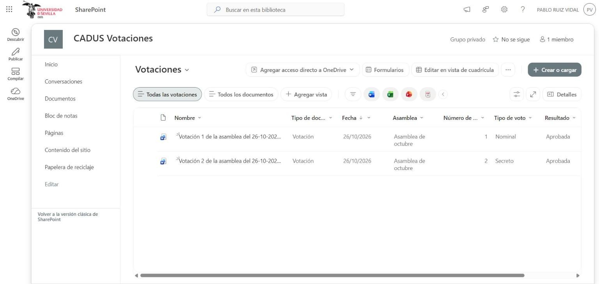
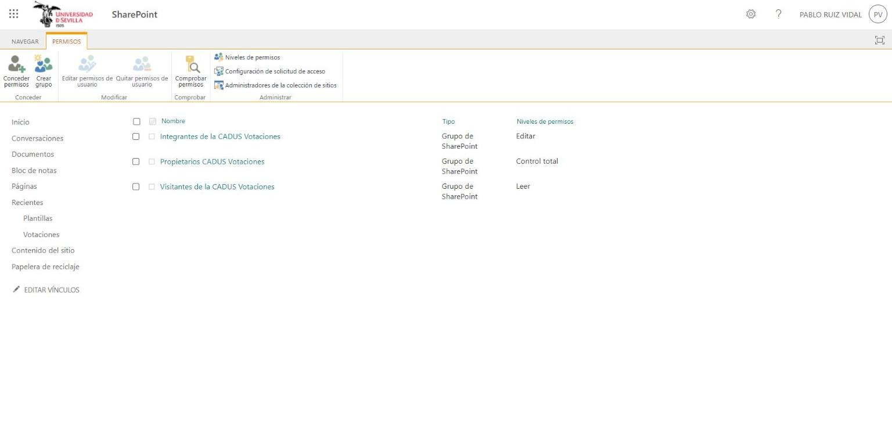
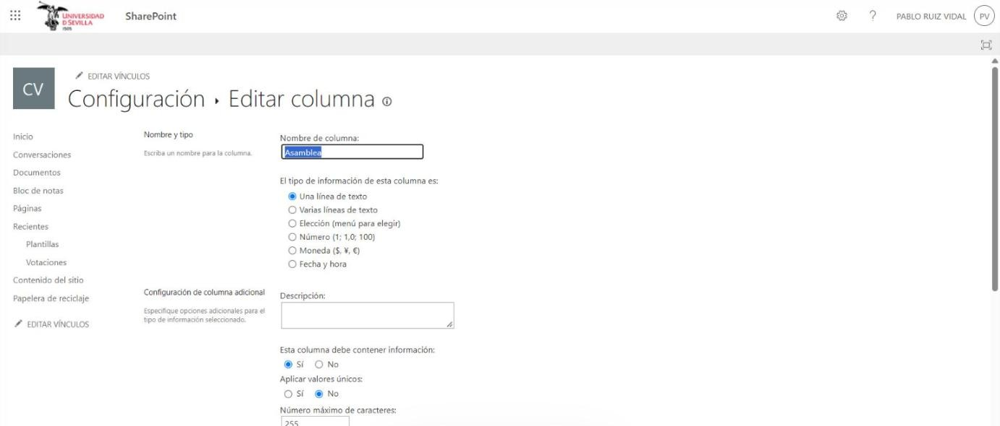
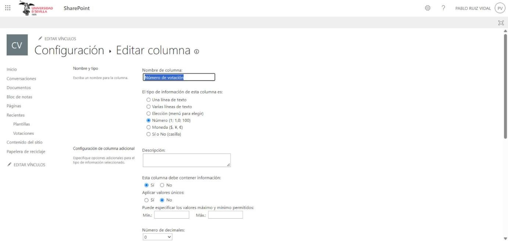
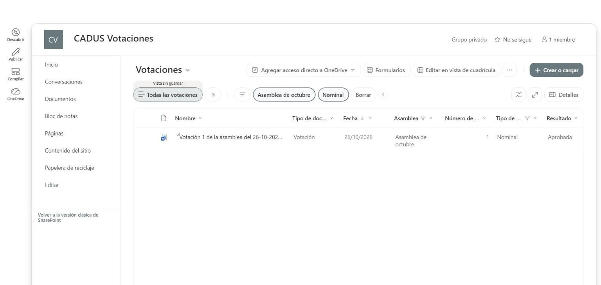
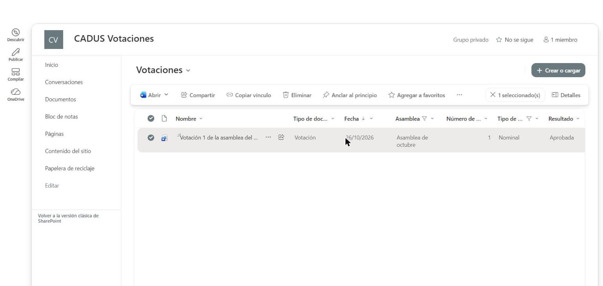
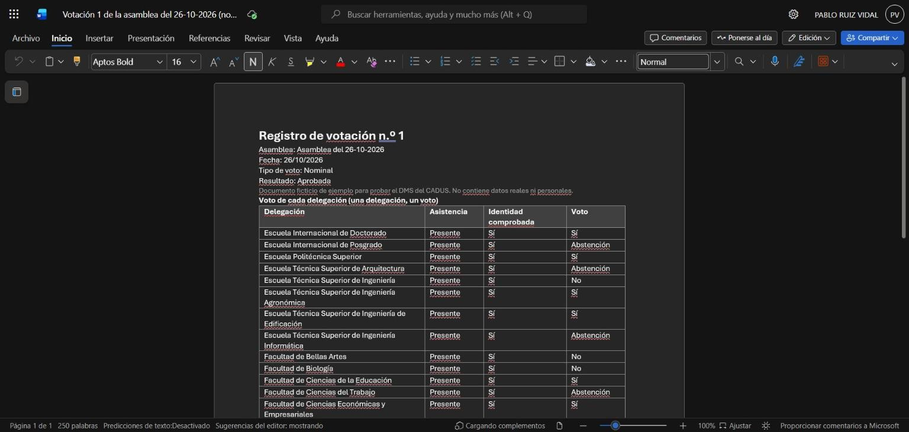

# Casos de uso — Registro de votación

DMS del CADUS · Lab 4 · Universidad de Sevilla (GSI) · versión 1.2 · Autor: Álvaro Martínez Ocaña · Actualizado el 13/11/2026 por Pablo Ruiz Vidal (cambio de sitio, ver más abajo) · Prueba cruzada: pendiente

## 1. Documento

Un registro de votación es el documento que deja la Ejecutiva del CADUS tras una votación presencial de asamblea, con un voto por delegación (27 delegaciones). No guarda el DNI de nadie y, si la votación es secreta, solo guarda el recuento total, sin vincular el voto a ninguna delegación. Solo lo ve la Ejecutiva.

| Dato | Valor |
|---|---|
| Sitio de SharePoint | CADUS Votaciones (`cadus-votaciones`, sitio propio desde el 13/11/2026; antes la biblioteca estaba en CADUS Órganos de gobierno) |
| Biblioteca | Votaciones |
| Casos de uso | CU-D06 Registrar el resultado de una votación presencial (Ejecutiva) y CU-D08 Consultar los registros de votaciones anteriores (Ejecutiva) |
| Reglas de negocio | RN-D04 Sin DNI y voto secreto separado del voto de cada delegación, RN-D05 Un voto por delegación y RN-D06 Tipo de documento rellenado en todos los documentos |
| Requisitos | RF-D01, RF-D02, RF-D05, RF-D06, RF-D09, IR-D05 y RNF-D01 |
| Documentos de ejemplo | Votación 1 (nominal, ejemplo).docx y Votación 2 (secreta, ejemplo).docx, de la asamblea de octubre, ambos con 27 filas, una por delegación |

## 2. Metadatos

| Metadato | Tipo de columna | Obligatorio |
|---|---|---|
| Tipo de documento | Elección (Votación) | Sí |
| Fecha | Fecha | Sí |
| Curso académico | Elección | No |
| Asamblea | Texto de una línea | Sí (desde el 12/11/2026) |
| Número de votación | Número (sin decimales) | Sí (desde el 12/11/2026) |
| Tipo de voto | Elección (Nominal, Secreto) | Sí |
| Resultado | Elección (Aprobada, Rechazada) | No |

«Asamblea» y «Número de votación» pasan a ser obligatorias porque identifican cada registro: una asamblea puede tener varias votaciones numeradas (RN-D05) y sin esos dos datos no se puede buscar ni distinguir un registro de otro (CU-D08).

## 3. Permisos

| Rol | Qué ve en Votaciones |
|---|---|
| Ejecutiva (Propietarios, cuenta del CADUS) | Control total: crea, edita, consulta y elimina registros. |
| Equipo del proyecto (Integrantes) | Editar, solo mientras se trabaja con datos de ejemplo. |
| Delegado (con la cuenta de su delegación) | Nada: no es miembro de ningún grupo del sitio Votaciones; ve solo las actas aprobadas de Órganos de gobierno. |
| Estudiante | Nada: solo es visitante del sitio Documentación pública. |

Desde el 13/11/2026 las votaciones tienen un **sitio propio**, en vez de una biblioteca con permisos exclusivos dentro de Órganos de gobierno. Es lo que pide el Lab 4: los permisos se conceden sobre el sitio, con los grupos predefinidos (Propietarios, Integrantes y Visitantes), y no se rompe la herencia a mano en una biblioteca. El grupo Visitantes de CADUS Votaciones existe pero se deja vacío, de modo que ningún delegado ni estudiante llega a los registros (RF-D06, RN-D04).

## 4. Casos de uso

### CU-D06 Registrar el resultado de una votación presencial

| Campo | Contenido |
|---|---|
| Actor | Ejecutiva del CADUS |
| Cuándo | En cada asamblea con votación. |
| Escenario | En la asamblea de octubre se celebra la votación número 1, nominal. La Ejecutiva crea el registro a partir de la plantilla, marca qué delegaciones estaban presentes y si se comprobó su identidad, anota el voto de cada una y el resultado. |
| Precondición | Se ha celebrado la votación y se ha comprobado la identidad de los delegados presentes. |
| Postcondición | Queda constancia del resultado sin guardar el DNI. |

**Pasos**

1. La Ejecutiva del CADUS crea el registro a partir de la plantilla en la biblioteca Votaciones.
2. El sistema muestra una fila por cada delegación para indicar si está presente y si se comprobó su identidad.
3. La Ejecutiva del CADUS marca la presencia y la identidad de cada delegación y el tipo de voto.
4. El sistema, si el voto es nominal, solicita el voto de cada delegación; si es secreto, solo el recuento total.
5. La Ejecutiva del CADUS introduce el resultado.
6. El sistema guarda el registro visible solo para la Ejecutiva, sin números de DNI.

**Requisitos relacionados:** RF-D01, RF-D02, RF-D09, RN-D04, RN-D05, IR-D05 y ACT-D01.

### CU-D08 Consultar los registros de votaciones anteriores

| Campo | Contenido |
|---|---|
| Actor | Ejecutiva del CADUS |
| Cuándo | Cuando necesita comprobar qué se decidió en una votación de una asamblea anterior. |
| Escenario | Antes de la asamblea de noviembre, la Ejecutiva quiere saber qué se decidió en la votación nominal de la asamblea de octubre. Abre Votaciones, filtra por asamblea y por tipo de voto y abre el registro. |
| Precondición | Existen registros de votación guardados y quien consulta es miembro de la Ejecutiva. |
| Postcondición | La Ejecutiva ha abierto el registro de votación que buscaba. |

**Pasos**

1. La Ejecutiva del CADUS abre la biblioteca Votaciones.
2. El sistema muestra la vista plana con todos los registros, solo a la Ejecutiva.
3. La Ejecutiva del CADUS filtra por asamblea y por tipo de voto.
4. El sistema muestra los registros que cumplen los filtros, identificados por su asamblea y su número de votación.
5. La Ejecutiva del CADUS abre el registro.

**Requisitos relacionados:** RF-D05, RF-D06, RN-D04, RN-D05, RN-D06, RNF-D01 y ACT-D01.

## 5. Implementación en SharePoint

La biblioteca Votaciones añade a las columnas comunes las de Asamblea, Número de votación, Tipo de voto (Nominal o Secreto) y Resultado. Los registros de ejemplo no contienen números de DNI y, en el de voto secreto, solo el recuento total. Corresponde a CU-D06, RN-D04 y RN-D05 (DMS-HU-07). En la biblioteca «Plantillas» del mismo sitio hay la plantilla de registro de votación con una fila por cada una de las 27 delegaciones (RF-D09); la plantilla de acta está en el sitio Órganos de gobierno.

El sitio usa los tres grupos predefinidos de SharePoint y el de Visitantes no tiene a nadie, para que los delegados no vean los registros de votación (RF-D06, RN-D04).

Las columnas «Asamblea» y «Número de votación» son obligatorias desde el 12/11/2026, de modo que todo registro nuevo queda identificado y se puede encontrar en CU-D08 (RN-D05, RN-D06). «Tipo de voto» ya lo era.

Con los filtros de las cabeceras «Asamblea» (Asamblea de octubre) y «Tipo de voto» (Nominal) la lista se reduce a un único registro: la votación 1 de la asamblea de octubre, nominal, aprobada. Son los pasos 2 a 4 de CU-D08 (RF-D05).

El registro encontrado, seleccionado en la lista, con su nombre («Votación 1 de la asamblea del 26-10-2026…»). Es el que se abre en el paso 5.

El registro se abre en Word en línea: título, asamblea, fecha, tipo de voto, resultado y una fila por delegación con su asistencia, identidad comprobada y voto, sin ningún DNI.

## 6. Pruebas

| Fecha | Quién | Qué | Resultado |
|---|---|---|---|
| 12/11/2026 | Álvaro | Hacer obligatorias «Asamblea» y «Número de votación» en la biblioteca Votaciones | OK. Las dos columnas tienen «Esta columna debe contener información» en Sí. |
| 12/11/2026 | Álvaro | CU-D08 pasos 1 a 4 con la cuenta de un miembro del sitio | OK. Los filtros funcionaron. El paso 5 (abrir el registro) falló porque los `.docx` de ejemplo eran de 2 bytes. |
| 13/11/2026 | Pablo, con Claude | Los `.docx` de ejemplo se regeneran como Word válidos y la biblioteca se traslada al sitio propio CADUS Votaciones (se vuelven a crear las columnas, la vista y la plantilla). Se rehacen las capturas 06, 07, 13a, 13b, 14, 14b y 15. | OK. Los dos registros conservan sus metadatos tras el traslado. |
| 13/11/2026 | Pablo, con Claude | CU-D08 completo en el sitio nuevo: filtro «Asamblea de octubre» y «Tipo de voto: Nominal» y apertura del registro | OK. Quedan 2 registros con el primer filtro y 1 con los dos; el registro se abre en Word en línea (capturas 14, 14b y 15). El fallo abierto del 12/11 queda cerrado. |
| 13/11/2026 | Pablo | Columnas obligatorias en el sitio nuevo | OK (capturas 13a y 13b). |
| Pendiente | Otra persona del equipo | CU-D08 completo con otra cuenta (prueba cruzada) | PENDIENTE |
| Pendiente | Equipo | CU-D06: crear un registro desde la plantilla y comprobar que no guarda DNI y que en el voto secreto no hay voto por delegación | PENDIENTE: no se ha ejecutado de principio a fin. |
| Pendiente | Álvaro | Rol estudiante y rol delegado: no ven el sitio Votaciones ni por enlace directo | PENDIENTE: falta la cuenta de visitante. |

**Limitaciones**

- La prueba de CU-D08 del 13/11 la hizo Pablo con su cuenta (propietaria del sitio); falta la prueba cruzada con otra persona.
- El sitio nuevo tiene a Pablo como propietario y a los otros cuatro integrantes del equipo en el grupo Integrantes; la cuenta única del CADUS se añadirá como propietaria cuando entreguen el sitio.
- Los registros son de ejemplo y no contienen datos personales ni DNI.
- La biblioteca antigua dentro de Órganos de gobierno se envió a la papelera de SharePoint tras comprobar el traslado.
