# Manual de usuario del portal web del CADUS (CMS)

Portal del Consejo de Alumnos y Estudiantes de la Universidad de Sevilla (CADUS) · Manual de usuario · versión 1.0 · 27/11/2026 · Grupo de proyecto de GSI, Universidad de Sevilla

## 1. Para qué sirve este manual

El portal del CADUS (WordPress) reúne las noticias, las actas y la normativa, el directorio de delegaciones, el calendario de asambleas, las votaciones y el buzón de consultas y reclamaciones. Este manual explica cómo usarlo según quién seas:

| Quién eres | Qué puedes hacer | Capítulo |
|---|---|---|
| Visitante o estudiante (sin iniciar sesión) | Leer noticias, actas, normativa, delegaciones, calendario y votaciones; enviar una consulta o reclamación, pedir una mediación y consultar su estado | 2 a 5 |
| Delegación de centro (cuenta de la delegación) | Lo anterior, y editar la ficha de su propia delegación | 6 |
| Ejecutiva del CADUS (cuenta `cadus`) | Publicar noticias, eventos y actas, gestionar las delegaciones y atender los tickets y las mediaciones | 7 |

Los estudiantes **no necesitan iniciar sesión** para nada. La instalación, las copias de seguridad y los ajustes técnicos están en el «Manual de administrador del portal».

## 2. Moverse por el portal

El menú principal está arriba (en el móvil se despliega con el botón de menú). Sus apartados son:

| Apartado | Qué encuentras |
|---|---|
| Inicio | Portada con las últimas noticias, los próximos eventos y, si las hay, las votaciones abiertas |
| Qué es el CADUS (y Gobierno y estatutos) | Presentación del Consejo, sus órganos y sus estatutos |
| Noticias | Comunicados del CADUS, con filtros |
| Actas y normativa | Actas de las asambleas y reglamentos, con descarga en PDF |
| Delegaciones | Directorio de las 27 delegaciones de centro |
| Calendario | Asambleas y eventos |
| Votaciones | Convocatorias de votación abiertas, próximas y cerradas |
| Atención al estudiante | Buzón de consultas y reclamaciones, mediación estudiantil, seguimiento de ticket y preguntas frecuentes |
| Contacto | Datos de contacto del CADUS |
| Acceder | Inicio de sesión de la Ejecutiva y de las delegaciones |

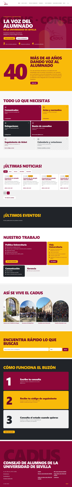

El portal se adapta al móvil y a la tablet. Quien navega con teclado dispone, como primer elemento, de un enlace «Saltar al contenido», que lleva directamente al texto principal de la página.

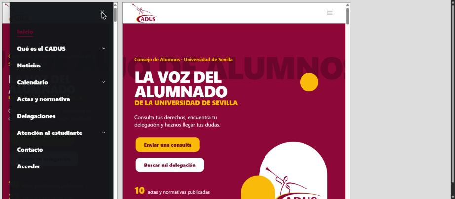

## 3. Consultar la información

### 3.1. Noticias

Abre **Noticias**. Puedes filtrar por categoría, por año o por una palabra clave. Al pulsar una noticia se abre completa.

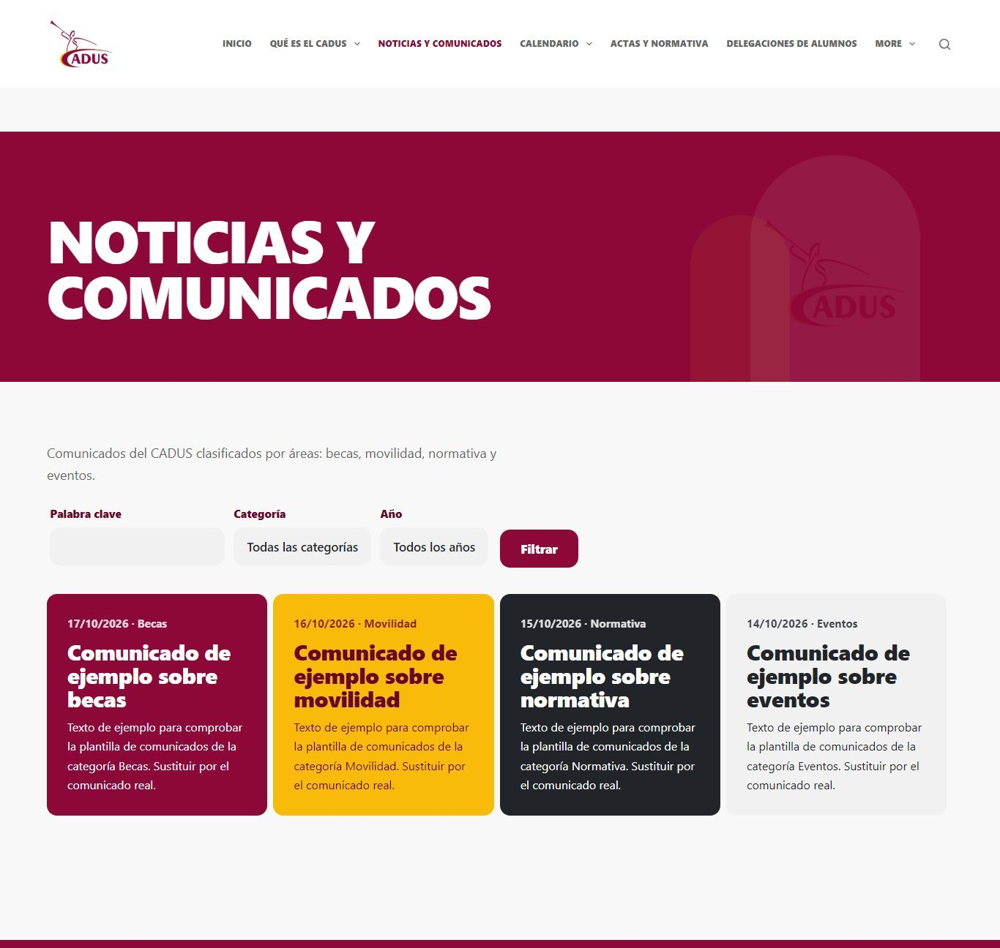

### 3.2. Actas y normativa

Abre **Actas y normativa**. La tabla muestra las actas y los reglamentos publicados; puedes filtrar por tipo (acta o normativa) y descargar el PDF de cada documento. Solo aparecen los documentos que la Ejecutiva ha aprobado y publicado: los borradores no se ven.

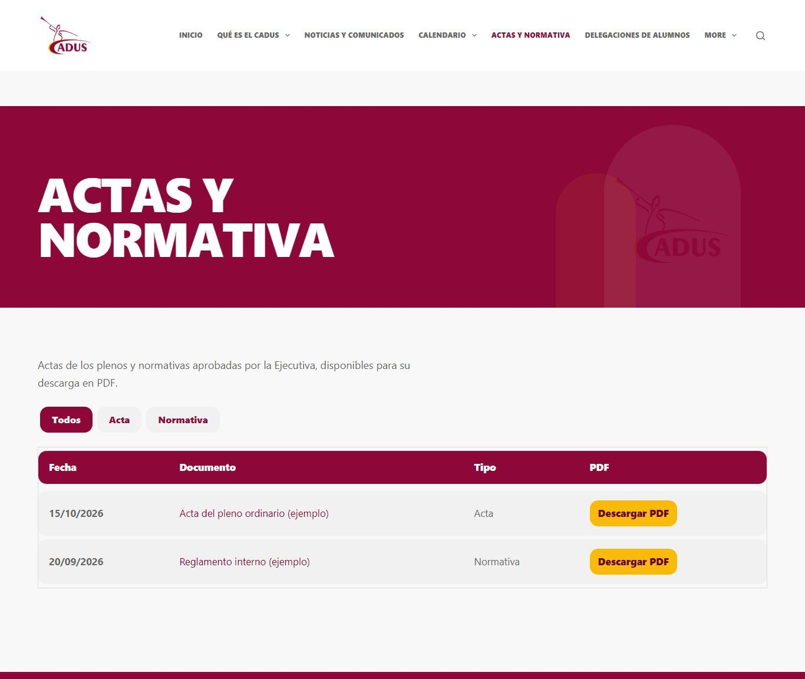

### 3.3. Delegaciones

Abre **Delegaciones**. El directorio agrupa las delegaciones por facultad o escuela y muestra el escudo de cada una. Con el buscador puedes localizar una delegación por su centro, sus siglas, su correo o el nombre de un miembro. Pulsa una delegación para ver su ficha (miembros, correo, teléfono, horario, Instagram y enlaces) y el enlace «Volver al listado».

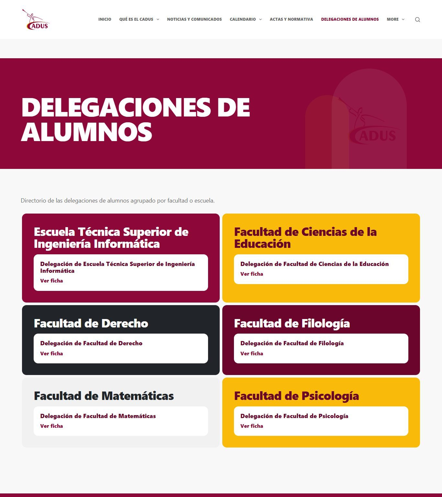

### 3.4. Calendario

Abre **Calendario**. Se ven los próximos eventos en lista, por mes o por día. Cada evento tiene su ficha. Abajo, el botón «Suscribirse al calendario» permite añadirlo a Google Calendar, iCalendar, Outlook o descargar un archivo `.ics`.

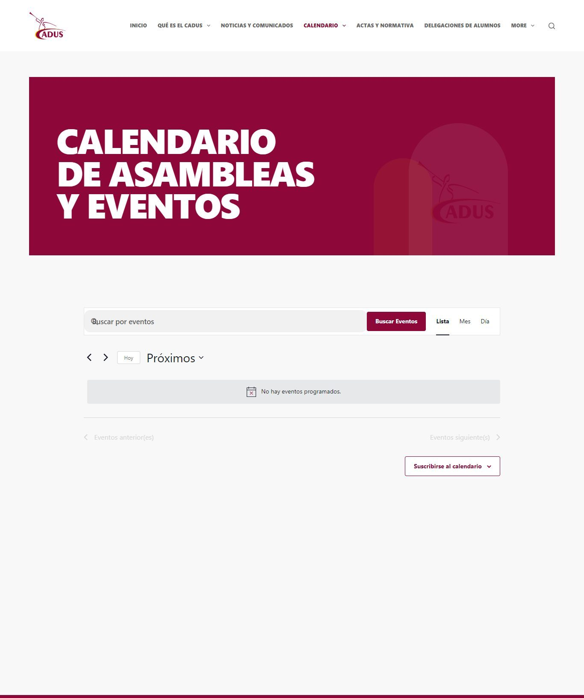

### 3.5. Votaciones

Abre **Votaciones**. Cada convocatoria está vinculada a una asamblea del calendario y aparece como **abierta**, **próxima** o **cerrada**, con su periodo. Pulsa «Ver votación» para ver la ficha. La votación de las asambleas es presencial; el portal publica la convocatoria y su calendario.

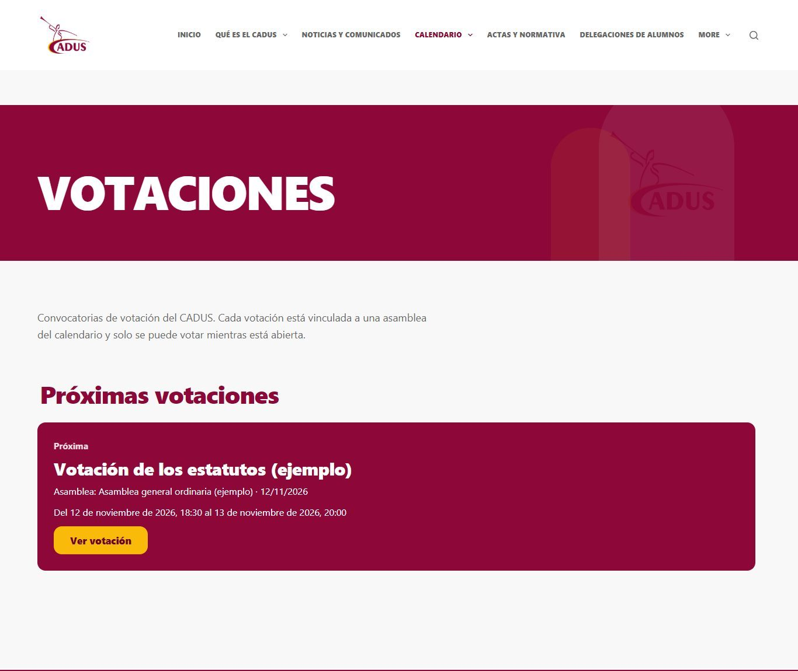

## 4. Enviar una consulta o una reclamación

Todo lo que envías al buzón es **privado**: solo lo ven el remitente (con su código) y la Ejecutiva del CADUS.

1. Entra en **Atención al estudiante › Buzón de consultas y reclamaciones**.
2. Rellena **nombre y apellidos**, **correo universitario** (debe ser de la Universidad de Sevilla, del tipo `…@alum.us.es`; otras direcciones se rechazan), **Facultad o Escuela**, **asunto** y **tipo** («Consulta» o «Reclamación académica») y la **descripción**.
3. Marca el **consentimiento RGPD**. Sin él no se puede enviar.
4. Pulsa **Enviar al CADUS**.
5. La página te muestra tu **código de seguimiento**, que empieza por `CAD-`. **Guárdalo y no lo compartas**: es la única forma de consultar tu ticket.

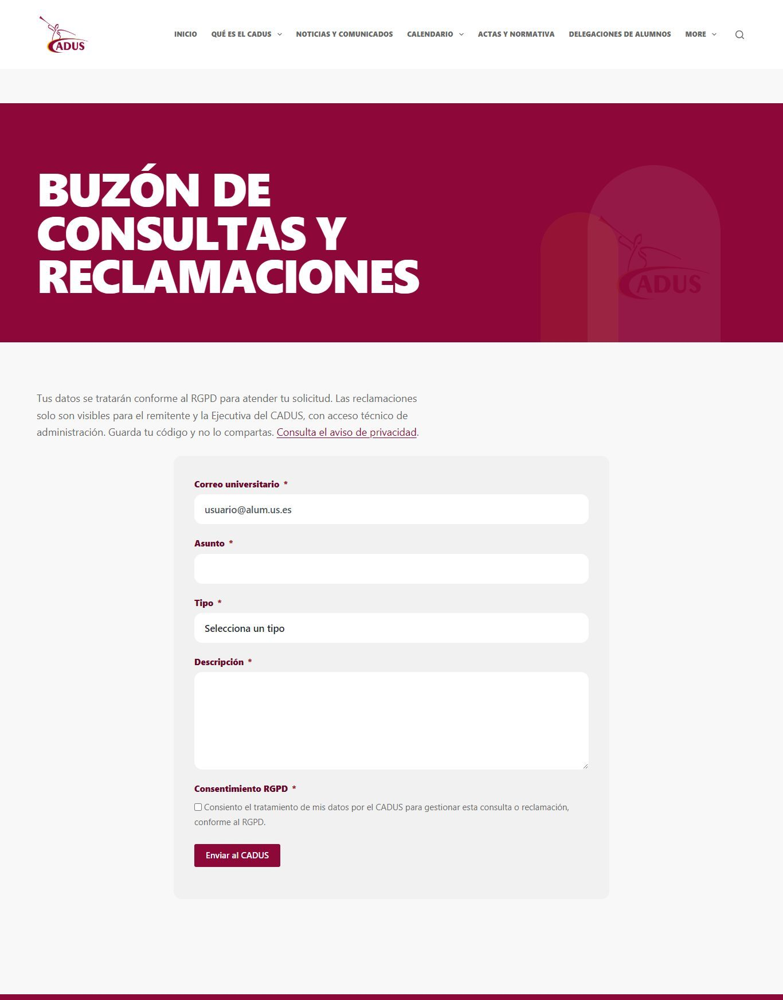

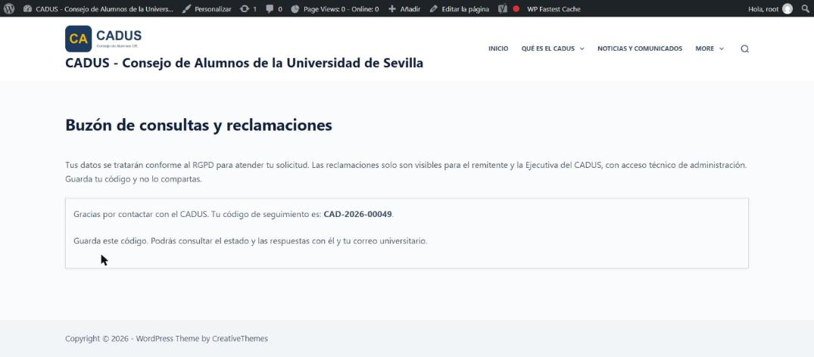

Si pierdes el código, por seguridad no se puede mostrar el ticket sin él: escribe a `dcadus@us.es` desde tu correo universitario, con el asunto y la fecha aproximada del envío, y te ayudarán a localizarlo.

## 5. Seguimiento de tu ticket y mediación

### 5.1. Consultar el estado de un ticket

1. Entra en **Atención al estudiante › Seguimiento de ticket**.
2. Escribe el **código de seguimiento** (empieza por `CAD-`) y el **mismo correo** con el que enviaste la consulta. Los dos campos son obligatorios.
3. Pulsa **Consultar seguimiento**. Verás el asunto, el estado (**Abierto**, **En proceso** o **Cerrado**) y las respuestas del CADUS.

Si el código o el correo no coinciden, la página responde con un mensaje genérico (no dice cuál de los dos falla). Por seguridad hay un máximo de diez intentos por IP cada quince minutos.

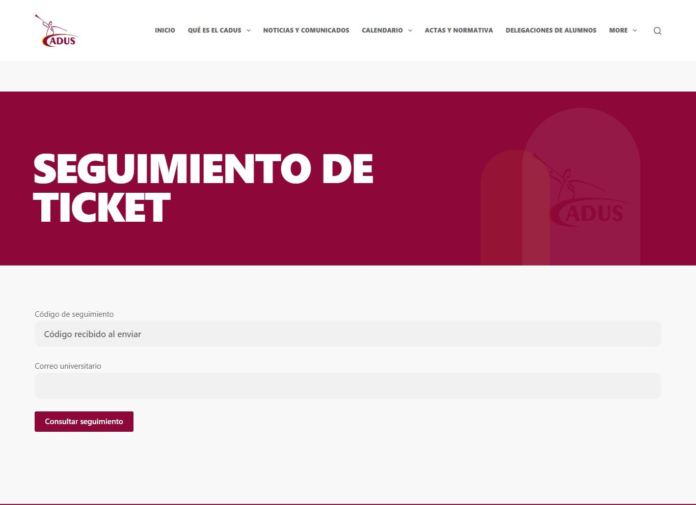

El correo que recibes cuando la Ejecutiva responde no incluye el contenido de la respuesta: solo el código y el enlace a esta página.

### 5.2. Pedir una mediación estudiantil

Si tienes un conflicto con otro estudiante, un profesor o un órgano de tu centro y quieres que el CADUS medie:

1. Entra en **Atención al estudiante › Mediación estudiantil**.
2. Rellena nombre y apellidos, correo `@alum.us.es`, Facultad o Escuela y la descripción del conflicto, y marca el consentimiento RGPD.
3. Pulsa **Solicitar mediación**. La página confirma el envío con una **referencia** que empieza por `MED-`.

La Ejecutiva revisa la solicitud y se pone en contacto contigo. Las solicitudes de mediación solo las ve la Ejecutiva y no tienen consulta de seguimiento pública.

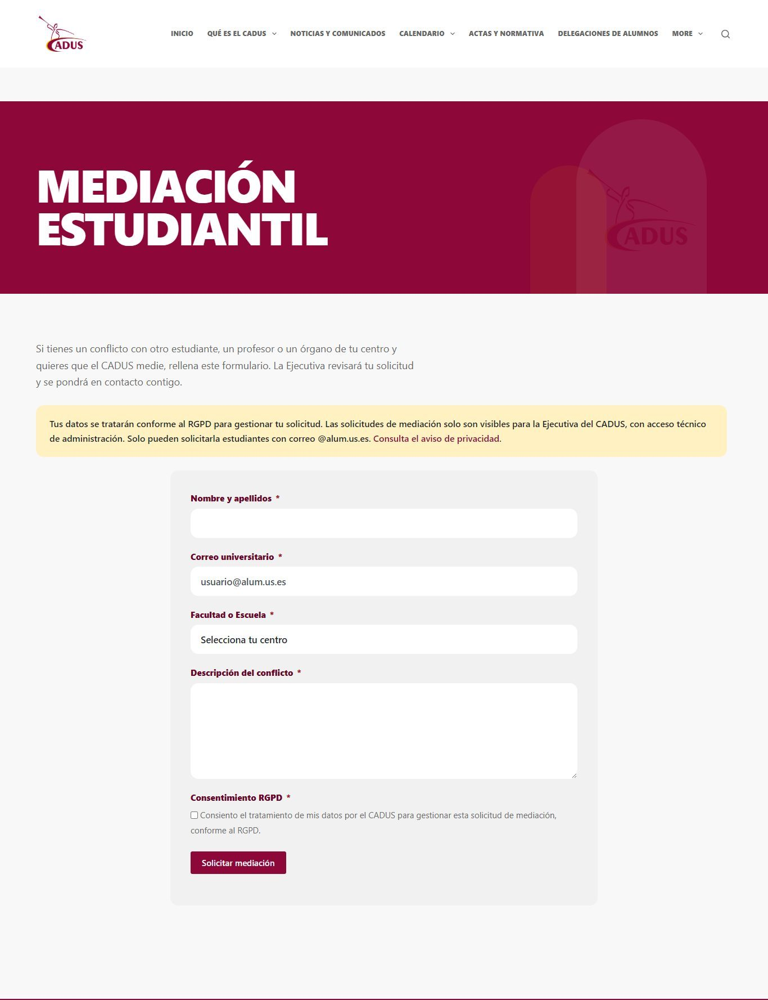

### 5.3. Preguntas frecuentes y privacidad

La página **Preguntas frecuentes** resuelve las dudas habituales (quién puede usar el buzón, diferencia entre consulta y reclamación, qué hacer si pierdes el código, quién ve tu consulta). El **aviso de privacidad** explica cómo se tratan tus datos.

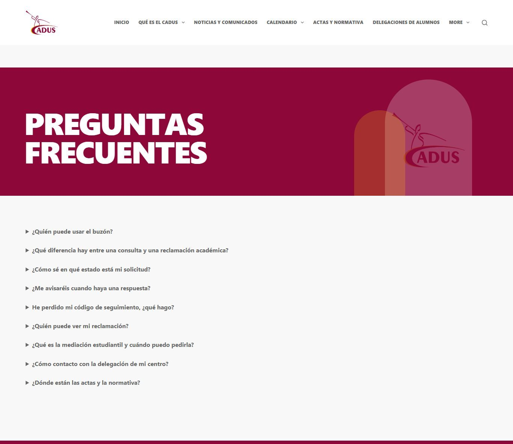

## 6. Manual para las delegaciones de centro

Cada delegación tiene **una única cuenta**, que representa a la delegación y no a la persona que la ocupa este curso. Entra con el correo institucional de la delegación.

### 6.1. Iniciar sesión

1. Pulsa **Acceder** en el menú.
2. Escribe el usuario o el correo y la contraseña y pulsa **Entrar**. Si no la recuerdas, usa **¿Has olvidado tu contraseña?** (el enlace llega al correo de la delegación).
3. Al entrar, el menú muestra **Mi delegación** y **Salir**.

### 6.2. Editar la ficha de tu delegación

1. Pulsa **Mi delegación**.
2. Edita los datos de la ficha: delegado o representante, correo, teléfono, horario, enlaces, miembros (uno por línea), Instagram y escudo.
3. Guarda los cambios.

Solo puedes editar **tu propia ficha**. No tienes acceso a las actas ni a los tickets del buzón; en el Escritorio solo se muestran tus accesos propios.

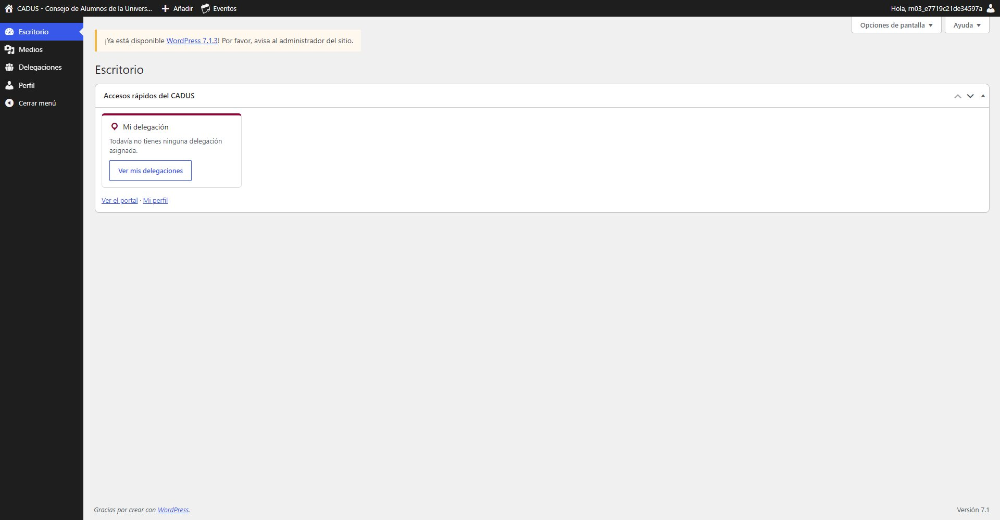

### 6.3. Cambio de equipo (relevo de la cuenta)

Cuando cambia el equipo de la delegación, **la cuenta no se borra**: pasa al equipo nuevo con una contraseña nueva, y la ficha y su historial siguen en la misma cuenta. Lo hace quien sale (o la Ejecutiva) en **Delegaciones › Relevo de la cuenta**:

1. Elige cómo entregar el acceso: **Contraseña nueva** (la escribes o aceptas la propuesta de 16 caracteres, y la entregas en mano al equipo entrante) o **Enlace al correo de la delegación** (el equipo entrante elige su contraseña desde el correo; necesita que el servidor pueda enviar correo).
2. Confirma. **Se cierran todas las sesiones** de la cuenta al momento: el equipo anterior pierde el acceso, también en otros navegadores y móviles.

La delegación saliente solo ve su propia cuenta. Si cambia quién gestiona el buzón de correo de la delegación, el CADUS lo tramita con la Universidad; la cuenta de la web no cambia.

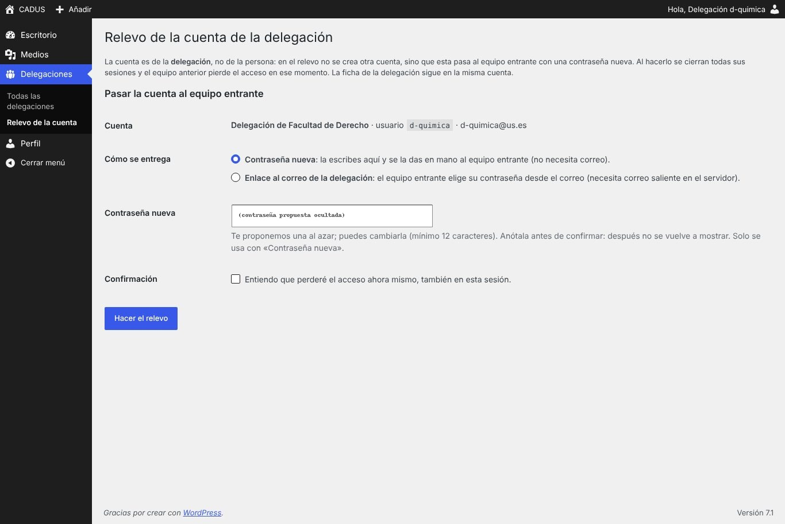

## 7. Manual para la Ejecutiva del CADUS

La Ejecutiva entra siempre con la cuenta única **`cadus`** (correo `dcadus@us.es`); no hay cuentas personales. Con el menú **Gestión** se hacen las tareas habituales sin entrar al panel de WordPress.

### 7.1. Iniciar sesión y la página «Gestión»

1. Pulsa **Acceder**, escribe `cadus` y la contraseña. La primera vez, usa **¿Has olvidado tu contraseña?** con el usuario `cadus`: el enlace llega a `dcadus@us.es`.
2. Pulsa **Gestión** en el menú. Ofrece: **nueva noticia**, **nuevo evento** (aparece en el calendario), **nueva acta o normativa** (con su PDF) y la gestión de las **delegaciones** (datos, delegado y enlace al relevo de la cuenta).

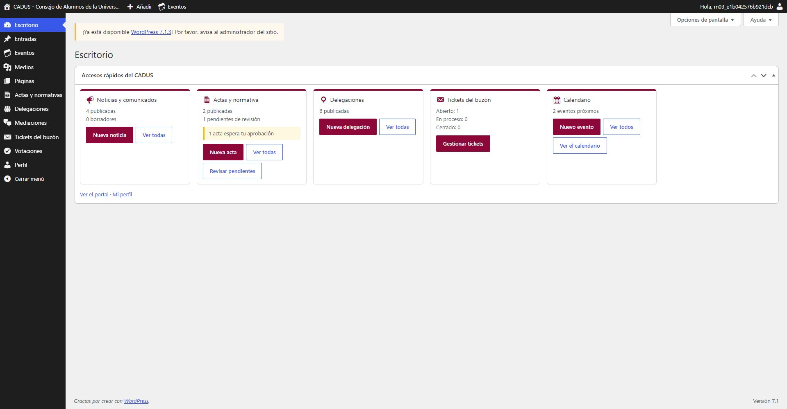

### 7.2. Publicar una noticia

1. En **Gestión**, ve a **Nueva noticia o comunicado**.
2. Rellena el **título**, la **categoría**, un **resumen** de una frase (se muestra en el listado) y el **texto** (separa los párrafos con una línea en blanco).
3. Pulsa **Publicar la noticia**. Aparece en **Noticias** y en la portada.

Si necesitas imágenes o un formato más rico, crea la entrada desde el panel de WordPress (**Entradas › Añadir**). Las imágenes que se suben se reducen solas a un máximo de 1920 píxeles y cada una puede pesar hasta 8 MB.

### 7.3. Crear un evento o una asamblea en el calendario

1. En **Gestión**, ve a **Nuevo evento del calendario** y rellena el **título**, el **tipo de evento**, la **fecha** y la **hora de inicio**. Opcionalmente, la fecha y la hora de fin (si dejas la hora vacía, dura una hora), el **lugar** y la **descripción**.
2. Si es una asamblea, elige el tipo **Asambleas** (existe también **Cursos**). Las votaciones se vinculan a eventos de asamblea.
3. Pulsa **Añadir al calendario**. El evento aparece en **Calendario** y en «Próximos eventos» de la portada.

### 7.4. Publicar un acta o una normativa

1. En **Gestión**, ve a **Nueva acta o normativa**. Rellena el **título**, el **tipo de documento**, la **fecha** y, si procede, el **pleno asociado** (por ejemplo, «Pleno ordinario de octubre»), y sube el **archivo PDF** (solo PDF, hasta 10 MB).
2. Pulsa **Publicar el documento**. Aparece en **Actas y normativa** con su PDF para descargar.
3. Desde el panel de WordPress (**Actas y normativas**) un acta también puede guardarse como **Pendiente de revisión** hasta que la Ejecutiva la apruebe; mientras tanto no se ve fuera del panel.

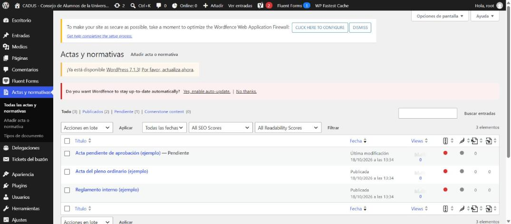

### 7.5. Convocar una votación

En el panel, **Votaciones › Añadir votación**: título, descripción, **asamblea del calendario**, apertura y cierre. Es obligatorio vincularla a una asamblea publicada y poner un cierre posterior a la apertura; si no, se queda en borrador y avisa. La votación se celebra de forma presencial en la asamblea.

### 7.6. Atender los tickets del buzón

1. En el panel, abre **Tickets del buzón**. El listado muestra la referencia, el estado y la fecha, y no los datos personales. Se puede buscar por código o por asunto y filtrar por estado y por tipo.
2. Abre un ticket: ahí ves los datos del estudiante y la descripción. En la caja **Estado** cambia entre **Abierto**, **En proceso** y **Cerrado**, y escribe la **respuesta para el estudiante** en la caja **Respuestas**.
3. El estudiante ve el estado y la respuesta en la página de seguimiento. Cada ticket nuevo envía un aviso a `dcadus@us.es` que lleva solo el código, el tipo, la fecha y el enlace al panel; nunca el texto de la consulta.

Las **Mediaciones** se gestionan igual desde su apartado (estados **Pendiente**, **En proceso** y **Cerrada**). Los tickets y las mediaciones se **anonimizan solos a los dos años** de resolverse: se conserva la referencia, el estado y el centro, y se eliminan el correo, el nombre y los textos.

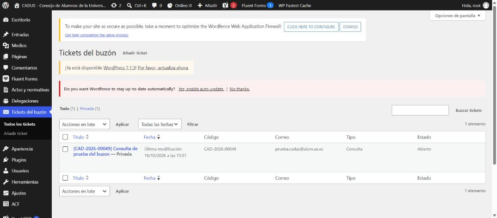

### 7.7. Gestionar las delegaciones y el relevo

En **Gestión › Delegaciones** (o en **Delegaciones** del panel) la Ejecutiva edita cualquier ficha. En **Delegaciones › Relevo de la cuenta** elige cualquier cuenta de delegación (nunca la de un administrador) y la entrega con una contraseña nueva o con un enlace al correo. Ve además una tabla con todas las cuentas, su ficha y el último relevo (fecha, modo y quién lo hizo), y un aviso con las fichas que no tienen cuenta.

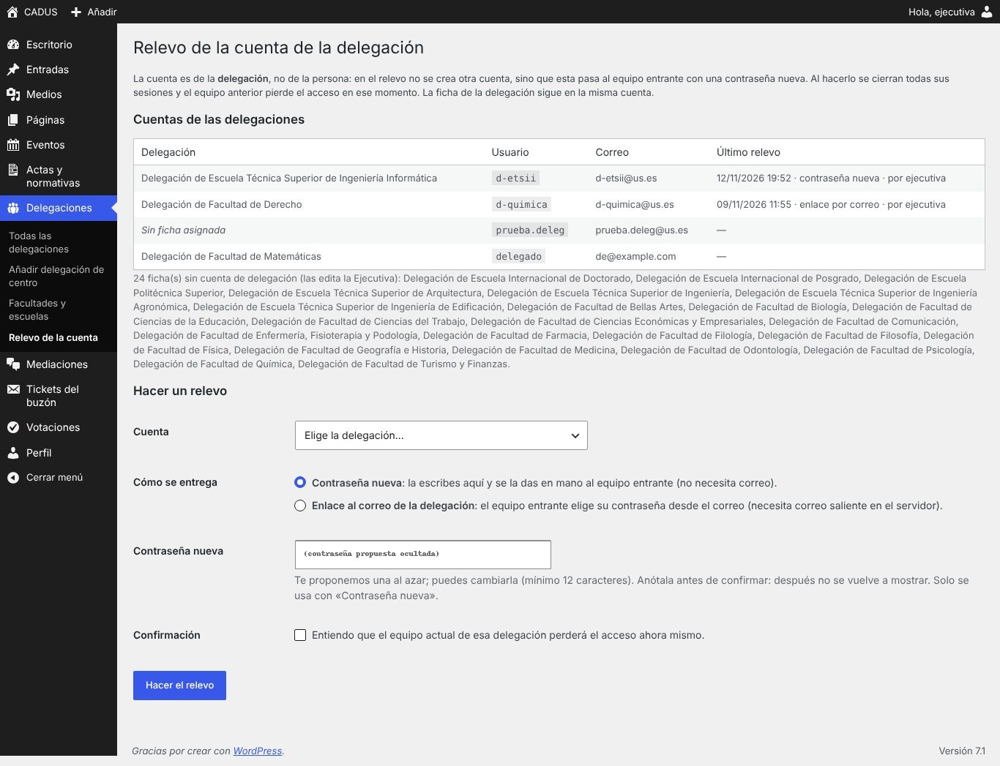

### 7.8. Cambiar la contraseña de la cuenta de la Ejecutiva

Con **¿Has olvidado tu contraseña?** y el usuario `cadus` (el enlace llega a `dcadus@us.es`). Si el servidor no envía correo, un administrador la cambia en **Usuarios › Editar** y pulsa **Cerrar la sesión en todas partes**.

## 8. Problemas frecuentes

| Problema | Qué hacer |
|---|---|
| El buzón rechaza mi correo | Usa tu correo `@alum.us.es`; los demás dominios se rechazan |
| He perdido mi código de seguimiento | Escribe a `dcadus@us.es` desde tu correo universitario con el asunto y la fecha aproximada |
| El seguimiento no encuentra mi ticket | Comprueba el código completo (empieza por `CAD-`) y el correo exacto; tras diez intentos hay que esperar quince minutos |
| No veo un acta que debería estar | Solo se muestran las publicadas; la Ejecutiva debe aprobarla |
| Una página sale sin estilos o con datos antiguos | La caché del servidor puede estar desactualizada; avisa a la Ejecutiva para que la vacíe (Manual de administrador) |
| No recibo el enlace de «¿Has olvidado tu contraseña?» | Comprueba la carpeta de correo no deseado; si el servidor no envía correo, el administrador cambia la contraseña desde el panel |
