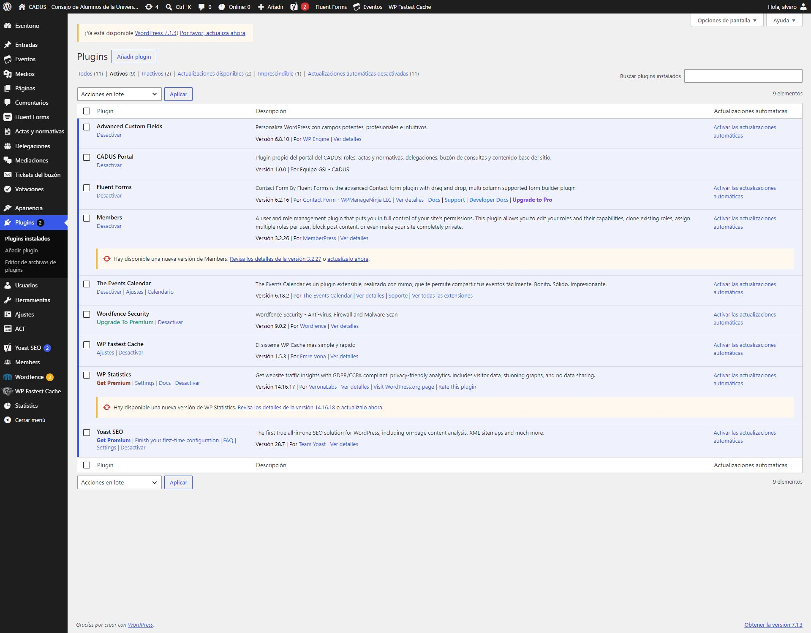
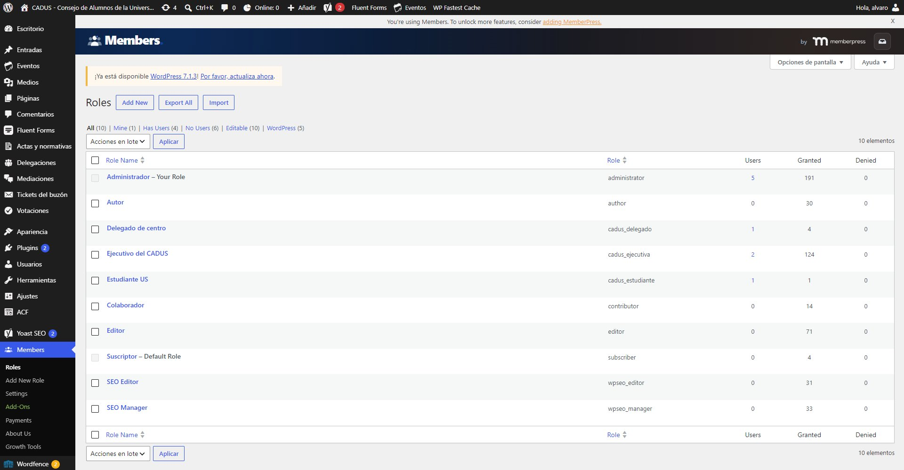
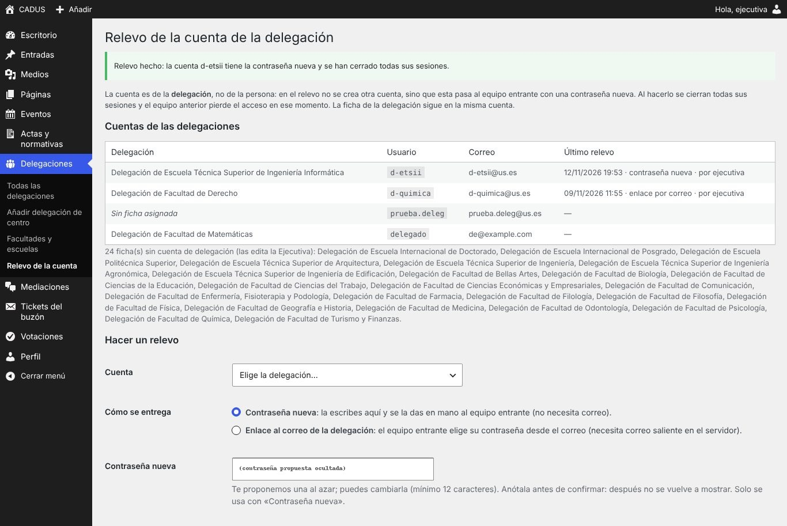
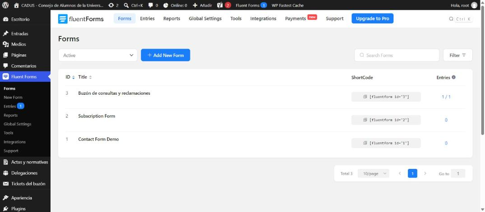
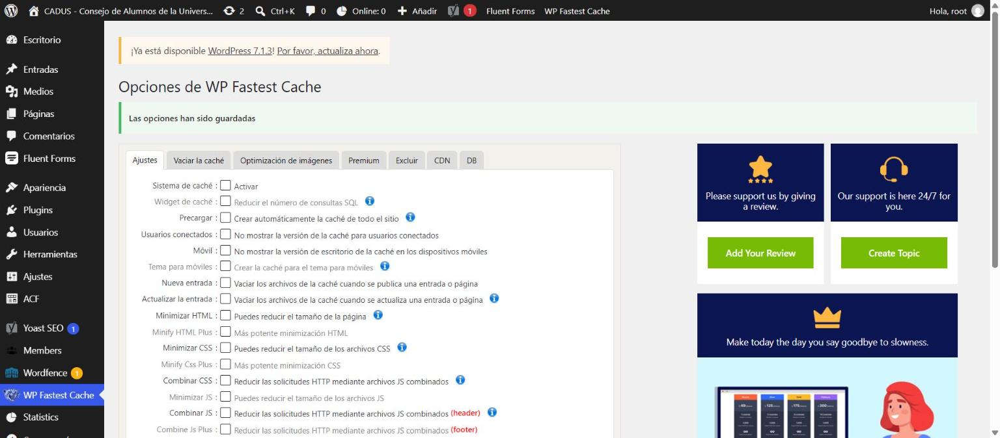
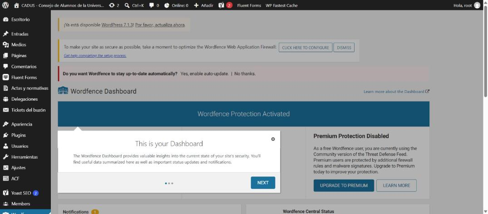

# Manual de administrador del portal web del CADUS (CMS)

Portal del Consejo de Alumnos y Estudiantes de la Universidad de Sevilla (CADUS) · Manual de administrador · versión 1.0 · 27/11/2026 · Grupo de proyecto de GSI, Universidad de Sevilla

## 1. Alcance

Este manual es para quien instala, mantiene y recupera el portal: el equipo técnico y la cuenta de administración del CADUS. El uso diario (noticias, actas, tickets) está en el «Manual de usuario del portal».

El portal es un **WordPress 7.1.4** con un plugin propio (`cadus-portal`) que implementa los roles, los contenidos, el buzón y las votaciones. Es independiente del DMS (SharePoint) y de la red social (Teams), que tienen sus propios manuales.

## 2. Arquitectura y requisitos

| Elemento | Detalle |
|---|---|
| Servidor del equipo | WampServer en un equipo anfitrión: Apache, PHP 8.x y MySQL 8.x (base de datos `bd_cadus`). El resto del equipo entra por Tailscale |
| Aplicación | WordPress 7.1.4, tema **Blocksy** |
| Plugin propio | `cadus-portal` (única parte versionada en Git junto con el contenido del repositorio) |
| Plugins de terceros activos | Advanced Custom Fields (ACF), Fluent Forms, Members, The Events Calendar, Yoast SEO, WP Fastest Cache, WP Statistics, Wordfence y Akismet |
| Requisitos del servidor | `mod_rewrite` activo y el `.htaccess` de WordPress; ACF, Fluent Forms y Blocksy instalados |
| Correo saliente | Necesario para los avisos de tickets y para los enlaces de «¿Has olvidado tu contraseña?» y de relevo. Los avisos se envían a `dcadus@us.es` |

Qué vive dónde: los contenidos y ajustes hechos desde el panel están en la base de datos; los archivos de plugins propios y la documentación están en el repositorio de GitHub; `wp-config.php`, `wp-content/uploads/` y las credenciales **solo** están en el equipo anfitrión y no se versionan.

## 3. Instalación en un servidor nuevo

1. **Preparar el servidor** con Apache (con `mod_rewrite`), PHP 8.x y MySQL 8.x. El servidor de la Universidad de Sevilla que se estudió corría PHP 7.2 o 7.3, que **no** vale para este WordPress; el despliegue en la Universidad está sin hacer y queda pendiente de hablar con ella (apartado 9).
2. **Copiar los archivos**: WordPress con la carpeta `wp-content` (tema Blocksy y plugins, incluido `cadus-portal`) y la carpeta `wp-content/uploads` que se entrega junto al volcado.
3. **Crear la base de datos** `bd_cadus` con cotejamiento `utf8mb4_unicode_ci` e **importar** el volcado (`bd_cadus_v1_sprint3.sql`) desde phpMyAdmin (pestaña «Importar») o por línea de comandos.
4. **Crear `wp-config.php`** a partir de `wp-config-sample.php` con los datos de la base de datos, las claves únicas de WordPress (generadas para ese servidor) y, si la dirección web cambia, la dirección del sitio (`siteurl` y `home`, en «Ajustes › Generales», o en la tabla `wp_options`).
5. **Comprobar** que la web carga, que se puede entrar en `wp-login.php` y que los enlaces permanentes funcionan («Ajustes › Enlaces permanentes › Guardar cambios» vuelve a generarlos si dan 404).
6. **Vaciar la caché** de WP Fastest Cache.
7. Pasar la lista de comprobación del apartado 8.

El volcado entregado **no incluye cuentas de prueba, tickets ni datos reales de estudiantes**; contiene las cuentas de administración del equipo y su historial de Wordfence, y sus contraseñas están cifradas (apartado 6.3). Antes de pasarlo a un servidor público, revisa qué usuarios debe tener.

## 4. Cuentas y roles

### 4.1. Cuentas del portal

Para el portal en producción las cuentas son **institucionales**: representan al órgano, no a la persona que lo ocupa este curso. Así el relevo anual no obliga a crear ni borrar cuentas.

| Cuenta | Quién la usa | Correo | Rol | Alta |
|---|---|---|---|---|
| `cadus` (única) | Toda la Ejecutiva | `dcadus@us.es` | Administrador | `php scripts/roles/crear_cuenta_cadus.php` |
| Una por delegación (hasta 27) | El equipo de la delegación | Correo institucional de la delegación (no `@alum.us.es`) | Delegado de centro | Desde `cadus` («Usuarios › Añadir nuevo») o con `aplicar_usuarios.php` |

Hay además cuentas del equipo de desarrollo (administradores). El estudiante **no tiene cuenta**.

### 4.2. Permisos por rol

| Capacidad | Administrador | Ejecutivo (rol «Ejecutivo del CADUS») | Delegado | Estudiante |
|---|:-:|:-:|:-:|:-:|
| Publicar actas y normativas | sí | sí | no | no |
| Ver y gestionar tickets y mediaciones | sí | sí | no | no |
| Editar la ficha de la propia delegación | sí | sí | sí | no |
| Editar fichas ajenas | sí | sí | no | no |

El rol «Ejecutivo del CADUS» (`cadus_ejecutiva`) existe para quien el CADUS quiera con permisos de contenido sin ser administrador; la Ejecutiva real usa la cuenta `cadus`. Los menús del panel se filtran por rol con listas cerradas (el delegado solo ve Escritorio, Delegaciones, Medios y Perfil), pero **ocultar un menú no sustituye al permiso**: el servidor comprueba la capacidad. Se bloquean además las pantallas de comentarios para los roles del portal.

### 4.3. Alta de las delegaciones por lotes

1. Copia `scripts/roles/usuarios-ejemplo.csv` a `usuarios-reales.csv` (ignorado por Git) y rellena **una línea por delegación**: `usuario,nombre,correo,rol,delegacion`. El correo es el institucional de la delegación; el script rechaza los `@alum.us.es`.
2. **Ensayo en seco** (no cambia nada): `php scripts/roles/aplicar_usuarios.php`.
3. **Aplicar**: `php scripts/roles/aplicar_usuarios.php --aplicar --avisar` (`--avisar` envía a cada delegación el enlace para elegir su contraseña y necesita correo saliente).
4. Comprobar con una cuenta de delegación el menú y los permisos.

Garantías del script: no guarda ni muestra contraseñas, no toca las cuentas de administrador, rechaza usuarios y correos repetidos y una segunda cuenta para la misma delegación, y deja a la delegación como autora de su ficha, que es lo único que le permite editarla.

### 4.4. Relevo de la cuenta

La cuenta pasa al equipo entrante con una contraseña nueva; la ficha y el historial no cambian. Delegaciones: **Delegaciones › Relevo de la cuenta** (el delegado saliente solo ve su cuenta; la Ejecutiva, todas las de delegación, nunca las de administrador), con **contraseña nueva** (mínimo 12 caracteres; se propone una de 16) o **enlace al correo de la delegación**. En los dos casos se **cierran todas las sesiones** de la cuenta. Ejecutiva: «¿Has olvidado tu contraseña?» con el usuario `cadus`, o un administrador pone una contraseña nueva en «Usuarios › Editar» y pulsa **Cerrar la sesión en todas partes** (única opción si no hay correo saliente).

## 5. Configuración del plugin

Al **activar** `cadus-portal` se ejecuta `cadus_portal_activar()`: crea o completa los roles, fija los enlaces permanentes, registra los tipos de contenido y siembra páginas, menú, noticias, actas y delegaciones de ejemplo.

- **Es idempotente:** volver a activarlo no duplica nada. Cada elemento sembrado lleva la marca `_cadus_semilla`.
- **Ajustes iniciales solo la primera vez:** tema, paleta, logotipo, descripción, menú y portada. Después no se pisan los cambios del equipo.
- Los textos de ejemplo están marcados como «ejemplo» y deben sustituirse por contenido real validado con el cliente.
- Las migraciones (versión de roles, de diseño, de votaciones, de la portada) se ejecutan solas, una vez, cuando la versión guardada difiere de la del código. En una instalación nueva con el volcado no hace falta hacer nada.

### 5.1. Módulos del plugin

| Archivo (`includes/`) | Qué hace |
|---|---|
| `roles.php`, `admin.php` | Roles, capacidades, menús y destino de inicio de sesión por rol |
| `contenidos.php`, `delegaciones.php` | Actas y normativas, delegaciones (27 fichas cargadas de `data/delegaciones.json`), directorio |
| `buzon.php`, `mediacion.php`, `privacidad.php`, `retencion.php` | Buzón, mediación, privacidad de los tickets y anonimización a los dos años |
| `calendario.php`, `votaciones.php` | Integración con The Events Calendar y convocatorias de votación |
| `gestion.php`, `escritorio.php`, `relevo.php` | Página «Gestión», accesos del Escritorio y relevo de la cuenta |
| `imagenes.php`, `accesibilidad.php` | Límites de imágenes y accesibilidad |
| `setup.php`, `inicio.php`, `portada_extra.php`, `estilo.php`, `galeria.php` | Páginas, tema, portada y estilos |

### 5.2. Formularios y avisos

Los formularios del buzón y de la mediación se crean con **Fluent Forms**; el plugin guarda sus identificadores en las opciones `cadus_buzon_form_id` y `cadus_mediacion_form_id`, de modo que no dependen de números fijos. Los formularios **no envían correos de Fluent Forms** (están desactivadas sus notificaciones por código); cada ticket nuevo envía un aviso propio a `dcadus@us.es` (opción o filtro `cadus_buzon_correo_avisos`) con solo el código, el tipo, la fecha y el enlace al panel. Si el correo falla, el resultado queda en el metadato `_cadus_aviso_ejecutiva` del ticket.

El desplegable de centros se lee de la taxonomía `cadus_centro`: una delegación nueva aparece sin editar el formulario.

### 5.3. Votaciones y calendario

Las convocatorias (menú **Votaciones**) deben vincularse a una asamblea publicada del calendario (The Events Calendar) y llevar apertura y cierre; si no, quedan en borrador. Las votaciones del CADUS son presenciales (la votación por internet, HU-21, se canceló). El campo «ID de la encuesta» y el plugin YOP Poll solo servirían para una papeleta en línea y **no están instalados** ni se usan. Las categorías de evento «Asambleas» y «Cursos» se crean solas una vez.

### 5.4. Imágenes

El plugin limita las imágenes subidas a **1920 píxeles** (no se sirve el original grande), genera los tamaños intermedios en WebP si el servidor lo admite (calidad 82), quita el tamaño de 2048 píxeles y rechaza las imágenes de **más de 8 MB**, incluidas las que se suben desde el editor de bloques.

## 6. Mantenimiento

### 6.1. Caché

WP Fastest Cache guarda HTML. **Tras cambiar `cadus.css`, `cadus.js` o los archivos de accesibilidad hay que vaciar la caché** («Ajustes de WP Fastest Cache › Delete Cache»); si no, se ven los archivos viejos. Las páginas con datos privados (buzón, mediación, seguimiento) no se cachean (cabeceras `no-store`). Al desplegar, retira las copias previas de esas páginas antes de abrir el servicio.

### 6.2. Seguridad

Wordfence protege el acceso (registro de inicios de sesión y bloqueos) y bloquea, por ejemplo, el envío de `<script>` en los formularios antes de que llegue al portal. Los formularios privados exigen el «nonce» de Fluent Forms y un campo trampa vacío (honeypot) y admiten **10 envíos con campos válidos por IP cada 15 minutos**; el seguimiento admite 10 consultas por IP cada 15 minutos. Revisa de vez en cuando el panel de Wordfence y las actualizaciones pendientes.

### 6.3. Copias de seguridad y restauración

La base `bd_cadus` es única y compartida. Los volcados `.sql` de `cms-wordpress/backup-db/` sirven como copia de seguridad antes de cambios grandes, como punto de entrega de cada sprint y para recuperar un servidor.

**Exportar:**
- Con phpMyAdmin: seleccionar `bd_cadus` › «Exportar» › método «Rápido», formato «SQL».
- Con PHP (cuando `mysqldump` no conecta por `caching_sha2_password`): `php scripts/entrega/volcado_bd.php cms-wordpress/backup-db/bd_cadus_v1_sprint3.sql`. Si hay un error de lectura o de escritura, el script aborta y borra el fichero para no dejar un volcado a medias.

**Nombre:** `bd_cadus_v<versión>_sprint<NN>.sql`; no sobrescribir los anteriores hasta cerrar el sprint.

**Restaurar:** crear `bd_cadus` (`utf8mb4_unicode_ci`) o vaciarla, «Importar» el `.sql` y comprobar que `wp-config.php` apunta a ella y que la web carga.

**Cuidado:** los volcados contienen las **contraseñas cifradas** de los usuarios y registros de Wordfence (direcciones IP y nombres de usuario). No se suben a GitHub (están en `.gitignore`) y la carpeta tiene un `.htaccess` que impide descargarlos por HTTP.

### 6.4. Retención y anonimización (HU-23)

Una tarea diaria de WP-Cron (`cadus_retencion_diaria`) **anonimiza** los tickets y las mediaciones **resueltos hace más de dos años**: conserva la referencia, el tipo, el estado, el centro y el consentimiento, y elimina el correo, el solicitante, los textos, las respuestas y los adjuntos. El plazo cuenta desde que pasan a «Cerrado» o «Cerrada»; un ticket abierto nunca se toca y uno reabierto reinicia la cuenta. La tarea es idempotente. **WP-Cron solo se dispara con visitas al sitio:** si el servidor lo tiene desactivado, programa una tarea del sistema que llame a `wp-cron.php`. Esta tarea no se ha comprobado en el servidor del equipo (apartado 9).

### 6.5. Actualizaciones

1. Haz un volcado de la base y una copia de `wp-content` antes de actualizar nada.
2. Actualiza WordPress, el tema y los plugins desde el panel.
3. Vacía la caché y pasa la lista de comprobación del apartado 8.
4. Si los enlaces dan 404 (en particular «Ver votación»), «Ajustes › Enlaces permanentes › Guardar cambios».

El plugin propio depende de ACF, Fluent Forms, The Events Calendar y Blocksy: tras actualizar cualquiera de ellos, repite las comprobaciones del apartado 8 (buzón, calendario y votaciones).

## 7. Datos que no se deben guardar

El buzón y la mediación **no conservan** copia en Fluent Forms: el texto y los datos del solicitante quedan solo en el tipo de contenido privado del portal (`cadus_ticket`, `cadus_mediacion`), que no tiene REST, archivo público, revisiones ni exportación y se excluye de los sitemaps. No registres su contenido en `error_log`. Si se añade algún aviso nuevo a la Ejecutiva, debe llevar solo el código y el enlace al panel, nunca el asunto, la descripción ni el correo del estudiante.

## 8. Lista de comprobación tras instalar o actualizar

| # | Comprobación |
|---|---|
| 1 | La portada, **Noticias**, **Actas y normativa**, **Delegaciones** (27 fichas), **Calendario** y **Votaciones** cargan sin errores |
| 2 | La cuenta `cadus` entra y ve **Gestión**; una cuenta de delegación solo ve **Mi delegación** |
| 3 | Un envío de prueba al buzón con un correo `@alum.us.es` devuelve un código `CAD-…` y el seguimiento lo encuentra; después **bórralo** |
| 4 | Un correo que no es `@alum.us.es` se rechaza |
| 5 | El ticket no es visible en ninguna página pública ni en `/wp-json/wp/v2/` |
| 6 | La caché está vaciada y no hay avisos en `wp-content/debug.log` si `WP_DEBUG_LOG` está activo |
| 7 | No quedan cuentas ni tickets de prueba |

Hay baterías automáticas en `scripts/pruebas/` (se lanzan desde la raíz del repositorio con el sitio en marcha): `rn03_http.py` y `privacidad_tickets.py` (privacidad de los tickets), `rn03_mediacion.py` (mediación), `sprint3_buzon.py` (protección de formularios, búsqueda del panel y datos mínimos), `hu15b_accesibilidad.py` (accesibilidad de los formularios), `hu23_prueba_retencion.php` (retención) y `gestion.php` (permisos de la página Gestión). Algunas **crean cuentas y tickets temporales** y los borran al terminar; no las ejecutes en paralelo ni en un sitio con datos reales sin leer antes su cabecera. Los resultados de cada una están en los documentos `tests/` y `scripts/pruebas/*.md`.

## 9. Problemas conocidos y límites

| Asunto | Estado |
|---|---|
| Despliegue en la Universidad de Sevilla | No hecho: el servidor estudiado tenía PHP 7.2/7.3, insuficiente. Pendiente de hablar con la Universidad |
| Correo saliente | El envío real del correo de aviso y de «contraseña olvidada» necesita SMTP en el servidor; no se ha probado la entrega real |
| Tareas programadas | La anonimización a los dos años no se ha comprobado en el servidor del equipo; en el entorno de pruebas se verificó con datos de ejemplo |
| Lector de pantalla | Probado con Narrador; NVDA sin probar |
| Pruebas con personas ajenas | Los tiempos de tareas (T1 a T3) se midieron de forma funcional, sin cronometrar con una persona externa |
| Datos de las fichas | Faltan el teléfono en 7 delegaciones, el correo en 1 y el horario en las 27 |
| Verificación del correo | `@alum.us.es` valida el dominio, no que el correo pertenezca a quien escribe |
| Imágenes de la portada | Proceden de cadus.us.es: confirmar con el cliente su uso y la autorización de las personas que aparecen |

Las decisiones pendientes con el CADUS son la retención de las copias de seguridad, el límite de envíos para redes con IP compartida y el almacenamiento privado de ficheros si algún día se admiten adjuntos (hoy los formularios no admiten ficheros).
