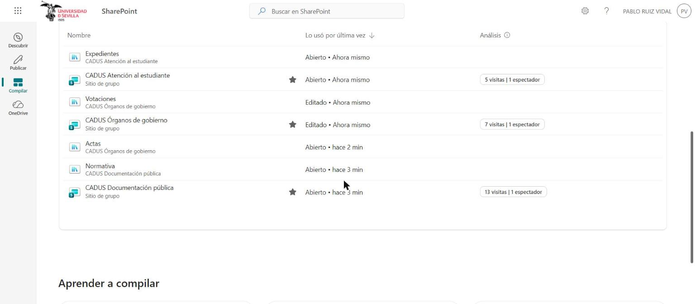
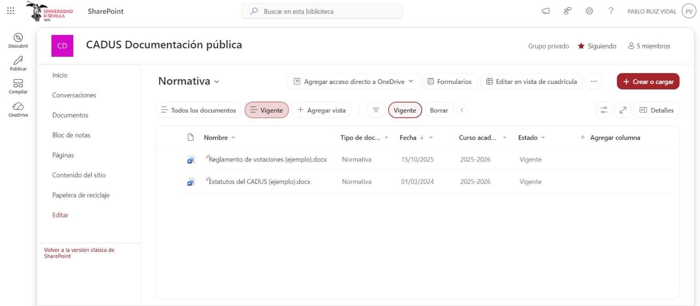
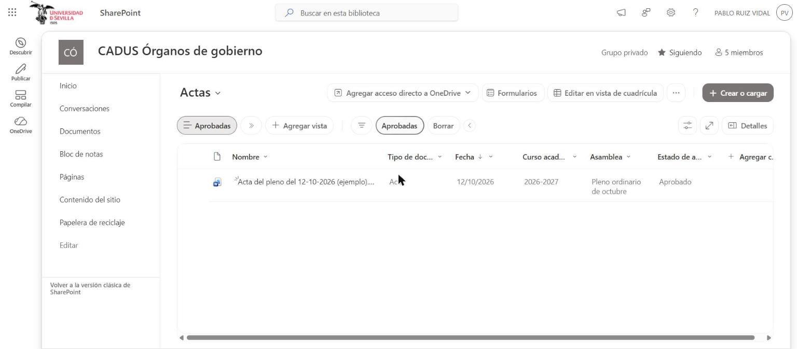
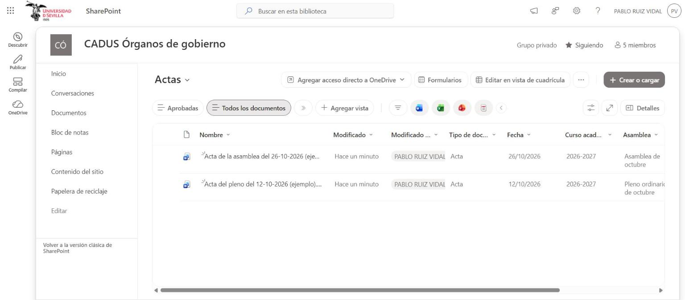
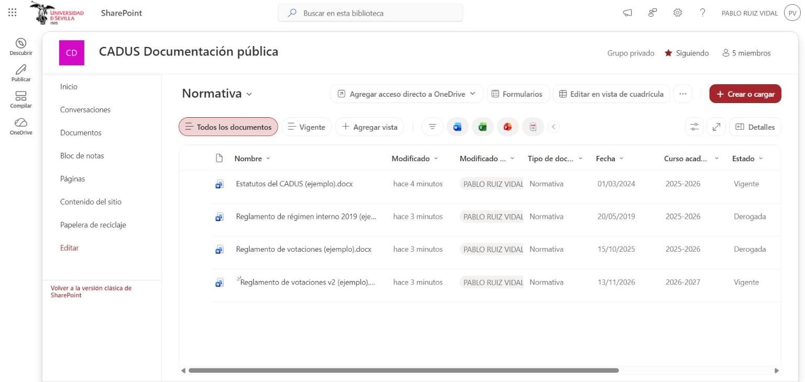
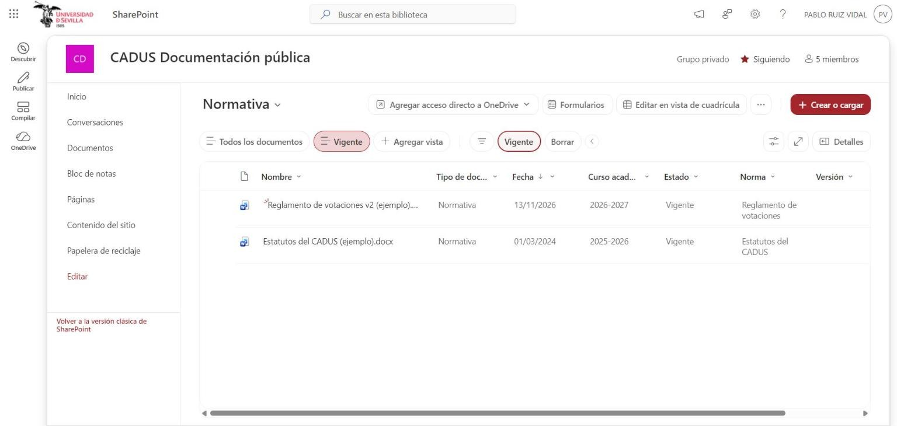
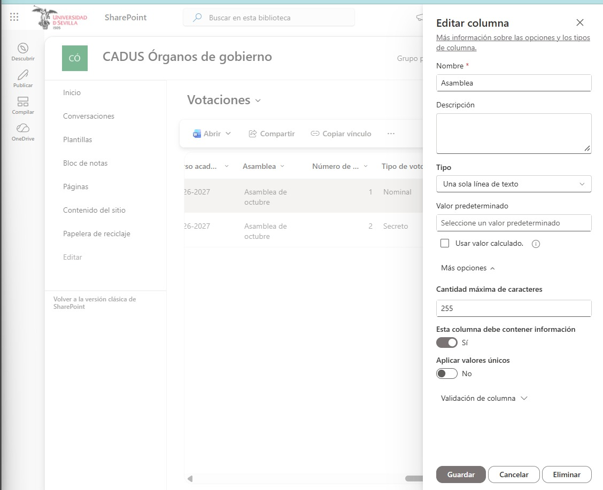
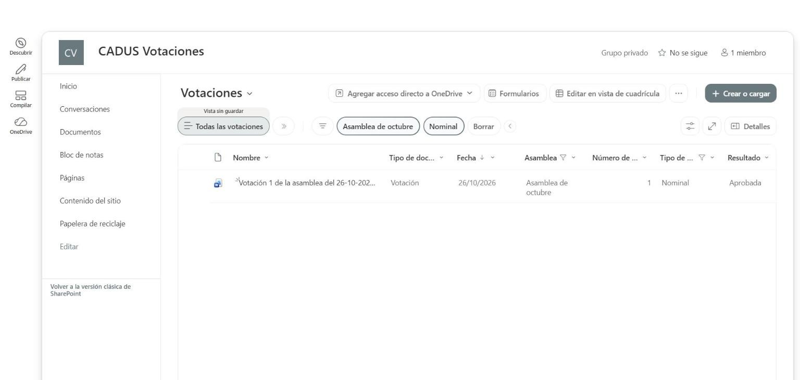
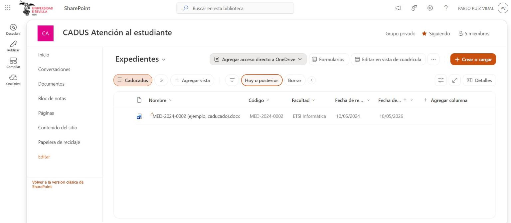
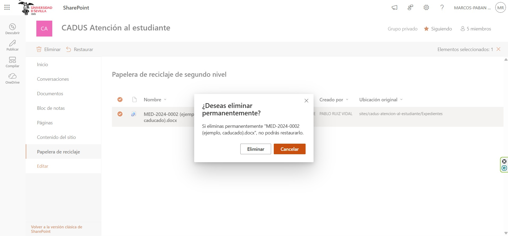

# Manual de usuario del sistema de gestión documental del CADUS (DMS)

DMS del CADUS en SharePoint (Lab 4) · Manual de usuario · versión 1.0 · 27/11/2026 · Grupo de proyecto de GSI, Universidad de Sevilla

## 1. Para qué sirve este manual

El DMS guarda los documentos oficiales del CADUS en cuatro sitios de SharePoint de la Universidad de Sevilla (`https://uses0.sharepoint.com`): la normativa, las actas de las asambleas, los registros de votaciones y los expedientes de reclamaciones y mediaciones. Es independiente del portal web, que publica las actas y la normativa para el público.

Cada persona ve solo lo que le corresponde:

| Quién eres | Qué ves y qué haces | Capítulo |
|---|---|---|
| Estudiante (con su correo `@alum.us.es`) | Leer la normativa vigente | 3 |
| Delegado (con la cuenta de su delegación) | Leer la normativa vigente y las actas **aprobadas** | 3 y 4 |
| Ejecutiva del CADUS (cuenta del CADUS) | Redactar y aprobar actas, publicar normativa, registrar votaciones y archivar y retirar expedientes | 5 a 8 |

La configuración de los sitios, los permisos y las bibliotecas está en el «Manual de administrador del DMS».

**Estado a 27/11/2026:** el DMS está montado con documentos de ejemplo ficticios, sin datos personales. Los delegados y los estudiantes aún no tienen cuentas en SharePoint: las pantallas y los pasos de los capítulos 3 y 4 describen el comportamiento previsto por los permisos de los sitios, que está pendiente de probar con cuentas reales de delegado y de estudiante (véase el manual de administrador). Los casos de la Ejecutiva (capítulos 5 a 8) se ejecutaron con las cuentas del equipo.

## 2. Los cuatro sitios y qué contiene cada uno

| Sitio | Biblioteca | Quién la ve |
|---|---|---|
| CADUS Documentación pública | Normativa | Ejecutiva, delegados y estudiantes (lectura) |
| CADUS Órganos de gobierno | Actas y Plantillas | Ejecutiva; los delegados solo leen las actas aprobadas |
| CADUS Votaciones | Votaciones y Plantillas | Solo la Ejecutiva |
| CADUS Atención al estudiante | Expedientes | Solo la Ejecutiva |

Cada documento tiene **metadatos** (tipo de documento, fecha, curso académico, estado…) que sirven para buscarlo y filtrarlo. Las vistas planas («Vigente», «Aprobadas», «Caducados»…) ya vienen filtradas.

## 3. Consultar la normativa vigente (estudiantes y delegados · CU-D03)

1. Entra en el sitio **CADUS Documentación pública** con tu correo `@alum.us.es` (estudiante) o con la cuenta de tu delegación (delegado).
2. Abre la biblioteca **Normativa** y la vista **Vigente**: muestra solo las normas en vigor y oculta las derogadas.
3. Busca por palabra clave o filtra por año.
4. Abre la norma.

De cada norma solo hay una versión vigente: al publicar una nueva, la anterior pasa a «Derogada» y se conserva como referencia, sin borrarse.

## 4. Consultar las actas aprobadas (delegados · CU-D02)

1. Entra con la cuenta de tu delegación (no con el correo de alumno de quien sea delegado este curso). La cuenta es de la delegación: cuando cambia el equipo, pasa al equipo nuevo con una contraseña nueva y el mismo acceso.
2. Abre el sitio **CADUS Órganos de gobierno**, biblioteca **Actas**, vista **Aprobadas**.
3. Filtra por fecha, curso o palabra clave y abre el acta.

Solo ves las actas con estado **Aprobado**: los borradores no aparecen, ni en la biblioteca ni abriendo un enlace directo.

## 5. Para la Ejecutiva: redactar, aprobar y archivar un acta (CU-D01)

1. En **CADUS Órganos de gobierno › Actas**, crea el acta a partir de la **plantilla de acta** (biblioteca Plantillas).
2. Se guarda como **borrador**, visible solo para su autor y la Ejecutiva.
3. Rellena los metadatos: **tipo de documento** (Acta, obligatorio), **fecha** (la del pleno o la asamblea, obligatoria), curso académico y asamblea.
4. Envía el acta a aprobación y, cuando todos los miembros de la Ejecutiva están de acuerdo con el texto, **apruébala**. El estado de aprobación lo pone SharePoint: no se escribe a mano.
5. Desde ese momento los delegados la ven en la vista **Aprobadas**.

## 6. Para la Ejecutiva: publicar una nueva versión de una norma (CU-D07)

Cuando la Ejecutiva aprueba una nueva redacción de una norma ya publicada:

1. Sube el documento de la versión nueva a **CADUS Documentación pública › Normativa**.
2. Rellena los metadatos: **tipo de documento** (Normativa), **norma** (el nombre que identifica la misma norma entre sus versiones, por ejemplo «Reglamento de votaciones»), **versión** (1, 2, 3…), fecha, curso y **estado Vigente**.
3. **Abre la versión anterior de esa norma y cambia su estado a Derogada.** SharePoint no comprueba por sí solo que haya una sola versión vigente: este paso lo hace la Ejecutiva a mano. Si se olvida, la vista «Vigente» mostraría las dos versiones.
4. Comprueba la vista «Vigente»: debe mostrar solo la versión nueva.

## 7. Para la Ejecutiva: registrar una votación presencial (CU-D06) y consultar las anteriores (CU-D08)

Un registro de votación recoge el resultado de una votación presencial de asamblea, con un voto por delegación (27). **No guarda el DNI de nadie**, y si la votación es **secreta** solo guarda el recuento total, sin vincular el voto a ninguna delegación.

**Registrar:**
1. En **CADUS Votaciones › Votaciones**, crea el registro a partir de la **plantilla de registro de votación** (una fila por delegación).
2. Marca qué delegaciones están **presentes** y si se comprobó su **identidad**, y el **tipo de voto** (Nominal o Secreto).
3. Si es nominal, anota el voto de cada delegación; si es secreta, solo el recuento total.
4. Rellena los metadatos obligatorios: **tipo de documento**, **fecha**, **asamblea**, **número de votación** y **tipo de voto**; y el **resultado** (Aprobada o Rechazada).

**Consultar:** abre la biblioteca, filtra por asamblea y por tipo de voto y abre el registro; cada registro se identifica por su asamblea y su número de votación.

## 8. Para la Ejecutiva: archivar y retirar expedientes (CU-D04 y CU-D05)

Un expediente es el documento que queda de una reclamación o una mediación ya resuelta (código `CAD-…` o `MED-…` del portal). Contiene datos personales: solo lo ve la Ejecutiva y se conserva **2 años** desde que se resuelve.

**Archivar un expediente resuelto (CU-D04):**
1. Sube el documento a **CADUS Atención al estudiante › Expedientes**.
2. Rellena el **código**, la **facultad** y la **fecha de resolución** (obligatoria), además del estado (Resuelto).
3. SharePoint calcula la **fecha de caducidad** (resolución más 2 años). No la escribas.

**Retirar los expedientes caducados (CU-D05), una vez al mes:**
1. Abre la vista **Caducados**: muestra los expedientes cuya fecha de caducidad es anterior a hoy.
2. **Elimina** cada expediente (se eliminan también todas sus versiones).
3. **Vacía las dos papeleras:** primero la papelera de reciclaje del sitio y después la de segunda fase («Configuración del sitio › Papelera de reciclaje › Papelera de reciclaje de segunda fase»). Un documento eliminado sigue 93 días en total en las papeleras, así que sin vaciar la segunda fase no se cumple el plazo de 2 años.

## 9. Problemas frecuentes

| Problema | Qué hacer |
|---|---|
| No veo un acta que sé que existe | Si eres delegado, solo se ven las **aprobadas**; pide a la Ejecutiva que la apruebe |
| No puedo abrir Votaciones o Expedientes | Es lo normal: solo la Ejecutiva accede a esos sitios |
| La vista «Vigente» muestra dos versiones de una norma | La Ejecutiva olvidó marcar como **Derogada** la versión anterior |
| Un documento no se abre en Word en línea | Descárgalo y avisa al equipo del DMS; los documentos de ejemplo se regeneraron por este motivo el 12 y el 15/11/2026 |
| No puedo entrar en un sitio | Comprueba que usas la cuenta correcta (la de tu delegación o tu correo `@alum.us.es`) y pide a la Ejecutiva que revise tus permisos en el sitio |
