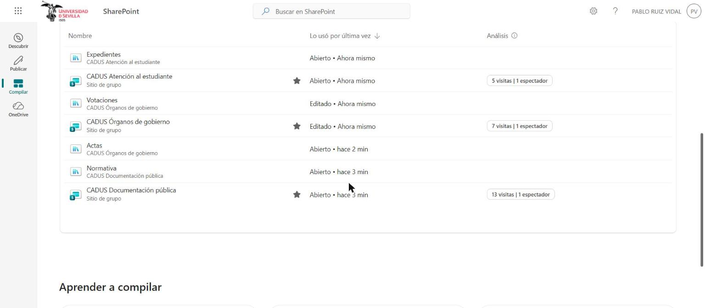
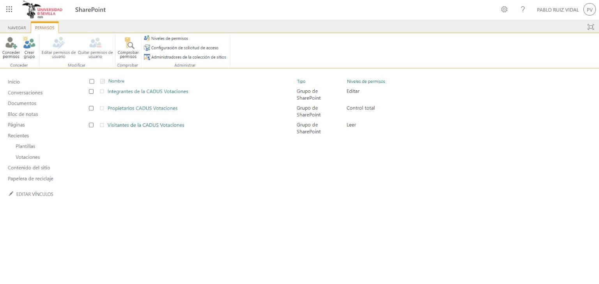
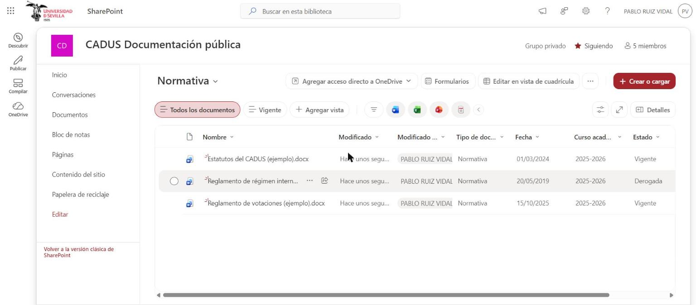
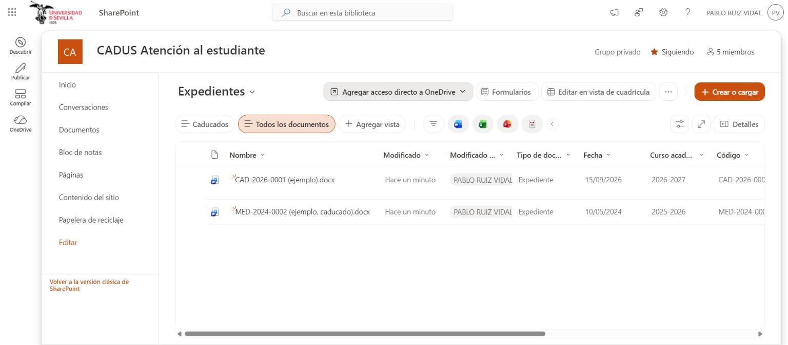
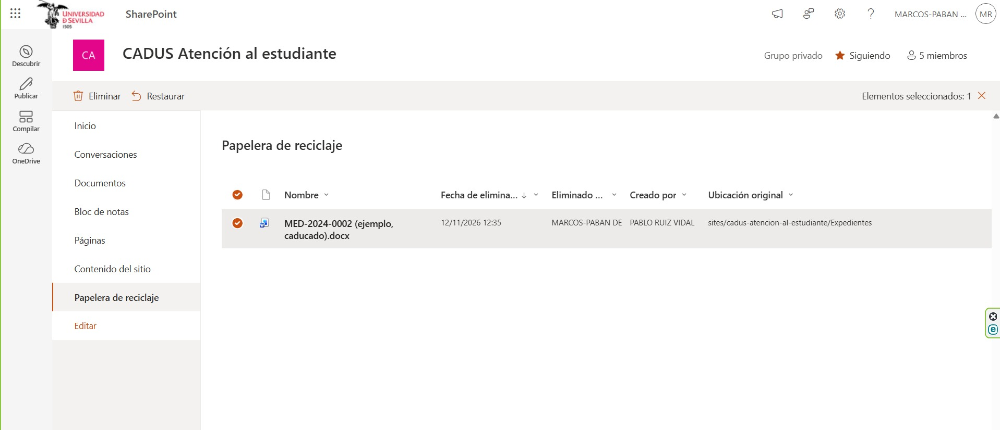

# Manual de administrador del sistema de gestión documental del CADUS (DMS)

DMS del CADUS en SharePoint (Lab 4) · Manual de administrador · versión 1.0 · 27/11/2026 · Grupo de proyecto de GSI, Universidad de Sevilla

## 1. Alcance

Este manual es para quien administra los sitios de SharePoint del DMS: crear y configurar sitios y bibliotecas, dar y quitar permisos, mantener las columnas y las vistas y hacer las tareas de mantenimiento periódicas. El uso diario por la Ejecutiva, los delegados y los estudiantes está en el «Manual de usuario del DMS».

Los nombres exactos de los menús de SharePoint Online cambian con las versiones del servicio. Donde este manual da una ruta de menús, es la que se usó; si no se parece a la que ves, busca la opción equivalente y anota lo que cambia.

## 2. Arquitectura

El DMS vive en el tenant de la Universidad de Sevilla (`https://uses0.sharepoint.com`). Son **cuatro sitios de grupo, privados**, creados con la plantilla «Equipo estándar» (tres el 26/10/2026 y el cuarto, CADUS Votaciones, el 13/11/2026). Es independiente del portal web y de la red social, aunque Teams enlaza algunos de estos sitios (véase el manual de la red social).

| Sitio | Dirección | Bibliotecas |
|---|---|---|
| CADUS Documentación pública | `/sites/cadus-documentacion-publica` | Normativa |
| CADUS Órganos de gobierno | `/sites/cadus-organos-de-gobierno` | Actas y Plantillas (plantilla de acta) |
| CADUS Votaciones | `/sites/cadus-votaciones` | Votaciones y Plantillas (plantilla de registro de votación, 27 filas) |
| CADUS Atención al estudiante | `/sites/cadus-atencion-al-estudiante` | Expedientes |

## 3. Permisos

Los permisos se conceden **sobre el sitio** con los tres grupos predefinidos del Lab 4: **Propietarios**, **Integrantes** y **Visitantes**. Las bibliotecas heredan los permisos del sitio, salvo Expedientes (apartado 3.2).

### 3.1. Quién está en cada grupo

| Grupo | Quién | Qué puede |
|---|---|---|
| Propietarios | Hoy, Pablo. La cuenta del CADUS (`dcadus@us.es`, la Ejecutiva) debe añadirse (apartado 7) | Control total: crear, editar, aprobar y eliminar |
| Integrantes | Los cuatro miembros del equipo del proyecto y Miguel Ángel Camacho Martín (CADUS) | Editar (solo mientras se trabaja con documentos de ejemplo) |
| Visitantes | Delegados y estudiantes cuando existan sus cuentas | Leer |

A fecha de este manual, en los cuatro sitios **Pablo es propietario** y los demás integrantes están en el grupo **Integrantes** con permiso de edición. En CADUS Votaciones los cuatro están en el grupo Integrantes de SharePoint (comprobado por la API el 13/11/2026); la cabecera del sitio puede seguir mostrando «1 miembro» porque cuenta el grupo de Microsoft 365, no el de SharePoint.

### 3.2. Reglas de privacidad por biblioteca

| Biblioteca | Delegado | Estudiante | Cómo se consigue |
|---|---|---|---|
| Normativa | Lectura | Lectura | Visitantes del sitio Documentación pública |
| Actas | Lectura, solo de las **aprobadas** | Nada | Aprobación de contenido con «Solo los usuarios que pueden aprobar elementos (y el autor del elemento)»: los borradores no se ven ni por enlace directo |
| Votaciones | Nada | Nada | Sitio propio; el grupo Visitantes se **deja vacío** |
| Expedientes | Nada | Nada | La biblioteca rompe la herencia (permisos exclusivos, sin Visitantes); el sitio tampoco tiene visitantes |

Votaciones es un sitio propio desde el 13/11/2026 porque el Lab 4 concede los permisos sobre el sitio, no con permisos exclusivos en una biblioteca. La biblioteca antigua y su plantilla se enviaron a la papelera de SharePoint (recuperables).

### 3.3. Tareas habituales de permisos

| Tarea | Cómo |
|---|---|
| Añadir un delegado o un estudiante | «Configuración del sitio › Permisos del sitio» (o «Compartir») y añadirlo al grupo **Visitantes** del sitio de Documentación pública (y, solo a los delegados, de Órganos de gobierno). **No** añadir nunca a Votaciones ni a Atención al estudiante |
| Añadir un miembro de la Ejecutiva | Grupo **Propietarios** de los cuatro sitios |
| Dar de baja a alguien | Quitarlo del grupo; la cuenta no se borra, solo pierde el acceso |
| Relevo de una delegación | La cuenta de la delegación se mantiene y pasa al equipo entrante (decisión del cliente del 09/11/2026). La contraseña de una cuenta de la Universidad no se cambia desde SharePoint: el CADUS lo tramita con la Universidad |
| Comprobar un permiso | Entrar con una cuenta de prueba de ese rol, incluyendo la apertura de enlaces directos |

## 4. Bibliotecas, columnas y vistas

Todo documento lleva el metadato **Tipo de documento** (Acta, Normativa, Expediente o Votación): es obligatorio en todas las bibliotecas, porque la búsqueda por metadatos depende de él.

| Biblioteca | Columnas | Obligatorias | Vista |
|---|---|---|---|
| Normativa | Tipo de documento, Fecha, Curso académico, Norma (texto), Versión (número entero), Estado (Vigente o Derogada) | Tipo de documento, Estado, Norma y Versión | **Vigente** |
| Actas | Tipo de documento, Fecha, Curso académico, Asamblea, Estado de aprobación (nativo) | Tipo de documento y Fecha | **Aprobadas** |
| Votaciones | Tipo de documento, Fecha, Curso académico, Asamblea, Número de votación, Tipo de voto (Nominal o Secreto), Resultado (Aprobada o Rechazada) | Tipo de documento, Fecha, Asamblea, Número de votación y Tipo de voto | **Todas las votaciones** |
| Expedientes | Tipo de documento, Fecha, Curso académico, Código, Facultad, Estado (Resuelto), Fecha de resolución, **Fecha de caducidad** (calculada) | Tipo de documento, Estado y Fecha de resolución | **Caducados** |

- **Fecha de caducidad:** columna calculada = fecha de resolución más 2 años. La vista **Caducados** muestra los expedientes con caducidad anterior a hoy.
- **Actas:** biblioteca con **aprobación de contenido** activada («Configuración de la biblioteca › Configuración de versiones»). El estado de aprobación (Borrador, Pendiente, Aprobado, Rechazado) lo pone SharePoint.
- **Plantillas:** la plantilla de acta (en Órganos de gobierno) y la de registro de votación (en Votaciones, con una fila por delegación y las columnas de presencia, identidad y voto) hacen que todos los documentos tengan la misma estructura.
- **Normas:** SharePoint **no impide** tener dos versiones vigentes de la misma norma. Hay que derogar la anterior a mano al publicar la nueva (véase el manual de usuario, CU-D07).

### 4.1. Cambiar una columna o una vista

«Configuración de la biblioteca › Columnas» (añadir, hacer obligatoria o cambiar los valores de una elección) y «Vistas» (crear o modificar una vista plana). Antes de hacer obligatoria una columna en una biblioteca con documentos, rellénala en los existentes o SharePoint los marcará como incompletos. Si cambias el nombre de un valor de una elección (por ejemplo, «Vigente»), actualiza también las vistas que lo filtran.

### 4.2. Documentos de ejemplo

Todas las bibliotecas tienen documentos de ejemplo ficticios, **sin datos personales ni DNI** (nueve: Normativa 4, Actas 2, Votaciones 2 y Expedientes 1). Se generaron con `scripts/dms/generar_ejemplos_docx.py` como documentos Word válidos. **Antes del uso real hay que borrarlos**, y vaciar las papeleras de reciclaje del sitio y de segunda fase.

## 5. Mantenimiento periódico

| Cuándo | Tarea | Cómo |
|---|---|---|
| Cada mes | Retirar los expedientes caducados (RN-D03) | Abrir la vista **Caducados**, eliminar cada expediente (se eliminan también sus versiones) y vaciar **las dos papeleras**: la del sitio y la de segunda fase («Configuración del sitio › Papelera de reciclaje › Papelera de reciclaje de segunda fase»). Sin vaciar la segunda fase un documento sigue 93 días y no se cumple el plazo |
| Cada asamblea | Registrar las votaciones y aprobar el acta | Véase el manual de usuario |
| Cada curso | Revisar quién está en cada grupo y dar de baja a quien ya no deba tener acceso | Permisos del sitio |
| Cuando cambia una norma | Comprobar que la vista «Vigente» muestra una sola versión por norma | Vista «Vigente» |

Un expediente se retira en la primera revisión mensual posterior al cumplimiento de los 2 años desde su resolución; en la práctica se conserva, como máximo, 2 años y un mes.

## 6. Cómo se montó (para repetirlo)

Los cuatro sitios se crearon con la plantilla «Equipo estándar» y se configuraron mediante la **API REST de SharePoint** desde la sesión del propietario (los tres primeros el 30/10/2026; el cuarto y las columnas de Normativa el 13/11/2026). Para montar un sitio equivalente a mano:

1. Crear un **sitio de equipo** privado con el nombre y la dirección de la tabla del apartado 2.
2. Crear las bibliotecas y las columnas de la tabla del apartado 4 y la vista plana de cada una.
3. En Actas, activar la aprobación de contenido con la opción de visibilidad de borradores indicada en el apartado 3.2.
4. En Expedientes, romper la herencia de permisos y quitar el grupo Visitantes; añadir la columna calculada de caducidad.
5. Subir las plantillas a la biblioteca Plantillas del sitio que corresponda.
6. Dar los permisos del apartado 3.1.

Hay un error conocido que conviene conocer: los documentos de ejemplo subidos por la API con un cuerpo vacío quedaron con 2 bytes (contenido `{}`) y no se abrían en Word en línea, en la vista previa ni descargados. Si subes documentos por API, comprueba que se abren.

## 7. Pendiente y limitaciones

| Asunto | Estado |
|---|---|
| Cuenta del CADUS (`dcadus@us.es`) como propietaria | **Pendiente** en los cuatro sitios; hoy el propietario es Pablo. Cuando se entregue el portal, añadirla también como propietaria de CADUS Votaciones |
| Cuentas de delegado y de estudiante | Aún no existen en SharePoint: **pendiente de la respuesta de la Universidad de Sevilla**. Hay que añadirlos como visitantes y **probar con ellos** que un delegado no ve borradores de actas, votaciones ni expedientes (el comportamiento de los permisos se comprobó con cuentas del equipo) |
| Prueba cruzada de cada caso de uso | Los documentos de casos de uso nombran a la persona que hizo la prueba cruzada de cada uno; con cuentas reales de delegado y de estudiante no se ha repetido |
| Visibilidad | Los integrantes del equipo ven también Votaciones y Expedientes; mientras solo contengan documentos de ejemplo no hay datos personales reales |
| Resumen automático de las actas (RF-D10) | Deseable; no implementado |
