# Manual de usuario de la red social interna del CADUS (Microsoft Teams)

Red social interna del CADUS en Microsoft Teams (Lab 5, Lab 6 y Lab 8) · Manual de usuario · versión 1.0 · 27/11/2026 · Grupo de proyecto de GSI, Universidad de Sevilla

## 1. Para qué sirve este manual

La red social interna es el espacio de trabajo del CADUS y de sus 27 delegaciones de centro. Está montada en **Microsoft Teams**, con la cuenta de la Universidad de Sevilla, y usa también Planner (tareas), Forms (formularios), SharePoint (documentos del DMS), Power Automate (avisos automáticos) y Power Apps (consulta del estado de las delegaciones). Es independiente del portal web y del DMS.

| Quién eres | Qué haces | Capítulo |
|---|---|---|
| Delegación de centro (miembro) | Leer los avisos, ver el calendario, abrir los documentos de su canal, responder al formulario de asistencia y actualizar sus tareas | 3 |
| Ejecutiva del CADUS (propietaria) | Publicar avisos, preparar la asamblea con tareas, compartir documentos con una delegación y seguir el avance | 4 |

La creación de los equipos y la configuración de los permisos están en el «Manual de administrador de la red social».

**Estado a 27/11/2026:** la red social es un **piloto con datos de ejemplo**, montado en el tenant de la Universidad de Sevilla por el equipo del proyecto. El CADUS real aún no tiene cuentas de delegación en Teams. Las capturas muestran cuentas del equipo que representan a una delegación o a la Ejecutiva.

## 2. La organización: tres equipos

| Equipo | Para qué | Quién publica | Contenido |
|---|---|---|---|
| **CADUS · Ejecutiva** | Trabajo interno de la Ejecutiva | Propietarios | Canal General y canal «Preparación de avisos», donde se preparan los avisos antes de publicarlos |
| **CADUS · Delegaciones** | Comunicación con las delegaciones | Solo los propietarios (la Ejecutiva) en el canal de avisos | Canal «Avisos» (antes General) y un **canal privado por delegación** («Delegación · ETSII», «Delegación · Derecho», «Delegación · Biología» como ejemplo) |
| **CADUS · Asamblea** | Preparar y seguir cada asamblea | Propietarios | Canal General (con calendario, plan de tareas, formulario de asistencia y enlace al DMS) y canal «Cursos» |

Los tres equipos son **privados**: solo entra quien ha sido añadido. Cada delegación ve **únicamente** su propio canal privado y el canal de avisos; no ve los canales de las otras delegaciones.

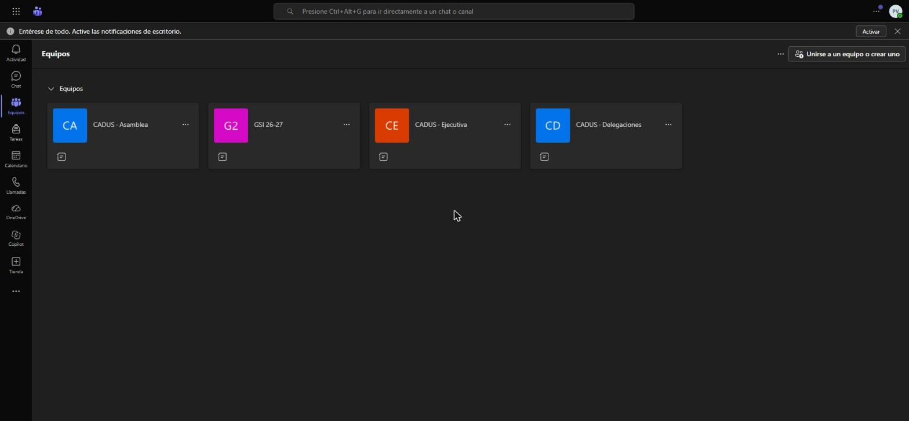

## 3. Manual para las delegaciones (miembros)

### 3.1. Entrar y leer los avisos (CU-R04)

1. Abre Teams con tu cuenta de la Universidad de Sevilla.
2. Entra en **CADUS · Delegaciones** y abre el canal **Avisos**. Ahí la Ejecutiva publica los avisos del CADUS; **tú puedes leerlos pero no iniciar conversaciones**: Teams muestra «Solo los moderadores del canal pueden publicar en este canal».
3. Abre tu canal privado **«Delegación · …»**: es el espacio de tu delegación con la Ejecutiva.

Solo ves los canales de tu delegación. Si no ves un canal que deberías ver, avisa a la Ejecutiva.

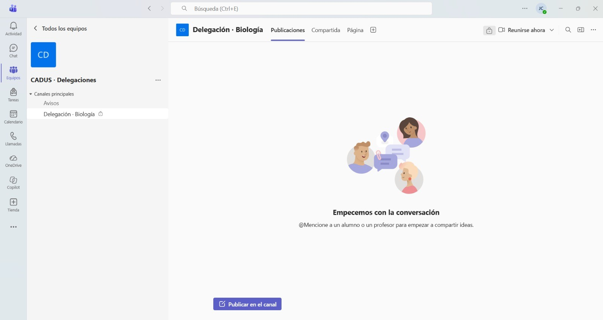

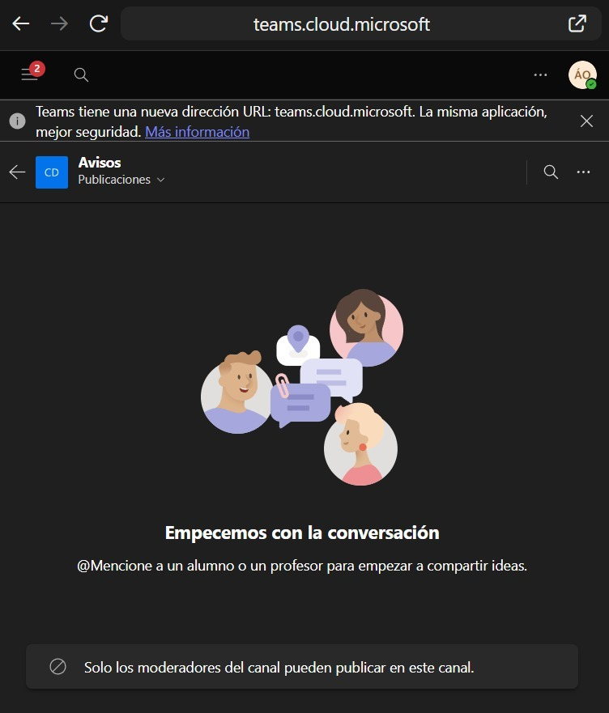

### 3.2. Ver el calendario de la asamblea

En **CADUS · Asamblea**, canal **General**, abre la pestaña **Calendario del canal**: ahí aparecen las asambleas y sus fechas (por ejemplo, la «Asamblea Noviembre» del jueves 26/11/2026).

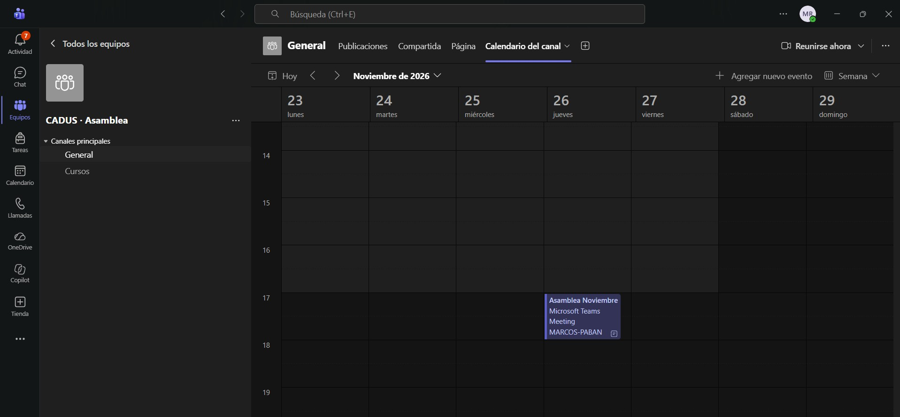

### 3.3. Abrir un documento oficial

Los documentos oficiales (actas, plantillas) **no se copian a Teams**: se abren desde su sitio de SharePoint. En el canal de la asamblea hay una pestaña que abre el sitio **CADUS Órganos de gobierno** del DMS. Solo se ven los documentos a los que tu cuenta tiene acceso (por ejemplo, un delegado solo ve las actas aprobadas).

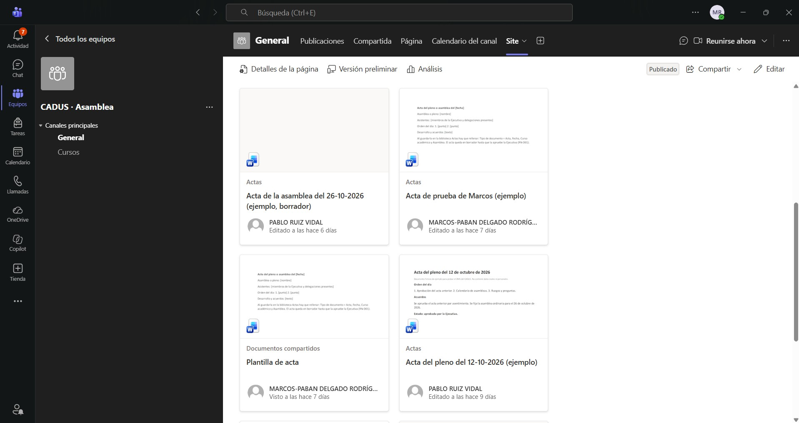

### 3.4. Confirmar la asistencia (formulario)

En el canal General de **CADUS · Asamblea** hay una pestaña **Confirmación de asistencia** (Forms). Contesta si asistirá tu delegación y de qué delegación se trata, y envíalo.

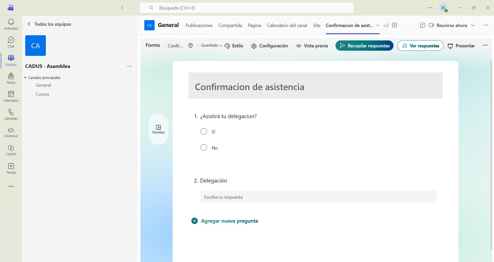

### 3.5. Tus tareas en Planner

1. En **CADUS · Asamblea**, abre la pestaña de **Planner** (plan «Preparación de la Asamblea»).
2. En el **Panel** verás cuatro columnas, una por etapa de la asamblea: **1 · Convocatoria**, **2 · Preparación**, **3 · Día de la asamblea** y **4 · Después (acta)**. Cada tarjeta es una tarea, con su responsable y su fecha límite.
3. Para **filtrar** por tu nombre y ver solo tus tareas, usa el filtro del plan.
4. Abre una de tus tareas y cambia su progreso: **No iniciada**, **En curso** o **Completada**. Una tarea completada **se queda en su etapa** (sale tachada); no cambia de columna.
5. La vista **Gráficos** muestra el avance por estado y por persona, y **Programación** pone cada tarea en su fecha.

**Importante:** Planner no tiene permisos por tarea. Cualquier miembro del equipo ve **todas** las tareas del plan y puede editar también las de los demás. Edita solo las tuyas.

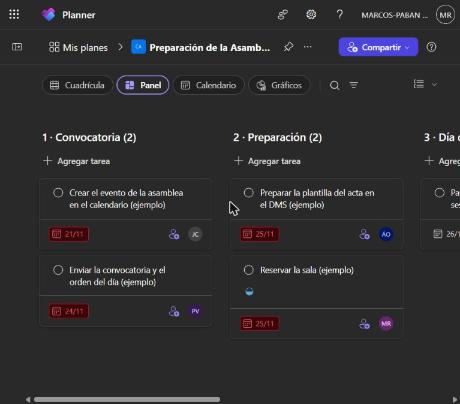

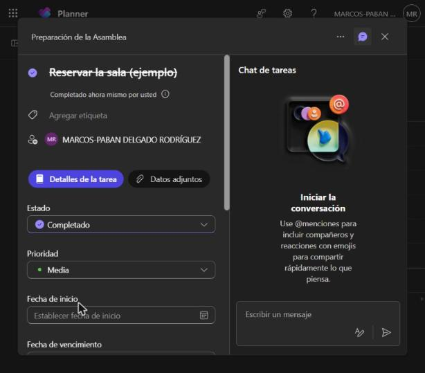

### 3.6. Avisos automáticos de tareas

Dos flujos de Power Automate publican avisos en el canal General de **CADUS · Asamblea**:

- **Aviso de tarea nueva:** a los pocos minutos de crearse una tarea en el plan sale un mensaje con su título, su fecha límite y quién la creó. En la prueba salió unos cinco minutos después.
- **Aviso de tareas que vencen:** una tabla con las tareas sin completar que vencen hoy, mañana o antes. Según su diseño se ejecuta una vez al día; en la prueba se lanzó a mano.

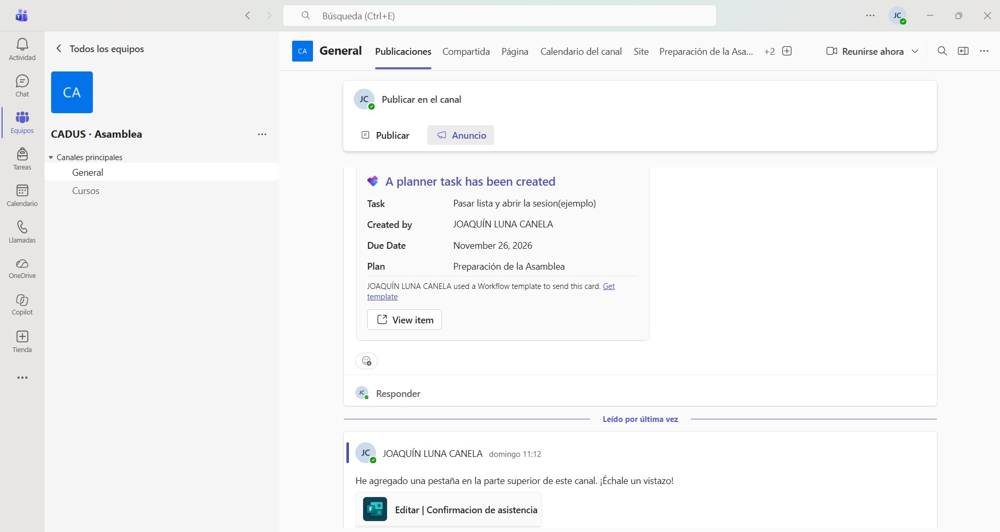

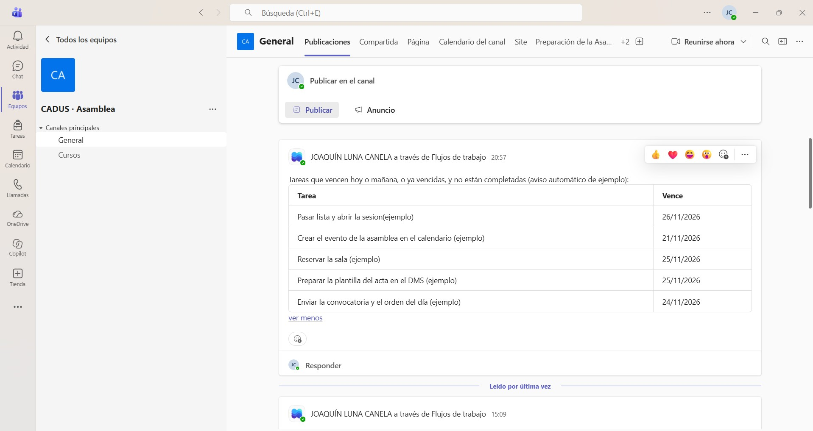

### 3.7. Aplicación «Estado de las delegaciones»

Es una aplicación de Power Apps de **prueba** que lee la lista «Delegaciones CADUS» (centro y estado de cada delegación) y la muestra en tres pantallas: lista, detalle y formulario. Para abrirla, la persona que la creó debe compartirla contigo y tener permiso en la lista; después la abres desde `apps.powerapps.com` con tu cuenta. **Aún no está publicada ni integrada en Teams** y no distingue permisos por rol.

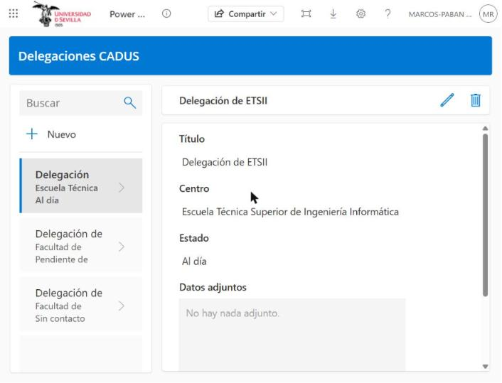

## 4. Manual para la Ejecutiva (propietaria)

### 4.1. Publicar un aviso (CU-R01)

1. Si quieres prepararlo antes, escríbelo en **CADUS · Ejecutiva › Preparación de avisos**.
2. Abre **CADUS · Delegaciones › Avisos**, redacta el aviso y, si hace falta, adjunta un archivo.
3. Publícalo. Teams lo muestra en el canal y lo notifica a los miembros. Las delegaciones no pueden publicar nuevos avisos en ese canal.

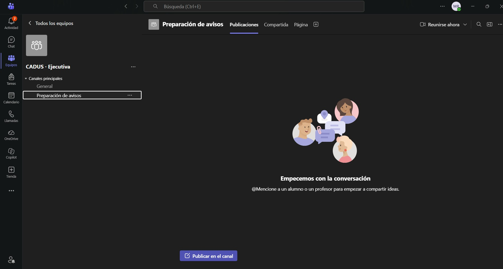

### 4.2. Preparar una asamblea con tareas (CU-R02)

1. En **CADUS · Asamblea**, canal General, abre **Calendario del canal** y **crea el evento** de la asamblea. Lo ve todo el equipo.
2. En el plan **Preparación de la Asamblea** (Planner), crea las **tareas** de preparación, cada una en el **cubo de su etapa**, con **responsable** y **fecha límite**: 1 · Convocatoria, 2 · Preparación, 3 · Día de la asamblea y 4 · Después (acta).
3. Cada tarea nueva dispara el aviso automático en el canal (apartado 3.6).
4. Envía a las delegaciones el formulario **Confirmación de asistencia** y consulta sus respuestas en Forms.
5. Sigue el avance en las vistas **Gráficos** (por estado y por persona) y **Programación**.

### 4.3. Compartir un documento con una delegación (CU-R03)

1. Abre el **canal privado** de la delegación.
2. En su pestaña de archivos enlaza el documento del sitio de SharePoint del DMS que corresponda. No subas documentos reales a Teams.
3. El enlace lo ven solo la Ejecutiva y esa delegación, y se abre desde su sitio del DMS.

### 4.4. Dar de alta o de baja una delegación (CU-R05)

El alta y la baja de una delegación las hace un **propietario** (véase el manual de administrador, apartado 4).

## 5. Reglas de uso

- **Solo datos de ejemplo mientras sea un piloto.** No se escribe en la red social nada de reclamaciones, mediaciones ni votaciones: esos datos están en el portal web y en el DMS, con sus propios permisos.
- Los documentos oficiales se **enlazan** desde el DMS, no se copian.
- Cada persona edita solo sus propias tareas de Planner.
- Los avisos y los planes los puede ver todo el que sea miembro del equipo; la privacidad entre delegaciones la dan los canales privados, no Planner.

## 6. Problemas frecuentes

| Problema | Qué hacer |
|---|---|
| No puedo escribir en «Avisos» | Es lo normal: solo los propietarios publican; usa tu canal privado |
| No veo mi canal «Delegación · …» | Pide a la Ejecutiva que te añada al canal |
| No me sale el aviso de una tarea nueva | Espera unos minutos; si no sale, avisa a quien creó los flujos (dependen de su cuenta) |
| Una tarea completada «ha desaparecido» | Sigue en su etapa, tachada, en «Tareas completadas»; usa el filtro de progreso |
| No puedo abrir la aplicación de Power Apps | Debe estar compartida contigo y tener permiso de lectura en la lista de SharePoint |
