# Manual de administrador de la red social interna del CADUS (Microsoft Teams)

Red social interna del CADUS en Microsoft Teams (Lab 5, Lab 6 y Lab 8) · Manual de administrador · versión 1.0 · 27/11/2026 · Grupo de proyecto de GSI, Universidad de Sevilla

## 1. Alcance

Este manual es para quien crea y mantiene la red social: los equipos de Teams, sus canales y permisos, los planes de Planner, los flujos de Power Automate y la aplicación de Power Apps. El uso diario está en el «Manual de usuario de la red social».

Los nombres exactos de los menús de Teams, Planner y Power Automate dependen de la versión y del idioma. Si algo no se parece a lo que dice este manual, **anota lo que ves en pantalla en lugar de adivinar**: el tenant puede limitar cosas (restricción RC-R02) y eso también es contenido válido de la documentación.

## 2. Arquitectura

| Elemento | Detalle |
|---|---|
| Plataforma | Microsoft Teams, en el tenant de la Universidad de Sevilla, con cuentas de la Universidad |
| Equipos | **CADUS · Ejecutiva**, **CADUS · Delegaciones** y **CADUS · Asamblea**, los tres **privados**, creados con la plantilla «Equipo básico» |
| Tareas | Planner, como pestaña de cada equipo (un plan por equipo) |
| Formularios | Forms (confirmación de asistencia) |
| Documentos | Pestañas de SharePoint que abren los sitios del DMS; no se copian documentos a Teams |
| Automatización | Power Automate (dos flujos), entorno «Productividad Personal US (default)» |
| Aplicación | Power Apps (aplicación de lienzo de prueba) sobre una lista de SharePoint |

Los equipos se crearon el 16/11/2026, con los cuatro integrantes del equipo del proyecto como **propietarios** (a partir del 20/11/2026). El CADUS real no tiene aún cuentas de delegación en Teams: es un **piloto con datos de ejemplo**.

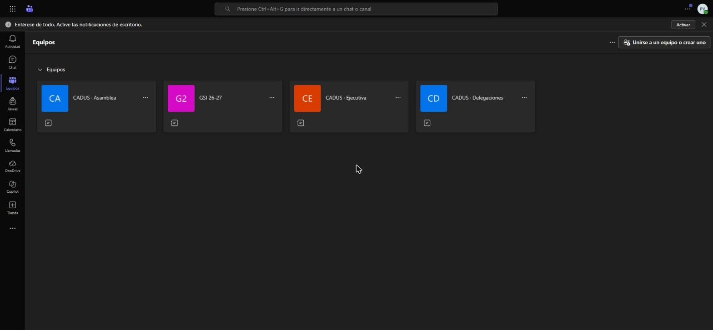

## 3. Equipos, canales y permisos

### 3.1. Estructura

| Equipo | Canales | Pestañas |
|---|---|---|
| CADUS · Ejecutiva | General; «Preparación de avisos» (canal estándar) | Plan «Coordinación de la Ejecutiva» |
| CADUS · Delegaciones | «Avisos» (el General renombrado, con moderación); un canal **privado** por delegación | Plan «Seguimiento de las delegaciones» |
| CADUS · Asamblea | General; «Cursos» | Calendario del canal, plan «Preparación de la Asamblea», formulario «Confirmación de asistencia» y una pestaña de SharePoint con el sitio «CADUS Órganos de gobierno» del DMS |

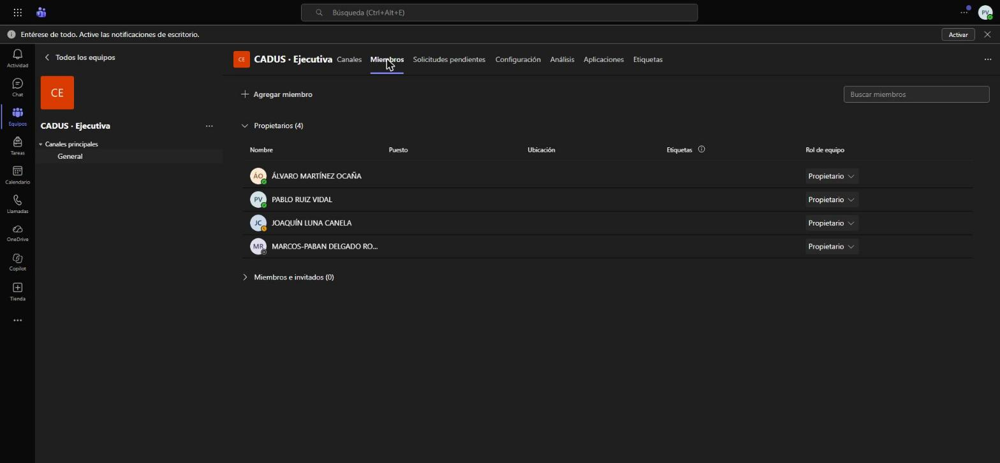

### 3.2. Roles

| Rol en Teams | Quién | Qué puede |
|---|---|---|
| Propietario | La Ejecutiva (hoy, los cuatro integrantes del equipo del proyecto) | Crear canales, administrar miembros, moderar, publicar en «Avisos» |
| Miembro | Cada delegación | Leer los avisos, ver su canal privado y trabajar en las pestañas; no inicia conversaciones en «Avisos» |

Para comprobar un rol, baja temporalmente a una cuenta a **Miembro** («Administrar equipo › Miembros») y vuelve a subirla al terminar, como se hizo el 22/11/2026.

### 3.3. El canal de avisos (RF-R05 · RN-R01)

1. En **CADUS · Delegaciones**, canal General, abre **Administrar canal** (los tres puntos) › **Moderación** y actívala dejando que **solo los propietarios** publiquen y respondan.
2. Renombra el canal General como **«Avisos»** (Teams lo permite).
3. Comprueba con una cuenta miembro que no puede iniciar una conversación: Teams muestra «Solo los moderadores del canal pueden publicar en este canal».

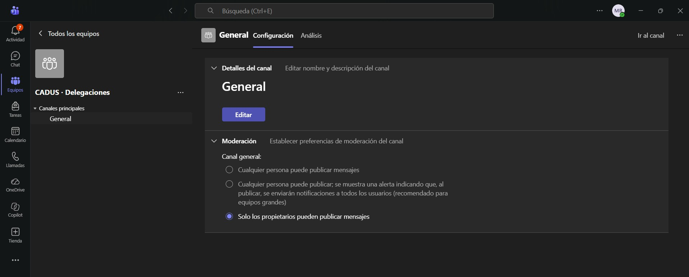

## 4. Alta y baja de una delegación (CU-R05)

**Alta:**
1. En **CADUS · Delegaciones**, crea un **canal privado** con el nombre «Delegación · <centro>» (por ejemplo, «Delegación · ETSII»).
2. Añade al canal la **cuenta de la delegación** y a la **Ejecutiva**. La delegación entra como miembro y la Ejecutiva como propietaria.
3. Comprueba con la cuenta de la delegación que solo ve «Avisos» y su canal.

**Baja:** **archiva** el canal de la delegación sin borrar lo publicado.

El patrón se repite para las **27 delegaciones**; en el piloto se crearon tres de ejemplo («Delegación · ETSII», «Delegación · Derecho» y «Delegación · Biología»). Se usan tres equipos y no uno solo por la separación de miembros, permisos y herramientas, no por un límite de canales (el límite del tenant no se ha comprobado).

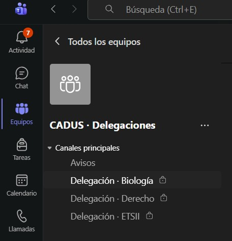

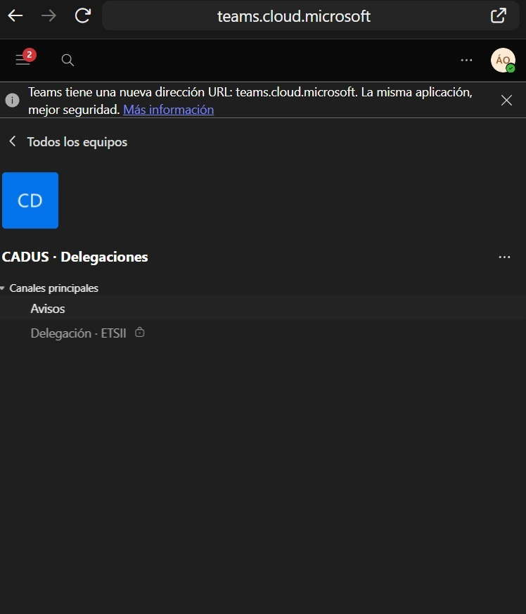

## 5. Calendario, documentos y formularios

- **Calendario (RF-R08):** en el canal General de **CADUS · Asamblea**, añade la pestaña **Calendario** y crea el evento de la asamblea.
- **Documentos del DMS (RF-R07 · RN-R03):** en el canal, añade una pestaña de **SharePoint** (o «Archivos») con la dirección del sitio del DMS que corresponda (por ejemplo, `cadus-organos-de-gobierno`). Los permisos los siguen dando los sitios del DMS, no Teams. No subas documentos reales.
- **Formulario (RF-R10):** en el canal General de la Asamblea, añade una pestaña de **Forms** con «Confirmación de asistencia» (dos preguntas: si asistirá la delegación y de qué delegación se trata).

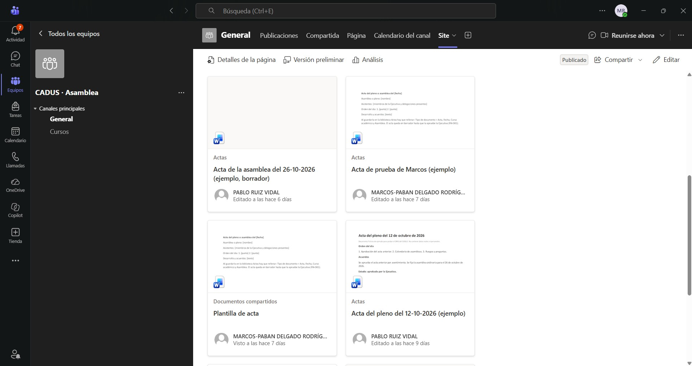

## 6. Planner: planes y patrones del Lab 6

### 6.1. Los tres planes

| Plan | Equipo | Patrón (Lab 6) | Cubos |
|---|---|---|---|
| Coordinación de la Ejecutiva | CADUS · Ejecutiva | Ciclo de vida de tareas | Por hacer · En curso · Hecho |
| Seguimiento de las delegaciones | CADUS · Delegaciones | Ciclo de vida de tareas | Por hacer · En curso · Hecho |
| Preparación de la Asamblea | CADUS · Asamblea | **Proceso de tareas** (rehecho el 25/11/2026) | 1 · Convocatoria · 2 · Preparación · 3 · Día de la asamblea · 4 · Después (acta) |

El plan de la asamblea describe un proceso con etapas en orden, así que sus cubos son las etapas y una tarea completada se queda en su etapa. Los otros dos siguen el ciclo de vida del estado del trabajo. No se usan «Tareas asignadas» ni «Tareas categorizadas» por delegación: serían 27 cubos y Planner no tiene permisos por tarea, así que no aportaría privacidad. La delegación a la que va una tarea se indica en el título (por ejemplo, «· Delegación ETSII») y en el responsable.

### 6.2. Crear un plan en un equipo

1. Abre el equipo, su canal **General** y pulsa **+** junto a las pestañas.
2. Elige **Planner** › **Crear un plan nuevo**, escribe el nombre y guárdalo.
3. Crea los cubos (en Teams se llaman **depósitos**) con los nombres de la tabla anterior.
4. Crea las tareas, cada una con **título**, **cubo**, **responsable**, **fecha límite** y **progreso**.
5. Comprueba que el panel muestra las tareas en sus cubos, con su responsable y su fecha.

### 6.3. Pasar un plan al patrón «Proceso de tareas»

Se hace **sobre el mismo plan** (no se crea otro), para que los flujos de Power Automate que lo vigilan sigan funcionando. Unos 20 minutos:

1. En el Panel, **renombra** los depósitos («Cambiar nombre»): «Por hacer» → «1 · Convocatoria», «En curso» → «2 · Preparación», «Hecho» → «3 · Día de la asamblea».
2. **Agregar nuevo depósito** «4 · Después (acta)» y colócalo el último; los cuatro deben quedar en orden del 1 al 4.
3. **Arrastra** cada tarea a su etapa.
4. Comprueba **Gráficos** (avance por estado y por persona) y **Programación** (las fechas).

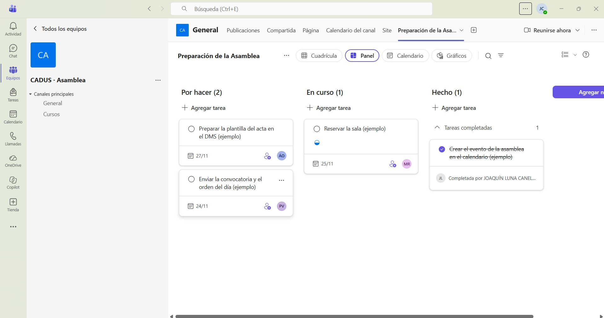

### 6.4. Limitaciones

- Planner **no tiene permisos por tarea**: todos los miembros ven todas las tareas del plan y pueden editar también las de los demás.
- Los planes de la Ejecutiva y de las delegaciones están capturados (27/11/2026, con la cuenta de Pablo), pero no los ha probado otra persona; solo el de la asamblea tiene prueba de otra persona (26/11/2026).

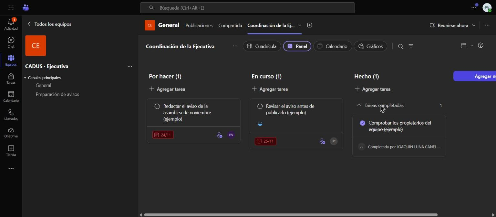

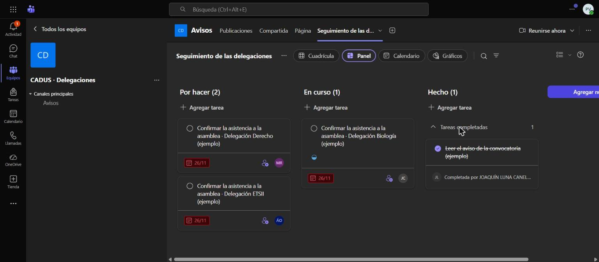

## 7. Power Automate: los dos flujos (RF-R11)

Entra en `https://make.powerautomate.com` y comprueba que el entorno (arriba a la derecha) es **Productividad Personal US (default)**.

| Flujo | Cuándo se ejecuta | Qué hace |
|---|---|---|
| Aviso de tarea nueva · Preparación de la asamblea | Cuando se crea una tarea en el plan | Publica en el canal General de CADUS · Asamblea el título, la fecha límite y quién la creó |
| Aviso de tareas que vencen · Preparación de la asamblea | Todos los días a las 08:00 (Madrid) | Publica en una tabla las tareas no completadas que vencen hoy, mañana o antes; si no hay ninguna, no publica nada |

### 7.1. Crear el flujo 1

1. En **Plantillas**, busca **Planner** y elige **Notificar a un canal cuando se crea una nueva tarea de Planner**.
2. Permite las **conexiones** (Planner, Office 365 Users y Microsoft Teams) con tu cuenta.
3. En el disparador elige el **grupo** `CADUS · Asamblea` y el **plan** `Preparación de la Asamblea`.
4. En la acción de Teams, publica **en el canal** General del equipo `CADUS · Asamblea` (como «Flow bot» o, si no está permitido, con tu usuario) con el mensaje «Nueva tarea en «Preparación de la Asamblea»: … Fecha límite: … Creada por: …», insertando el contenido dinámico de la tarea con el selector.
5. Nómbralo, **guarda** y compártelo con un segundo propietario (**Compartir**).

### 7.2. Crear el flujo 2

1. **Nuevo flujo › Flujo de nube programado**, repetición cada 1 día a las 08:00, zona horaria de Madrid.
2. Acción de Planner que **enumera las tareas** del plan.
3. **Filtrar matriz** con la condición avanzada: no completada, con fecha de vencimiento y que vence hoy, mañana o antes (`@and(not(equals(item()?['percentComplete'], 100)), not(empty(item()?['dueDateTime'])), lessOrEquals(item()?['dueDateTime'], addDays(utcNow(), 1)))`).
4. **Crear tabla HTML** con las columnas «Tarea» y «Vence».
5. **Condición**: si el número de elementos filtrados es mayor que 0, publicar en el canal General el texto «Tareas que vencen hoy o mañana, o ya vencidas, y no están completadas» seguido de la tabla; si no, no hacer nada.
6. **Guarda** y compártelo.

### 7.3. Probarlos y revisarlos

Crea una tarea de prueba con responsable y fecha: en uno a cinco minutos debe salir el aviso. El **historial de ejecuciones** del flujo debe marcar **Correcto**. Para el flujo 2, deja una tarea sin completar que venza mañana y pulsa **Probar › Manualmente › Ejecutar flujo**. Borra después las tareas de prueba.

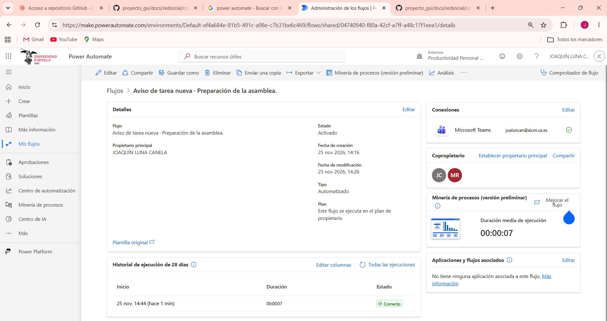

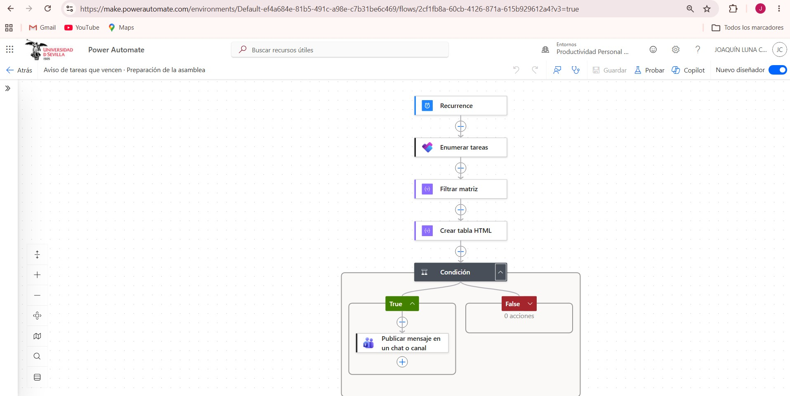

### 7.4. Traspaso y limitaciones

- **Los flujos dependen de la cuenta que los creó** (usan sus conexiones). Si esa cuenta se desactiva, dejan de ejecutarse. Por eso tienen un segundo propietario, y **al pasar la red social a la Ejecutiva hay que reconstruirlos con la cuenta de la Ejecutiva** siguiendo el apartado 7.1 y 7.2.
- «Se asigna una tarea» solo avisa si la tarea se **asigna al crearla**; si se crea sin responsable y se asigna después, el flujo 1 no avisa.
- El flujo 2 consulta una vez al día, no al instante. Su ejecución programada de las 08:00 **se observó** el 26 y el 27/11/2026 (mensajes del flujo en el canal General de la Asamblea); las pruebas manuales fueron el 25/11.
- El canal General de la Asamblea no está moderado. En un canal moderado (como «Avisos») el mensaje solo saldría si lo publica un propietario.
- Si el tenant no permite crear o ejecutar flujos, documenta el mensaje literal con captura (RC-R02).

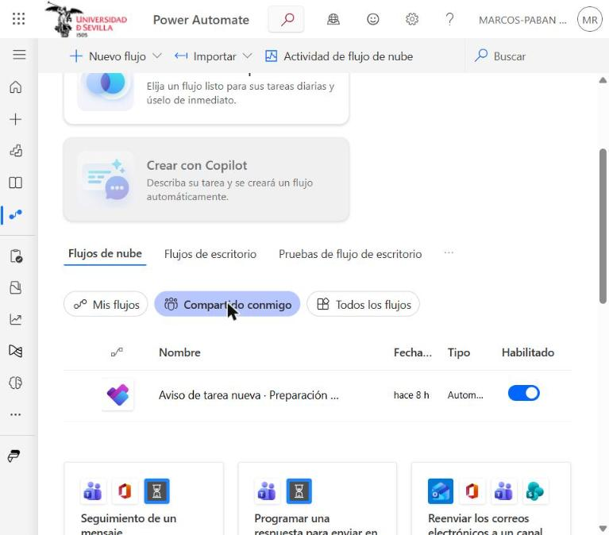

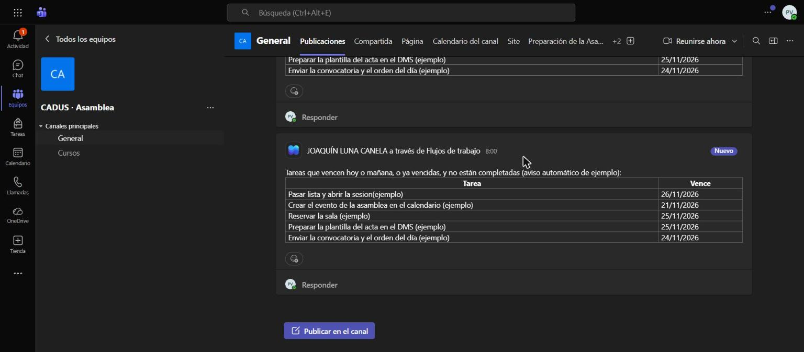

## 8. Power Apps: «Estado de las delegaciones» (RF-R12)

1. **Lista de SharePoint** «Delegaciones CADUS» con las columnas Título, Centro y Estado y tres filas de ejemplo (ETSII, Derecho y Biología), sin datos personales.
2. **Aplicación de lienzo** generada desde la lista («Integrar › Power Apps › Crear una aplicación») y guardada en Power Apps Studio con el nombre «Estado de las delegaciones». Es la plantilla de tres pantallas (lista, detalle y formulario).
3. **Compartir** la aplicación con la otra persona **y** darle permiso en la lista de SharePoint; sin permiso en la lista la aplicación no muestra datos.

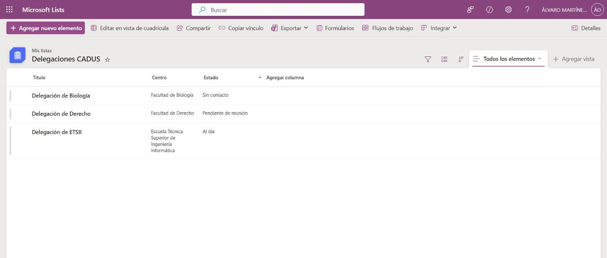

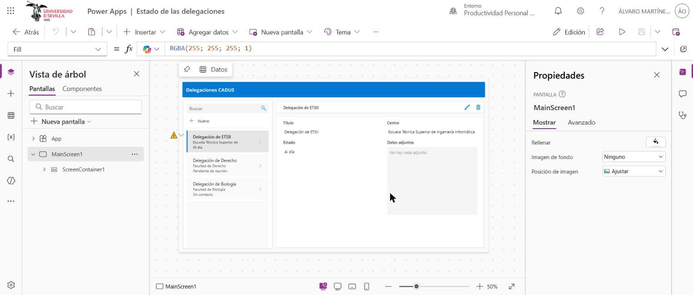

**Limitaciones:** la lista y la aplicación están en el espacio personal de su creador, no en un sitio del CADUS (para moverlas, crear la lista en el sitio y volver a conectar la aplicación). La aplicación **no está publicada**, no se ha ejecutado desde una pestaña de Teams, no usa los conectores de Planner ni de Teams y no restringe el alta y la baja por rol (CU-R05 · RN-R01). Es una demostración con datos de ejemplo.

## 9. Traspaso a la Ejecutiva

1. Añadir la cuenta de la Ejecutiva como **propietaria** de los tres equipos y retirar a quien deje el proyecto.
2. **Reconstruir los flujos** de Power Automate con su cuenta (apartado 7.4) y volver a conectar la aplicación de Power Apps si se traslada la lista.
3. Crear las cuentas y los canales privados de las delegaciones reales (apartado 4) y vaciar los datos de ejemplo.
4. Revisar quién tiene acceso a los sitios del DMS que enlazan los canales (véase el manual de administrador del DMS).

## 10. Reglas de seguridad y datos

- **Solo datos de ejemplo** en el piloto. Nada de reclamaciones, mediaciones ni votaciones en Teams (RNF-R01).
- No pegues contraseñas, enlaces de conexión ni identificadores en capturas ni en el repositorio.
- Cada captura debe decir qué requisito demuestra.
- Quien prueba una cuenta distinta lo anota con fecha, persona y resultado en `docs/redsocial/pruebas.md`.

## 11. Estado y pendientes

| Asunto | Estado |
|---|---|
| Planes de la Ejecutiva y de las delegaciones | Capturados el 27/11; sin prueba de otra persona |
| Ejecución programada del flujo 2 | Observada el 26 y el 27/11 a las 08:00 |
| Publicación de la aplicación de Power Apps | Hecha según Álvaro (27/11); sin captura ni comprobación de otra persona |
| Cuentas de delegación reales | No existen en Teams |
| Límite de canales del tenant | No comprobado |
